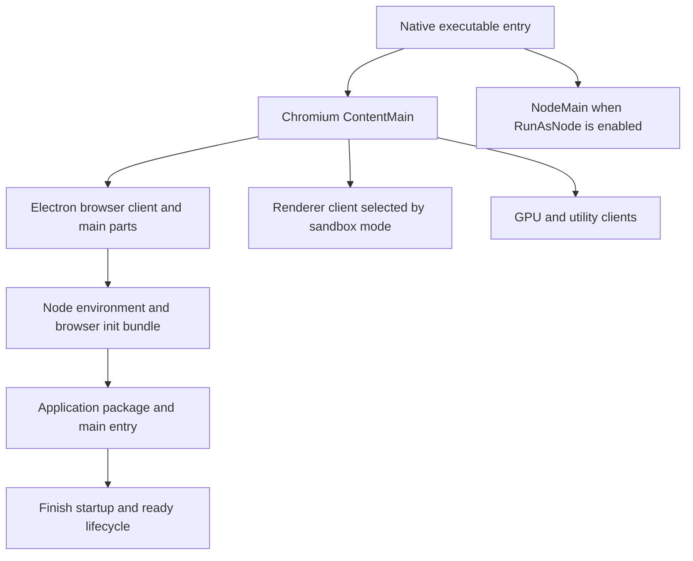

# Process startup and application lifecycle

Electron embeds Node.js into Chromium's process model. The main process owns application lifecycle and desktop APIs; renderer initialization follows the selected sandbox path. GPU and utility clients are also supplied by Electron's native delegate.

## Entry and ownership

On Linux, the executable repairs standard streams, initializes command lines, and checks the RunAsNode fuse plus environment flag. When enabled, that branch calls NodeMain; otherwise it invokes Chromium ContentMain with ElectronMainDelegate. The repository has separate Windows and macOS entry files, so platform startup changes must be checked there too.

ElectronMainDelegate constructs the browser, GPU, renderer, and utility clients. Renderer selection explicitly chooses ElectronSandboxedRendererClient or ElectronRendererClient from the sandbox configuration. This selection precedes the JavaScript preload policy described in [renderer isolation](../concepts/renderer-isolation.md).

## Browser bootstrap and application handoff

ElectronBrowserMainParts creates the browser JavaScript environment after the proxy resolver's V8 setup, initializes NodeBindings, creates the Node environment, adds Electron process bindings, installs a microtask runner, and loads the environment. It then joins application-code loading. The feature list and logging are initialized again after app code has had an opportunity to change command-line switches, app name, or user data location.

The browser init bundle restores argv, loads common initialization, configures EventEmitter support, and loads internal RPC and guest-view services. It searches resource-relative package candidates supplied by native state. When ASAR-only loading is required it checks that candidate through the archive helper. Failure to find a package schedules exit code 1 and throws `Unable to find a valid app`.

Once a package is found, initialization applies its name, version and desktop name, sets the app path, and prepares API wrappers that must exist before application code creates windows. The main entry is `packageJson.main || 'index.js'`. A module package whose main is not `.cjs`, or an explicit `.mjs` entry, uses Node's ESM loader. Other entries use synchronous Module._load. The ESM path signals `appCodeLoaded` after import success or failure; the CJS path signals it immediately before synchronous loading.

This ordering matters for startup bugs: distinguish package discovery failure, entry-module failure, native startup waiting for app code, and API use before readiness.

## Readiness and default behavior

Browser::DidFinishLaunching creates the user-data directory when available, marks readiness, resolves a stored readiness promise, and notifies launch observers. Browser::WhenReady creates that promise lazily and resolves it immediately if readiness has already occurred.

JavaScript installs a default `window-all-closed` listener which quits only when it is the sole listener. Adding an application listener therefore takes over that default decision. The default application menu is installed at `will-finish-launching`, before ready-time windows are created.

Unhandled main-process exceptions reach a built-in error dialog unless another uncaughtException listener is installed. The native browser bootstrap sets unhandled rejection handling to `warn-with-error-code`. These are separate failure paths; do not assume every startup JavaScript failure immediately terminates the process.

## Shutdown is a state machine

`app.quit()` reaches Browser::Quit: it prevents reentry, asks before-quit observers, then closes windows or proceeds to will-quit. Either observer cancellation or a window close cancellation can reset quitting. Shutdown marks the state and notifies quit observers, then schedules the main-loop quit closure; early shutdown can wait until that closure becomes available.

`app.exit()` takes a different native path: it sets the exit code and destroys windows without asking them to close. Before the message loop is ready it can exit directly. Browser JavaScript maps `process.exit` to `app.exit`, so it should not be used when cancellation and normal close handling are required.

## Tracing and validation

Use [app specs](../../spec/api-app-spec.ts), especially `whenReady` and `window-all-closed`, for existing lifecycle expectations. Inspect [Browser](../../shell/browser/browser.cc) for cancellation state and [browser init](../../lib/browser/init.ts) for app-entry failures. [Node embedding](../concepts/node-and-asar.md) explains loop cooperation; [API layers](api-layers.md) explains the exports loaded during bootstrap.
