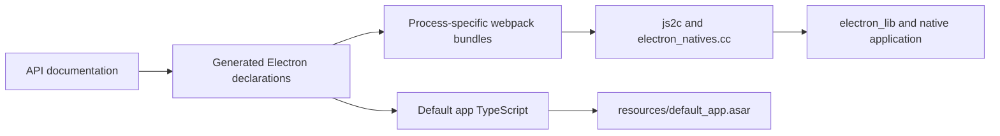

# Build Electron from source

Building this repository produces the Electron framework itself. It requires the surrounding Chromium/Node dependency checkout, platform toolchains, and generated resources. Installing the published electron npm package is a separate path for application development.

## Checkout layout and prerequisites

Use the repository's platform prerequisites for [Linux](../../docs/development/build-instructions-linux.md), [macOS](../../docs/development/build-instructions-macos.md), or [Windows](../../docs/development/build-instructions-windows.md), then follow the [GN build guide](../../docs/development/build-instructions-gn.md). The guide offers Electron build-tools or manual depot_tools setup.

The manual setup uses this layout:

```text
workspace/
  src/                         Chromium source root and GN working directory
    electron/                  This Git repository
    third_party/electron_node/ Vendored Node checkout
    out/Testing/               Build products
```

From a new workspace directory:

```sh
gclient config --name "src/electron" --unmanaged https://github.com/electron/electron
gclient sync --with_branch_heads --with_tags
```

DEPS specifies the Chromium checkout at src and Node at src/third_party/electron_node, along with other pinned dependencies. Its hooks apply Electron patches and install repository JavaScript dependencies with a pinned Yarn and frozen lockfile. After changing revisions, synchronize dependencies according to DEPS; a Git pull in electron alone does not update the surrounding tree.

The repository's .nvmrc selects Node 20 for development tooling. That is distinct from the Node revision embedded in Electron, which DEPS controls. Read these files when choosing tool versions rather than assuming they match.

## Configure and compile

From the full checkout's src directory on Linux/macOS:

```sh
export CHROMIUM_BUILDTOOLS_PATH="$PWD/buildtools"
gn gen out/Testing --args='import("//electron/build/args/testing.gn")'
ninja -C out/Testing electron
ninja -C out/Testing electron:node_headers
```

For a release configuration:

```sh
gn gen out/Release --args='import("//electron/build/args/release.gn")'
ninja -C out/Release electron
```

The Testing preset is not a conventional debug build: it sets is_debug=false, keeps DCHECKs enabled, is_official_build=false, and symbol_level=1. Release enables official-build behavior. Both import all.gn, which configures Electron's root dependency, Node ABI number, V8 settings and shared framework choices. Both explicitly use component FFmpeg while disabling the overall component build.

Use gn args out/Testing to modify an existing configuration and gn args out/Testing --list to inspect options. Cross-compilation depends on Chromium's supported host/target combinations; target_cpu and target_os alone do not supply a missing toolchain.

The executable is out/Testing/electron on Linux, electron.exe on Windows, or Electron.app/Contents/MacOS/Electron on macOS. Windows environment syntax and toolchain setup are documented separately in the linked build guide.

## How JavaScript enters the binary

The build graph has an important generated-code chain:



BUILD.gn generates declarations for both IDE use and compilation, then builds browser, renderer, sandboxed renderer, isolated renderer, worker, Node, utility and preload-realm bundles. electron_js2c passes those bundles to the Node js2c tool and produces electron_natives.cc. electron_lib depends on this generated source, buildflags, resources, Mojo interfaces and native components.

The webpack base configuration chooses lib/<target>/init.ts or init.js, maps Electron imports to the selected process export entry, and adapts globals depending on whether Node is present or its globals will later be deleted. This is why changing an Electron import or preload global can affect multiple bundles.

The default application is separately compiled and packaged as resources/default_app.asar. It is a build artifact, not the source location of core Electron API implementations.

## Adding files and diagnosing failures

Generated filenames lists supply bundle dependency inputs and API docs to GN. script/gen-filenames.ts obtains webpack dependency graphs; package hooks regenerate lists for relevant JS/TS and API-doc edits. Check those inputs when a newly added file is missing from an incremental build.

Classify failures before changing configuration:

- Missing Chromium/Node paths: verify the full gclient layout and synchronization.
- Patch import failures: use the [patch workflow](dependency-patches.md).
- Type or bundle errors: inspect generated API declarations and the specific process webpack config.
- Spec addon build failures: generate node_headers for the selected output and follow [validation](../testing/validation.md).
- Missing distributable resources: inspect the GN data dependencies and [distribution target](../operations/distribution.md).

These commands describe the repository workflow; a source-only checkout does not imply that its dependency tree or build products are already available.
