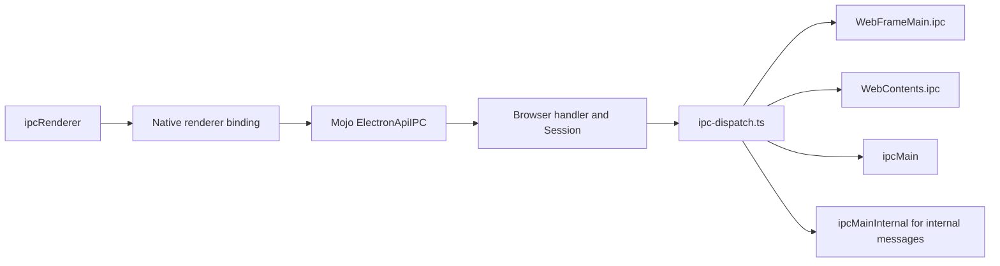

# IPC dispatch and message ports

Electron's IPC crosses both a process boundary and an API boundary. The renderer-facing `ipcRenderer` wrapper delegates to a native binding; the browser receives serialized messages and dispatches them to the appropriate JavaScript emitter. Internal framework traffic is distinguished from application traffic throughout this path.

## Transport and dispatch

`lib/renderer/api/ipc-renderer.ts` supplies `internal = false`; the native binding in `shell/renderer/api/electron_api_ipc_renderer.cc` serializes values into Blink cloneable or transferable messages. The interface lives in `shell/common/api/api.mojom`. The browser handler resolves the sender's session from its render frame and forwards the event through that session. IPC methods fail if their renderer context has already been released; serialization failures are surfaced before sending.

For ordinary frame messages, `lib/browser/ipc-dispatch.ts` emits the WebContents-level `ipc-message` observation event and then dispatches to frame, WebContents, and global emitters. Frame lookup uses the frame-tree-node ID so messages from unloading frames can still reach handlers after a frame swap. `event.reply()` targets the original process/frame pair, which matters when an iframe sent the request.

Internal messages go only to `ipcMainInternal`. Service-worker events use the corresponding `ServiceWorkerMain.ipc` rather than the frame/global cascade; they carry session/version identity and expose a worker accessor. Do not assume every event originated in a window's main frame.

## Request and response contracts

| API | Dispatch contract | Failure or lifecycle behavior |
| --- | --- | --- |
| `send` | Event notification to all applicable emitters | No request-result promise |
| `invoke` | First registered handler in frame → WebContents → global order | Missing handler or thrown/rejected handler produces an error reply |
| `sendSync` | Synchronous transport; assigning `event.returnValue` sends the reply | Warns for frame messages with no applicable listeners |
| `postMessage` | Transfers message ports alongside a serialized message | Invalid transferable values are rejected |

Each `IpcMainImpl` permits one invoke handler per channel. A duplicate registration throws; `handleOnce` removes the handler before calling it. The browser awaits either a synchronous return or a promise, replies with `{ result }`, and converts exceptions to `{ error: error.toString() }`. The renderer constructs a new `Error` from that reply, so callers should not depend on retaining the original error object or prototype.

## Port ownership and delivery

`MessagePortMain` wraps a native port and translates transferred ports into wrappers on incoming events and back to native ports on outgoing calls. Native ports begin with incoming processing paused. Call `start()` after installing listeners to receive messages; `close()` releases the connection and emits `close`.

Transfer moves the underlying endpoint: the former wrapper becomes disentangled. Native validation rejects invalid ports, source-port transfers, duplicates, and already transferred endpoints. An active, started, entangled native port pins its wrapper against garbage collection. Closing or transferring it removes that pending activity. This ownership model also underlies [utility-process messaging](utility-processes.md).

## Changing or diagnosing IPC

Start with the public TypeScript wrapper, follow the native serializer and Mojo interface, then inspect `ipc-dispatch.ts`. A handler that appears missing may be registered on the wrong scope, hidden by a more specific invoke handler, or associated with a frame that has navigated. Keep internal channels separate when extending framework behavior.

Read `spec/api-ipc-spec.ts` for synchronous/asynchronous handler errors, missing handlers, ordering across send variants, port transfer/close behavior, and frame/WebContents priority. `spec/api-ipc-main-spec.ts` covers internal-channel separation and replies around destruction. These tests are useful regression targets; this wiki generation did not execute them.

IPC transports capabilities; it does not establish application authorization. Expose narrowly scoped preload methods and validate sender and payload at the receiving boundary as described in [renderer security](../concepts/renderer-security.md). For sender ownership and navigation, see [windows and web contents](windows-and-web-contents.md).
