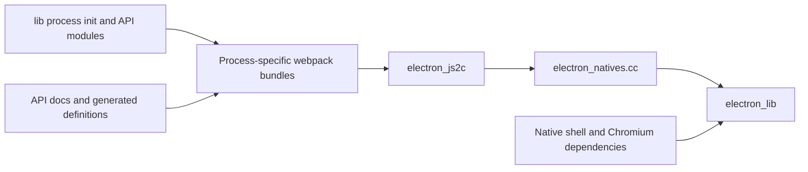

# Building Electron and maintaining dependencies

Building Electron itself requires a Chromium-style dependency checkout. This Git repository is normally located at `<checkout>/src/electron`; Chromium occupies `<checkout>/src`, and Node is checked out under `src/third_party/electron_node`. An arbitrary standalone clone is sufficient for source research but does not supply the whole native build tree. Installing the published npm package downloads a prebuilt runtime instead; see [distribution](distribution-and-release.md).

## Checkout and build entry points

Begin with the repository's platform prerequisites: [Linux](../../docs/development/build-instructions-linux.md), [macOS](../../docs/development/build-instructions-macos.md), or [Windows](../../docs/development/build-instructions-windows.md). The [build guide](../../docs/development/build-instructions-gn.md) describes Electron Build Tools and the manual depot_tools workflow. For a new manual checkout, run from an empty parent directory:

```sh
gclient config --name "src/electron" --unmanaged https://github.com/electron/electron
gclient sync --with_branch_heads --with_tags
```

For a POSIX shell, run these from the resulting **Chromium `src` directory**, not the Electron Git root:

```sh
export CHROMIUM_BUILDTOOLS_PATH="$PWD/buildtools"
gn gen out/Testing --args='import("//electron/build/args/testing.gn")'
ninja -C out/Testing electron
ninja -C out/Testing electron:node_headers
```

Use `release.gn` and `out/Release` for the release configuration. Testing explicitly enables DCHECKs and uses reduced symbols; release enables `is_official_build`. Both import shared Electron arguments. Adjust an existing configuration with `gn args out/Testing`.

Executables live under the selected `src/out/<name>` directory: `electron` on Linux, `electron.exe` on Windows, or `Electron.app/Contents/MacOS/Electron` on macOS. Contributor scripts select `ELECTRON_OUT_DIR` when supplied and otherwise search `Testing`, `Release`, `Default`, then `Debug`. An explicitly selected missing directory fails instead of falling back silently.

## Dependency ownership

`DEPS` pins Chromium, Node and other upstream revisions. Its hooks apply Electron patches and install the tooling dependencies using the pinned Yarn version with `--frozen-lockfile`. The root `package.json`/`yarn.lock` describe contributor and generation tools; they are not the native dependency graph.

After changing Electron revisions, synchronize dependencies according to the build guide (`gclient sync -f`) before interpreting compiler failures as local source bugs. Check whether a failure is in dependency checkout, patch application, GN generation, JavaScript bundling or native compilation; each has a different owner.

## How TypeScript enters the executable



`BUILD.gn` defines bundles for browser, renderer, sandboxed and isolated renderer, worker, Node, utility and preload-realm contexts. Webpack selects each target's initializer and API export module, aliases `@electron/internal` to `lib`, and uses Node or web mode depending on the target. It supplies globals where Node is unavailable or removed. This is why adding a process import can affect both bundle contents and allowed dependencies.

`electron_js2c` converts the bundles to `electron_natives.cc`; `electron_lib` depends on that result alongside native sources, Mojo interfaces, generated fuses and resources. `script/gen-filenames.ts` measures webpack dependency graphs and regenerates `filenames.auto.gni`, including API docs and typings. Regenerate that file when changing graph membership; do not maintain its generated entries by hand.

## Upstream patch lifecycle

`patches/config.json` maps patch directories to dependency repositories. Each `.patches` file supplies application order. The sync hook calls `script/apply_all_patches.py`, which imports each configured series; the `ELECTRON_USE_THREE_WAY_MERGE_FOR_PATCHES` environment variable enables three-way import in that helper.

The [patch maintenance guide](../../docs/development/patches.md) explains the contributor workflow: change and commit code in the dependency checkout, then export that commit series back into Electron's patch directory. Export ignores uncommitted changes. `refs/patches/upstream-head` records the boundary between upstream and imported Electron commits. During an upstream roll, resolve application conflicts in the dependency repository and re-export the corrected series so the durable patch files match the tested result.

Avoid treating a successful patch application as behavioral validation. Changes to Node embedding need the relevant Node smoke tests; Chromium-facing changes need focused API/native coverage. [Contributor validation](../testing/contributor-validation.md) maps those checks, and [extending an API](../workflows/extending-electron-api.md) connects build registration to exports and generated types.
