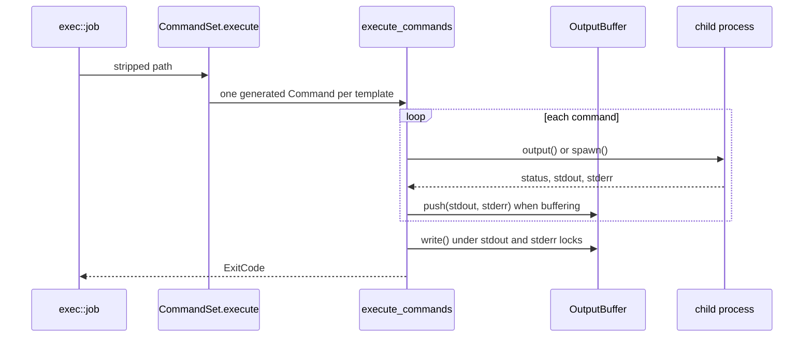

## Overview

`-x`/`--exec` runs a command for each search result, in parallel; `-X`/`--exec-batch` runs a command once with many results as arguments. Both live in `src/exec`. A command is parsed at startup into a `CommandSet`, and when one is set the walker's receiver does not print: it feeds the results to `exec::job` or `exec::batch` instead ([[Directory Traversal]]). `--list-details` is a batch command too, built from the platform's `ls` ([[Startup and Configuration]]).

Sources: [src/exec/mod.rs:20-74](repo://src/exec/mod.rs#L20-L74), [src/walk.rs:406-433](repo://src/walk.rs#L406-L433), [src/main.rs:395-410](repo://src/main.rs#L395-L410)

## Parsing a command

### CommandSet

`CommandSet` holds an `ExecutionMode` (`OneByOne` or `Batch`) and a list of `CommandTemplate`s, one per occurrence of the flag: `fd -x echo a \; -x echo b` runs both commands for every result, in order. clap hands each occurrence's arguments to `CommandSet::new` or `CommandSet::new_batch` ([[Command-Line Options]]).

Sources: [src/exec/mod.rs:29-70](repo://src/exec/mod.rs#L29-L70), [src/cli.rs:861-874](repo://src/cli.rs#L861-L874)

### CommandTemplate

`CommandTemplate::new` parses every argument into a `FormatTemplate` ([[Placeholder Templates]]). It refuses an empty command, and for `--exec-batch` it refuses a placeholder as the program. If no argument holds a placeholder, it appends a `{}` argument, so `fd -x rm` runs `rm <path>`. `new_batch` also refuses more than one argument with placeholders, because all paths go in one spot of the command line.

Sources: [src/exec/mod.rs:210-260](repo://src/exec/mod.rs#L210-L260), [src/exec/mod.rs:51-70](repo://src/exec/mod.rs#L51-L70)

`generate` expands each argument for one path and builds an `argmax::Command`, a `std::process::Command` wrapper that knows the system's argument length limit. The arguments are passed straight to the program, never through a shell, so a placeholder value cannot be split or interpreted.

Sources: [src/exec/mod.rs:262-272](repo://src/exec/mod.rs#L262-L272)

## One command per result

### Job threads

`WorkerState::receive` starts `threads` job threads, each reading from a clone of the result channel, and merges their exit codes. To share work evenly between them, the walker sends batches of one result instead of 256.

Sources: [src/walk.rs:415-433](repo://src/walk.rs#L415-L433), [src/walk.rs:449-457](repo://src/walk.rs#L449-L457)

`exec::job` loops over its results. A walk error is printed only with `--show-errors`. For an entry it calls `CommandSet::execute` with the stripped path, and folds the returned code into its own with `merge_exitcodes`, so one failed command makes the whole run fail while the others keep going.

Sources: [src/exec/job.rs:8-44](repo://src/exec/job.rs#L8-L44)

Sources: [src/exec/mod.rs:76-88](repo://src/exec/mod.rs#L76-L88), [src/exec/command.rs:59-99](repo://src/exec/command.rs#L59-L99)

### Output buffering

With more than one thread, `execute_commands` captures each command's stdout and stderr with `output()` and stores them in an `OutputBuffer`. When the result's commands are done, `OutputBuffer::write` takes the stdout and stderr locks and writes everything at once, so output from parallel commands is never interleaved. With `--print0` it also writes a NUL after each result's output. With one thread, commands are spawned with inherited stdio and nothing is captured, so interactive programs work and output appears live.

Sources: [src/exec/job.rs:16-17](repo://src/exec/job.rs#L16-L17), [src/exec/command.rs:9-57](repo://src/exec/command.rs#L9-L57), [src/exec/command.rs:72-78](repo://src/exec/command.rs#L72-L78)

### Failure

The commands for one result run in order and stop at the first one that exits with a non-zero status; the buffered output is still written and the result is `GeneralError`. `handle_cmd_error` turns a spawn error into a message: `Command not found: <program>` when the program does not exist, otherwise `Problem while executing command`. Because commands are not run through a shell, shell aliases and functions are "not found".

Sources: [src/exec/command.rs:80-99](repo://src/exec/command.rs#L80-L99), [src/exec/command.rs:101-115](repo://src/exec/command.rs#L101-L115), [README.md:439-446](repo://README.md#L439-L446)

## Batch execution

`exec::batch` drains every result on the receiver thread, prints walk errors when asked, and passes the stripped paths to `CommandSet::execute_batch` with `--batch-size` as the limit.

Sources: [src/exec/job.rs:46-64](repo://src/exec/job.rs#L46-L64)

`execute_batch` creates one `CommandBuilder` per template. A builder splits the template around its placeholder argument into `pre_args` (the program and the arguments before) and `post_args` (the arguments after), and starts a command with `pre_args`. For each path, `push` expands the placeholder and appends it; `finish` appends `post_args`, runs the command with inherited stdio, and starts a fresh command.

Sources: [src/exec/mod.rs:90-208](repo://src/exec/mod.rs#L90-L208)

A builder runs its command early, and starts a new one, in two cases.

Sources: [src/exec/mod.rs:173-176](repo://src/exec/mod.rs#L173-L176)

1. `--batch-size` is above zero and the command already holds that many paths.
2. `args_would_fit` says the next path plus `post_args` would push the command line past the operating system's limit.

Sources: [src/exec/mod.rs:173-189](repo://src/exec/mod.rs#L173-L189)

So `fd -X rm` on a huge tree runs `rm` several times instead of failing with "argument list too long". A non-zero exit from any run marks that builder `GeneralError`, and the exit codes of all builders are merged. An IO error, such as a missing program, stops the batch with `handle_cmd_error`.

Sources: [src/exec/mod.rs:100-119](repo://src/exec/mod.rs#L100-L119), [src/exec/mod.rs:191-207](repo://src/exec/mod.rs#L191-L207)

> [!NOTE]
> The order of results given to `-x` and `-X` is not defined. Results stream in as the parallel walk finds them, and with `-x` the commands also run concurrently.

Sources: [src/cli.rs:894-899](repo://src/cli.rs#L894-L899), [src/cli.rs:932-934](repo://src/cli.rs#L932-L934)
