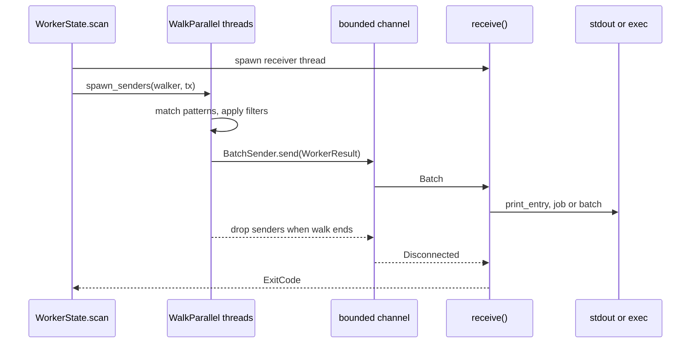
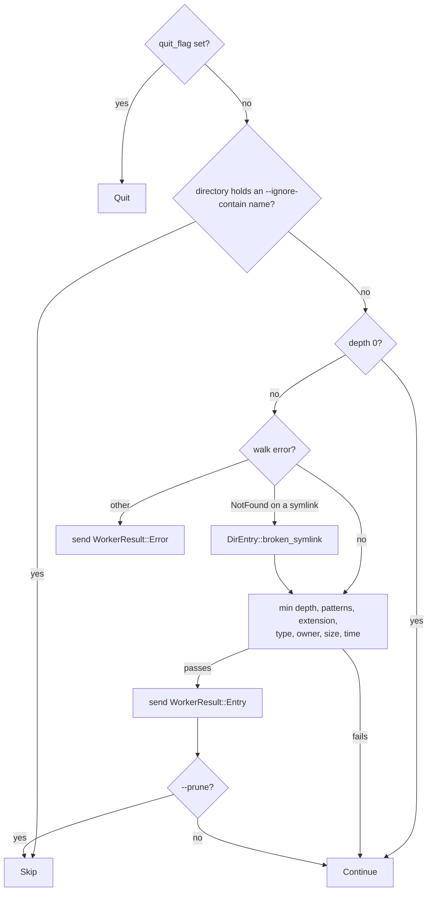
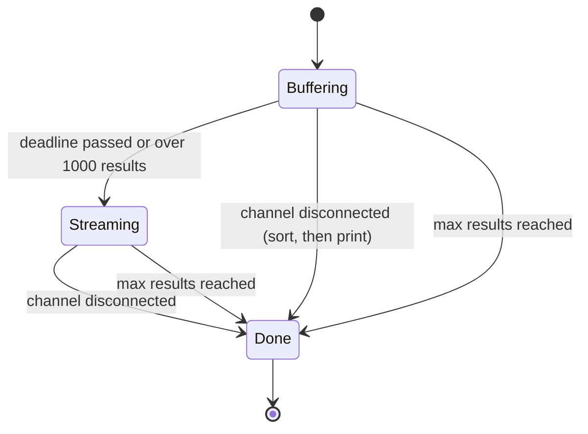

## Overview

`src/walk.rs` runs the search. It builds a parallel walker from the `ignore` crate (the walker behind ripgrep), lets each walker thread match and filter entries, and sends the survivors over a channel to one receiver, which prints them or runs commands on them. The split keeps the slow part, reading directories and metadata, on many threads, while output stays on one thread and is never interleaved.

Sources: [src/walk.rs:680-687](repo://src/walk.rs#L680-L687), [src/walk.rs:617-653](repo://src/walk.rs#L617-L653)

## The scan

`walk::scan` wraps the patterns and `Config` in a `WorkerState`, which also owns two flags: `quit_flag` asks every thread to stop, and `interrupt_flag` records a Ctrl-C. `WorkerState::scan` builds the walker, opens a bounded channel of `2 * threads` batches, spawns the receiver in a thread scope, runs the senders on the current thread, and returns the receiver's exit code, or `KilledBySigint` if Ctrl-C was pressed.

Sources: [src/walk.rs:305-328](repo://src/walk.rs#L305-L328), [src/walk.rs:617-653](repo://src/walk.rs#L617-L653)

Sources: [src/walk.rs:406-440](repo://src/walk.rs#L406-L440), [src/walk.rs:443-458](repo://src/walk.rs#L443-L458), [src/walk.rs:600-613](repo://src/walk.rs#L600-L613), [src/walk.rs:636-646](repo://src/walk.rs#L636-L646)

When output is colored and results are printed, `scan` installs a Ctrl-C handler. The first press sets `quit_flag` and `interrupt_flag`, so the walk stops and the receiver flushes and exits with `KilledBySigint`. A second press exits the process at once. Without colors there is no handler and Ctrl-C kills fd the usual way; the handler exists to avoid leaving the terminal in the middle of a color escape.

Sources: [src/walk.rs:621-634](repo://src/walk.rs#L621-L634), [src/walk.rs:259-264](repo://src/walk.rs#L259-L264)

## Building the walker

`build_walker` maps `Config` onto a `WalkBuilder` rooted at the first search path; the other paths are added with `builder.add`.

Sources: [src/walk.rs:347-404](repo://src/walk.rs#L347-L404)

| Builder setting | From |
| --- | --- |
| `hidden` | `ignore_hidden` |
| `ignore` (`.ignore` files) | `read_fdignore` |
| `parents` | `read_parent_ignore`, and either `read_fdignore` or `read_vcsignore` |
| `git_ignore`, `git_global`, `git_exclude` | `read_vcsignore` |
| `require_git` | `require_git_to_read_vcsignore` |
| `overrides` | `--exclude` globs from `build_overrides` |
| `follow_links`, `same_file_system`, `max_depth` | the matching flags |
| `threads` | `threads` |

Sources: [src/walk.rs:352-365](repo://src/walk.rs#L352-L365), [src/walk.rs:402](repo://src/walk.rs#L402)

On top of these, `.fdignore` is added as a custom ignore file name when `read_fdignore` is on. The global ignore file is `fd/ignore` under the platform config directory chosen by `etcetera` (`~/.config/fd/ignore` on Linux). It and each `--ignore-file` are added with `add_ignore`; a partial parse error is ignored, any other error is printed and the search goes on.

Sources: [src/walk.rs:367-396](repo://src/walk.rs#L367-L396)

`build_overrides` adds each exclude pattern, already prefixed with `!`, to an `OverrideBuilder`. A malformed glob fails the whole search with `Malformed exclude pattern`.

Sources: [src/walk.rs:330-345](repo://src/walk.rs#L330-L345), [src/main.rs:380](repo://src/main.rs#L380)

## Per-entry work in the senders

### Filter order

`spawn_senders` gives every walker thread a closure that decides each entry's fate and returns a `WalkState`: `Continue` to go on, `Skip` to not descend into a directory, `Quit` to stop. The checks run cheapest first, so most entries are dropped before any `stat` call.

Sources: [src/walk.rs:443-463](repo://src/walk.rs#L443-L463), [src/walk.rs:600-613](repo://src/walk.rs#L600-L613)

Sources: [src/walk.rs:459-524](repo://src/walk.rs#L459-L524), [src/walk.rs:526-612](repo://src/walk.rs#L526-L612)

1. The root of each search path (depth 0) is never a result.
2. A walk error whose IO kind is `NotFound` on a path that is a symlink becomes a broken-symlink entry, so `fd` still lists dangling links. Other errors go to the receiver, which prints them only with `--show-errors`.
3. Entries shallower than `--min-depth` are dropped; a broken symlink has no depth and is dropped too when a minimum is set.
4. Every pattern must match the search string: the file name, or with `--full-path` the absolute path built by `search_str_for_entry` from the cached working directory (with a leading `./` removed).
5. The extension `RegexSet`, `FileTypes::should_ignore`, the owner filter, size filters (which drop anything that is not a regular file) and time filters follow. All of them are described in [[Filters]].
6. When printing with colors, the entry's style is computed here, on the walker thread, so the receiver does not have to.
7. With `--prune`, a matching directory is returned as `Skip`, so its contents are never visited.

Sources: [src/walk.rs:464-524](repo://src/walk.rs#L464-L524), [src/walk.rs:526-611](repo://src/walk.rs#L526-L611), [src/walk.rs:656-678](repo://src/walk.rs#L656-L678)

### DirEntry

`DirEntry` wraps either an `ignore::DirEntry` or the path of a broken symlink. Metadata and the color style are each computed at most once, in a `OnceCell`, because several filters and the printer may ask for them. A broken symlink reads `symlink_metadata`, so it reports the link itself. Entries compare and sort by path.

Sources: [src/dir_entry.rs:11-110](repo://src/dir_entry.rs#L11-L110), [src/dir_entry.rs:116-137](repo://src/dir_entry.rs#L116-L137)

`stripped_path` removes the leading `./` when `strip_cwd_prefix` is on, except when the rest would start with `-`: a result named `-rf` keeps its `./` so a command never reads it as an option.

Sources: [src/dir_entry.rs:56-80](repo://src/dir_entry.rs#L56-L80), [src/dir_entry.rs:112-114](repo://src/dir_entry.rs#L112-L114)

## Batching

Sending every entry through the channel on its own would make the channel the bottleneck. `BatchSender` collects results in a shared `Batch`, an `Arc<Mutex<Option<Vec<WorkerResult>>>>`, and sends the batch over the channel when its first item is pushed. The sender keeps adding to the same batch until it holds `limit` items or the receiver has taken it (the `Option` is `None`), then starts a new one. The receiver therefore gets work as soon as it exists and picks up whatever accumulated while it was busy.

Sources: [src/walk.rs:47-122](repo://src/walk.rs#L47-L122)

The limit is `0x100` items. With `--exec` on more than one thread it is 1, so results spread evenly across the job threads instead of one thread getting a batch of 256.

Sources: [src/walk.rs:449-457](repo://src/walk.rs#L449-L457)

## The receiver

### Choosing a consumer

`receive` picks what consumes the channel. With `--exec-batch` (or `--list-details`) one `exec::batch` call reads every result. With `--exec`, `threads` job threads each run `exec::job` on a clone of the channel, and their exit codes are merged with `merge_exitcodes`. Otherwise a `ReceiverBuffer` prints to a buffered, locked stdout. [[Command Execution]] covers the first two.

Sources: [src/walk.rs:406-440](repo://src/walk.rs#L406-L440)

### Buffering then streaming

`ReceiverBuffer` starts in `Buffering` mode. For up to `max_buffer_time` (100 ms by default, set by the hidden `--max-buffer-time` flag) it stores results instead of printing them. If the walk ends inside that window, the buffer is sorted and printed, so small searches give stable, sorted output. If the deadline passes or more than 1000 results pile up, it switches to `Streaming`, prints the buffer unsorted and from then on prints each result as it arrives.

Sources: [src/walk.rs:124-127](repo://src/walk.rs#L124-L127), [src/walk.rs:151-171](repo://src/walk.rs#L151-L171), [src/walk.rs:198-293](repo://src/walk.rs#L198-L293)

Sources: [src/walk.rs:198-293](repo://src/walk.rs#L198-L293)

In streaming mode stdout is flushed whenever the channel is empty, so results show up while the walk waits on the disk. `--quiet` returns `HasResults(true)` at the first entry. `--max-results` stops once the count is reached; the returned error code ends `process`, which sets `quit_flag` so the walker threads stop too. A write error other than a broken pipe is reported and exits with a general error; a failed flush, usually a closed pipe, also ends the run.

Sources: [src/walk.rs:173-181](repo://src/walk.rs#L173-L181), [src/walk.rs:198-267](repo://src/walk.rs#L198-L267), [src/walk.rs:295-302](repo://src/walk.rs#L295-L302)
