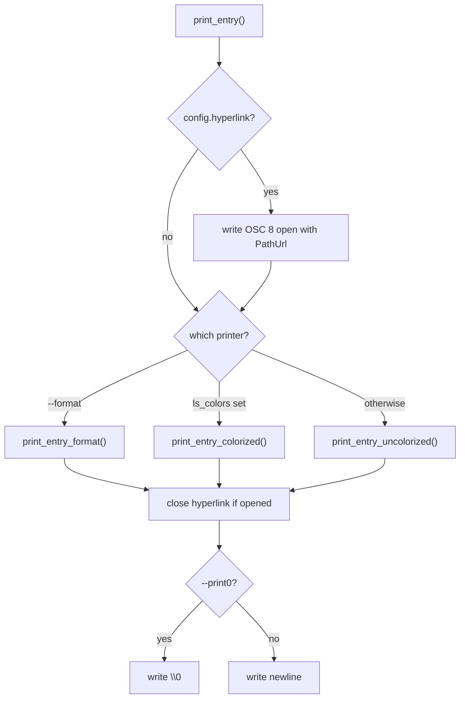

## Overview

`src/output.rs` writes one search result. The receiver thread calls `print_entry` for each entry it prints, on a buffered, locked stdout ([[Directory Traversal]]). Every choice made here, whether to color, which separator, what terminator, comes from `Config`, which [[Startup and Configuration]] filled once. Two helpers sit beside it: `src/hyperlink.rs` builds `file://` URLs, and `src/sanitize.rs` keeps file names from injecting terminal escape sequences.

Sources: [src/output.rs:1-43](repo://src/output.rs#L1-L43), [src/walk.rs:251-258](repo://src/walk.rs#L251-L258)

## print_entry

`print_entry` picks one of three printers, wraps the result in a hyperlink if asked, and ends it with a newline, or a NUL byte with `--print0`.

Sources: [src/output.rs:16-43](repo://src/output.rs#L16-L43)

Sources: [src/output.rs:17-43](repo://src/output.rs#L17-L43)

All three printers use `entry.stripped_path(config)`, the path with `./` removed when `strip_cwd_prefix` is on, except when the rest would start with `-`.

Sources: [src/dir_entry.rs:56-71](repo://src/dir_entry.rs#L56-L71)

## The printers

### Colorized

`print_entry_colorized` splits the path into its parent (including the trailing separators) and its last component. The parent is painted with the `LS_COLORS` directory style, after replacing separators if `--path-separator` is set. The last component gets the entry's own style, which a walker thread already computed and cached in the `DirEntry`. A directory then gets a trailing separator painted in the directory style.

Sources: [src/output.rs:88-139](repo://src/output.rs#L88-L139), [src/dir_entry.rs:105-109](repo://src/dir_entry.rs#L105-L109)

### Uncolorized

On Unix, when stdout is not a terminal and no custom separator is set, the uncolorized printer writes the path's raw bytes, so a file name that is not valid UTF-8 reaches the next program unchanged. Otherwise `print_entry_uncolorized_base` converts the path lossily to a string, replaces separators, sanitizes it and writes it. Both add the trailing separator for directories, without color.

Sources: [src/output.rs:141-182](repo://src/output.rs#L141-L182)

### Format template

With `--format`, `print_entry_format` expands the parsed `FormatTemplate` for the entry, passing the custom separator, and writes the result lossily as UTF-8 after sanitizing. No trailing separator is added. [[Placeholder Templates]] covers the template language.

Sources: [src/output.rs:68-86](repo://src/output.rs#L68-L86)

### Trailing separator

`print_trailing_slash` writes `actual_path_separator` after any directory: the custom `--path-separator` when one is set, else the platform separator.

Sources: [src/output.rs:45-66](repo://src/output.rs#L45-L66), [src/main.rs:257-263](repo://src/main.rs#L257-L263)

## Hyperlinks

With hyperlinks on, the path is wrapped in an OSC 8 escape, `ESC ]8;;URL ESC \` before and `ESC ]8;; ESC \` after, which terminals that support it turn into a clickable link. `PathUrl::new` makes the path absolute and gives up quietly if that fails.

Sources: [src/output.rs:18-36](repo://src/output.rs#L18-L36), [src/hyperlink.rs:5-11](repo://src/hyperlink.rs#L5-L11)

The URL is `file://`, then the host name, then the path percent-encoded byte by byte. Only ASCII letters, digits and `/ : - . _ ~` stay as they are; every other byte, including each byte of a multi-byte character, becomes `%XX`, because on some systems the path bytes are not valid UTF-8. On Windows `\` becomes `/` and the host part is `/`. On Unix the host name comes from `gethostname` and is cached in a `OnceLock`.

Sources: [src/hyperlink.rs:13-62](repo://src/hyperlink.rs#L13-L62)

## Terminal sanitization

A file name may contain control characters. Printed to a terminal, a name holding an escape sequence could change the terminal's title, write to the clipboard (OSC 52) or hide text. `maybe_sanitize` therefore escapes such characters, but only when the output is a terminal: pipes and files get the name unchanged.

Sources: [src/sanitize.rs:1-55](repo://src/sanitize.rs#L1-L55)

`needs_escape` flags every control character except tab, plus invisible and direction-changing characters: soft hyphen, zero-width characters, bidi embeddings and overrides, word joiners, the BOM, interlinear annotations and language tags. `sanitize_for_terminal` borrows the string when nothing needs escaping, and otherwise writes `\xNN` for code points up to `0xFF` and `\u{NNNN}` above.

Sources: [src/sanitize.rs:6-46](repo://src/sanitize.rs#L6-L46)

The same function guards error messages: `print_error` sanitizes when stderr is a terminal, since errors often quote paths. See [[Errors and Exit Codes]].

Sources: [src/error.rs:1-9](repo://src/error.rs#L1-L9)
