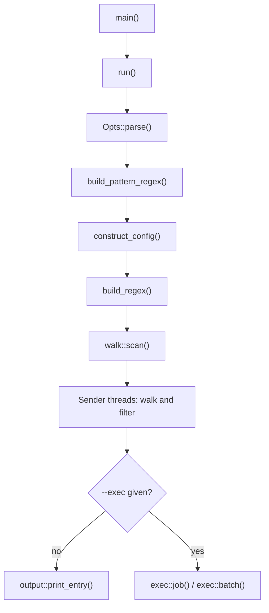

## Overview

`fd` finds entries in your filesystem. It is a simple, fast and user-friendly alternative to `find`: it does not try to cover all of `find`'s features, but it picks sensible defaults for most searches. The crate is published as `fd-find` and builds one binary, `fd`, from `src/main.rs`.

Sources: [README.md:8-11](repo://README.md#L8-L11), [Cargo.toml:1-35](repo://Cargo.toml#L1-L35)

## Defaults

- The pattern is a regular expression by default. `--glob`, `--fixed-strings` and `--exact` change how it is read.
- Smart case: the search ignores case unless the pattern holds an uppercase character.
- Hidden files and directories are skipped. `-H` includes them.
- Patterns from `.gitignore`, `.ignore` and `.fdignore` files are respected. `-I` turns this off, and `-u` turns off both the hidden and the ignore filters.
- Only the file name is matched. `--full-path` matches the whole path instead.
- Directories are walked in parallel, and results are colored the way `ls` colors them.

Sources: [README.md:15-28](repo://README.md#L15-L28), [README.md:124-152](repo://README.md#L124-L152)

## How a search runs

`main` calls `run`, which reads the command line into `Opts`, moves into `--base-directory` if one is given, and checks the search paths. Next it turns every pattern (the positional one plus each `--and` pattern) into a regex string, folds the options into one `Config`, compiles the regexes, and hands everything to `walk::scan`. If `run` returns an error, `main` prints it and exits with the general error code.

Sources: [src/main.rs:62-112](repo://src/main.rs#L62-L112)

Sources: [src/main.rs:75-112](repo://src/main.rs#L75-L112), [src/walk.rs:406-440](repo://src/walk.rs#L406-L440)

## Source modules

| Module | Role | Page |
| --- | --- | --- |
| `cli` | The clap `Opts` struct and its helpers | [[Command-Line Options]] |
| `main`, `config`, `regex_helper` | Startup, pattern building, the `Config` struct | [[Startup and Configuration]] |
| `walk`, `dir_entry`, `filesystem` | Parallel traversal, batching, buffering | [[Directory Traversal]] |
| `filetypes`, `filter` | Type, size, time and owner filters | [[Filters]] |
| `output`, `hyperlink`, `sanitize` | Printing results | [[Output and Colors]] |
| `exec` | `--exec` and `--exec-batch` | [[Command Execution]] |
| `fmt` | `{}`-style placeholders for `--format` and `--exec` | [[Placeholder Templates]] |
| `exit_codes`, `error` | Exit status and error messages | [[Errors and Exit Codes]] |

Sources: [src/main.rs:1-15](repo://src/main.rs#L1-L15)
