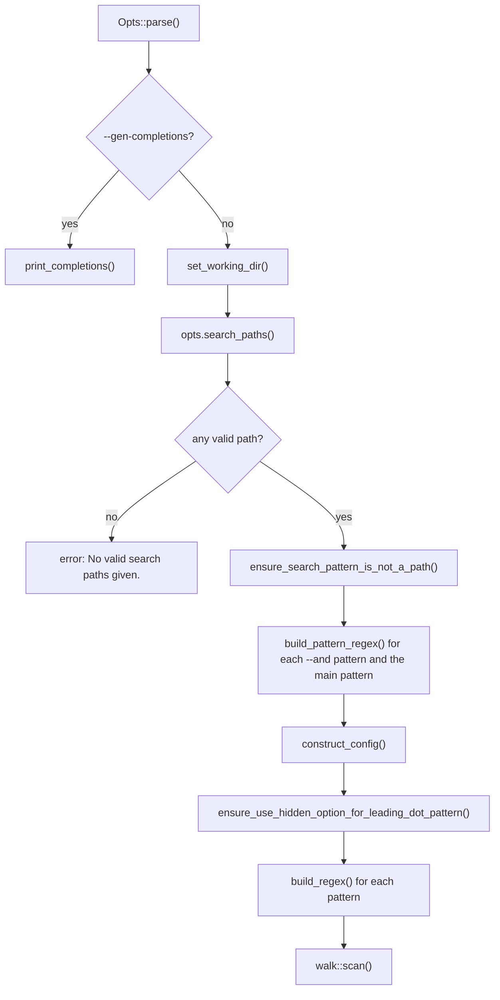

## Overview

Startup lives in `src/main.rs`. It turns the parsed `Opts` into two things the search needs: a list of compiled regexes and one `Config` value. Everything after startup reads `Config` and never looks at `Opts` again, so every default, alias and environment variable is resolved here, once.

Sources: [src/main.rs:62-112](repo://src/main.rs#L62-L112), [src/config.rs:13-14](repo://src/config.rs#L13-L14)

`main` calls `run` and turns its result into the process exit: an `Ok(ExitCode)` exits with that code, an error is printed with `print_error` and exits with `ExitCode::GeneralError`. See [[Errors and Exit Codes]].

Sources: [src/main.rs:62-73](repo://src/main.rs#L62-L73)

## The run sequence

Sources: [src/main.rs:75-112](repo://src/main.rs#L75-L112)

1. `set_working_dir` applies `--base-directory`: it must be an existing directory, and the process `chdir`s into it, so relative search paths resolve against it.
2. `search_paths` drops roots that are not directories with a printed error; if none are left, `run` fails.
3. `ensure_search_pattern_is_not_a_path` refuses, unless `--full-path` is set, any pattern (the main one or an `--and` one) that holds `/`. On Windows it also refuses a pattern holding `\` when that pattern names an existing directory, since `\` is also the regex escape character. The error suggests `fd . 'dir'` or `fd --full-path`.
4. The patterns become regex strings, then `construct_config` builds `Config`.
5. On Unix, when hidden files are skipped and a pattern can only match names starting with a dot, `run` fails and suggests `-H`.
6. The regex strings are compiled and `walk::scan` runs the search ([[Directory Traversal]]).

Sources: [src/main.rs:131-216](repo://src/main.rs#L131-L216), [src/main.rs:521-539](repo://src/main.rs#L521-L539)

## Building the patterns

### Pattern modes

`build_pattern_regex` turns each pattern into regex source text. The main pattern comes last in the list, after the `--and` patterns, and a result must match all of them.

Sources: [src/main.rs:90-100](repo://src/main.rs#L90-L100)

| Option | Regex source |
| --- | --- |
| `--glob` (non-empty pattern) | `GlobBuilder` with `literal_separator(true)`, so `*` never crosses `/` |
| `--exact` | `^` + escaped pattern + `$` |
| `--fixed-strings` | the escaped pattern |
| default | the pattern unchanged |

Sources: [src/main.rs:218-232](repo://src/main.rs#L218-L232)

`build_regex` compiles each source into a `regex::bytes::Regex`, which matches raw bytes so non-UTF-8 file names still work. It sets `dot_matches_new_line` and makes the match case-insensitive unless `Config.case_sensitive`. A compile error gets a note pointing at `--fixed-strings`, `--exact` and `--glob`.

Sources: [src/main.rs:541-555](repo://src/main.rs#L541-L555)

### Smart case

The search is case-sensitive when `--ignore-case` is absent and either `--case-sensitive` is given or any pattern holds an uppercase character. `pattern_has_uppercase_char` parses the pattern with `regex_syntax` and walks the syntax tree, checking literals and the ends of character class ranges. Because it reads the parsed tree, escapes such as `\A` or `\x6F` do not count as uppercase, while a class like `[a-zA-Z]` does.

Sources: [src/main.rs:249-255](repo://src/main.rs#L249-L255), [src/regex_helper.rs:4-37](repo://src/regex_helper.rs#L4-L37), [src/regex_helper.rs:90-96](repo://src/regex_helper.rs#L90-L96)

`pattern_matches_strings_with_leading_dot` only detects the simplest hidden-file pattern: a concatenation that starts with the `^` anchor followed by a literal beginning with `.`, as in `^\.gitignore`.

Sources: [src/regex_helper.rs:39-79](repo://src/regex_helper.rs#L39-L79)

## construct_config

### Ignore and traversal settings

`construct_config` consumes `Opts` and fills the `Config` struct. The ignore settings combine several flags: `-u` (`rg_alias_ignore`) turns off hidden-file skipping and every ignore file, `-I` turns off every ignore file, and the narrower flags turn off one source each.

Sources: [src/main.rs:248](repo://src/main.rs#L248), [src/main.rs:310-329](repo://src/main.rs#L310-L329)

| Config field | False when |
| --- | --- |
| `ignore_hidden` | `-H` or `-u` |
| `read_fdignore` | `-I` or `-u` |
| `read_vcsignore` | `-I`, `-u` or `--no-ignore-vcs` |
| `require_git_to_read_vcsignore` | `--no-require-git` |
| `read_parent_ignore` | `--no-ignore-parent` |
| `read_global_ignore` | `-I`, `-u` or `--no-global-ignore-file` |

Sources: [src/main.rs:313-320](repo://src/main.rs#L313-L320)

### Colors and hyperlinks

With `--color auto`, output is colored only when stdout is a terminal, `NO_COLOR` is unset or empty, and the terminal supports ANSI codes (on Windows, when `enable_ansi_support` succeeds or `TERM` is set). Colors come from `LS_COLORS`, or from the built-in `DEFAULT_LS_COLORS` table, generated with `vivid` from its molokai theme, when the variable is missing. `--hyperlink=auto` follows the color decision.

Sources: [src/main.rs:271-297](repo://src/main.rs#L271-L297), [src/main.rs:56-60](repo://src/main.rs#L56-L60)

### Path separator

The separator printed between path components is `--path-separator`, else `default_path_separator()`, which returns `/` on Windows when `MSYSTEM` is set (MSYS2 shells), else the platform's own. On Windows the separator must be one byte, because some shells expand `/` into a longer path; the error suggests `//`.

Sources: [src/main.rs:234-264](repo://src/main.rs#L234-L264), [src/filesystem.rs:123-136](repo://src/filesystem.rs#L123-L136)

### Filters and commands

- `--type` values become a `FileTypes` value. `executable` also sets `files`, and `empty` alone selects both files and directories.
- `--extension` values lose a leading dot and become one case-insensitive `RegexSet` of `.\.ext$` patterns.
- `--exclude` globs get a `!` prefix, the form the `ignore` crate's overrides use for exclusions.
- `--changed-within` and `--changed-before` go through `extract_time_constraints`; a value that is neither a date nor a duration is an error.
- `--full-path` caches the current directory in `full_path_base`.

Sources: [src/main.rs:298-308](repo://src/main.rs#L298-L308), [src/main.rs:333-382](repo://src/main.rs#L333-L382), [src/main.rs:496-519](repo://src/main.rs#L496-L519)

`extract_command` takes the `--exec`/`--exec-batch` command from `Opts`. Without one, `--list-details` becomes a batch command running `ls`: GNU `ls -l -h -d --color=…` on most Unix systems, `gls` when present on macOS and the BSDs, otherwise BSD `ls -l -h -d` with `-G` for color (not on NetBSD or OpenBSD). On Windows it needs a GNU `ls` on `PATH` and fails otherwise.

Sources: [src/main.rs:395-494](repo://src/main.rs#L395-L494)

## The Config struct

`Config` is a plain struct with public fields, shared read-only by every thread through a reference, with the command behind an `Arc`. Its one method, `is_printing`, is true when no command is set: the walker uses it to decide whether to compute colors and install the Ctrl-C handler.

Sources: [src/config.rs:13-16](repo://src/config.rs#L13-L16), [src/config.rs:93-94](repo://src/config.rs#L93-L94), [src/config.rs:138-143](repo://src/config.rs#L138-L143), [src/walk.rs:593-598](repo://src/walk.rs#L593-L598), [src/walk.rs:621-634](repo://src/walk.rs#L621-L634)
