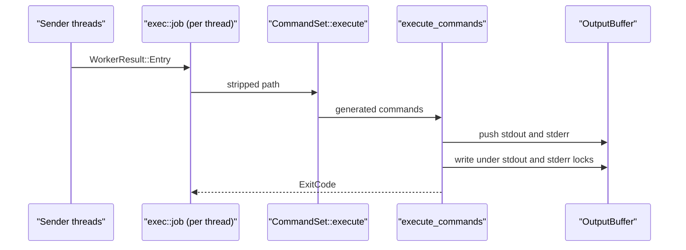

## Overview

`-x`/`--exec` runs a command once for each search result, in parallel; `-X`/`--exec-batch` runs it once with all results as arguments. Both turn the command line into a `CommandSet` of `CommandTemplate`s at argument parsing time, and the walk's receiver hands results to the `exec` module instead of printing them (see [[Overview]] for the walk itself).

Sources: [src/cli.rs:882-952](repo://src/cli.rs#L882-L952), [src/walk.rs:406-440](repo://src/walk.rs#L406-L440)

```bash
fd -e zip -x unzip                 # one unzip per archive
fd -e jpg -x convert {} {.}.png    # placeholders in the arguments
fd -e rs -X wc -l                  # one wc call with every .rs file
fd -g 'test_*.py' -X vim           # open all matches in one editor
```

Sources: [src/cli.rs:909-917](repo://src/cli.rs#L909-L917), [src/cli.rs:944-948](repo://src/cli.rs#L944-L948)

## Parsing the command line

clap has no derive support for grouped values, so `Exec` implements `FromArgMatches` by hand: each occurrence of `--exec` becomes one command of `CommandSet::new`, otherwise each occurrence of `--exec-batch` becomes one command of `CommandSet::new_batch`. Every argument after the flag belongs to the command, up to a `;` terminator (written `\;` in a shell), so the flag is best placed last.

Sources: [src/cli.rs:855-930](repo://src/cli.rs#L855-L930)

`CommandTemplate::new` parses each argument with `FormatTemplate::parse` and enforces three rules.

Sources: [src/exec/mod.rs:225-234](repo://src/exec/mod.rs#L225-L234)

1. There must be at least one argument, or fd would try to execute every file it finds.
2. In batch mode the first argument must be a fixed executable, not a placeholder.
3. Without any placeholder, a `{}` argument is appended at the end.

Sources: [src/exec/mod.rs:219-256](repo://src/exec/mod.rs#L219-L256)

`CommandSet::new_batch` also refuses a command with more than one placeholder argument, since a batch appends many paths at a single position.

Sources: [src/exec/mod.rs:51-70](repo://src/exec/mod.rs#L51-L70)

`--list-details` (`-l`) is built on the same mechanism: without `--exec`, `extract_command` turns it into a batch command running `ls` with long-listing options, passing `--color=always` or `--color=never` to match fd's own colour setting.

Sources: [src/main.rs:395-420](repo://src/main.rs#L395-L420)

## Placeholders

`FormatTemplate::parse` scans the argument with one Aho-Corasick automaton over `{{`, `}}` and the five placeholders. An argument without placeholders stays `FormatTemplate::Text`; otherwise it becomes `FormatTemplate::Tokens`, a list of `Token::Text` pieces and placeholder tokens. `{{` and `}}` produce a literal brace.

Sources: [src/fmt/mod.rs:41-107](repo://src/fmt/mod.rs#L41-L107), [src/fmt/mod.rs:199-211](repo://src/fmt/mod.rs#L199-L211)

| Placeholder | Token | Expands to |
| --- | --- | --- |
| `{}` | `Placeholder` | the path of the result |
| `{/}` | `Basename` | the file name |
| `{//}` | `Parent` | the parent directory |
| `{.}` | `NoExt` | the path without its extension |
| `{/.}` | `BasenameNoExt` | the file name without its extension |

Sources: [src/fmt/mod.rs:13-39](repo://src/fmt/mod.rs#L13-L39), [src/cli.rs:900-908](repo://src/cli.rs#L900-L908)

`FormatTemplate::generate` builds each argument as an `OsString` for one path. With `--path-separator`, the separator is replaced inside the expanded placeholders only, never in the fixed text. The same templates drive `--format` when printing.

Sources: [src/fmt/mod.rs:109-140](repo://src/fmt/mod.rs#L109-L140), [src/main.rs:374-377](repo://src/main.rs#L374-L377)

## One command per result

For `--exec`, `WorkerState::receive` starts `config.threads` scoped threads, each running `exec::job` over a clone of the result channel, and merges their exit codes. The senders then put one result in each batch, so the jobs share the work evenly.

Sources: [src/walk.rs:408-433](repo://src/walk.rs#L408-L433), [src/walk.rs:449-457](repo://src/walk.rs#L449-L457)

`job` loops over the results, prints walker errors only with `--show-errors`, and calls `CommandSet::execute` with the entry's path (stripped of `./` as configured). `execute` generates each command of the set and passes them to `execute_commands`.

Sources: [src/exec/job.rs:8-44](repo://src/exec/job.rs#L8-L44), [src/exec/mod.rs:76-88](repo://src/exec/mod.rs#L76-L88)



Sources: [src/exec/job.rs:11-44](repo://src/exec/job.rs#L11-L44), [src/exec/command.rs:59-99](repo://src/exec/command.rs#L59-L99)

## Output buffering

With more than one thread, `execute_commands` captures each command's output with `cmd.output()` and pushes it into an `OutputBuffer`. `OutputBuffer::write` then takes the stdout and stderr locks and writes everything at once, so the output of parallel commands never interleaves; with `--print0` it ends each entry's output with a NUL byte. With `--threads=1` the command is spawned with inherited streams, so its output appears live and the command can be interactive.

Sources: [src/exec/job.rs:16-17](repo://src/exec/job.rs#L16-L17), [src/exec/command.rs:9-99](repo://src/exec/command.rs#L9-L99)

> [!NOTE]
> Commands run in no guaranteed order. Use `--threads=1` for sequential execution.

Sources: [src/cli.rs:894-899](repo://src/cli.rs#L894-L899)

## Batch execution

`exec::batch` drains the whole channel on the receiver thread, keeps only the entries' paths and calls `CommandSet::execute_batch` with `--batch-size` as the limit.

Sources: [src/exec/job.rs:46-64](repo://src/exec/job.rs#L46-L64)

`execute_batch` makes one `CommandBuilder` per command. A builder splits the template into the fixed arguments before the placeholder (`pre_args`), the placeholder argument (`path_arg`) and the arguments after it (`post_args`), and starts an `argmax::Command` from `pre_args`.

Sources: [src/exec/mod.rs:90-171](repo://src/exec/mod.rs#L90-L171)

For each path, `push` runs the pending command first when the batch already holds `limit` paths (a limit of 0 means no limit), or when the next argument plus `post_args` would no longer fit the operating system's command-line length limit (`args_would_fit`). `finish` appends `post_args`, runs the command, records a failure as `ExitCode::GeneralError`, and starts a fresh command for the remaining paths.

Sources: [src/exec/mod.rs:173-208](repo://src/exec/mod.rs#L173-L208), [src/cli.rs:494-508](repo://src/cli.rs#L494-L508)

## Errors and exit codes

`handle_cmd_error` reports a missing program as `Command not found: <program>` and any other spawn failure as `Problem while executing command`, both with `ExitCode::GeneralError`. A command that exits non-zero makes `execute_commands` flush its buffered output and return `GeneralError`.

Sources: [src/exec/command.rs:80-115](repo://src/exec/command.rs#L80-L115)

`merge_exitcodes` folds the codes of every job thread, or every batch builder, into one: fd exits with 1 if any command failed and 0 otherwise.

Sources: [src/exit_codes.rs:46-51](repo://src/exit_codes.rs#L46-L51), [src/exec/mod.rs:116](repo://src/exec/mod.rs#L116-L116)
