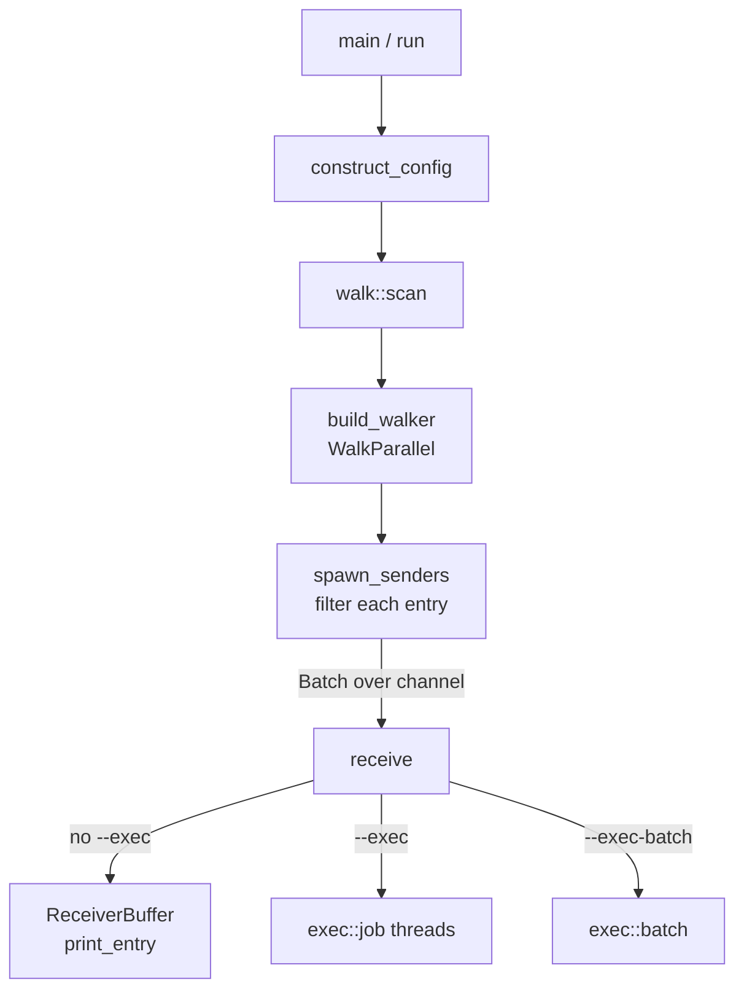

## Overview

`fd` finds entries in the filesystem: a fast, user-friendly alternative to `find` with opinionated defaults. It matches a regular expression (or a glob) against file names, skips hidden files and anything listed in `.gitignore`, colours its output like `ls`, and walks directories on several threads at once. [[Quickstart]] shows how to build and run it; [[Command Execution]] covers `--exec` and `--exec-batch`.

Sources: [README.md:1-28](repo://README.md#L1-L28)

The binary is one Rust crate. `main.rs` declares every module: `cli` parses the arguments, `config` holds the resolved settings, `walk` runs the search, `output` prints results, `exec` and `fmt` run and template commands, and `filter` holds the size, time and owner filters.

Sources: [src/main.rs:1-36](repo://src/main.rs#L1-L36)

## From arguments to a search

`main` calls `run` and turns its result into the process exit code; any error is printed through `print_error` and exits with `ExitCode::GeneralError`. `run` parses `Opts` with clap, applies `--base-directory`, resolves the search paths and refuses a pattern that contains a path separator, because without `--full-path` fd matches only the file name and such a pattern could never match.

Sources: [src/main.rs:62-112](repo://src/main.rs#L62-L112), [src/main.rs:149-216](repo://src/main.rs#L149-L216)

Each pattern (the positional one plus every `--and` expression) is turned into a regex string by `build_pattern_regex`: `--glob` compiles a glob through `globset`, `--exact` anchors and escapes it as `^…$`, `--fixed-strings` escapes it, and otherwise the pattern is used as a regex as given.

Sources: [src/main.rs:218-232](repo://src/main.rs#L218-L232)

`construct_config` resolves everything else into one `Config`. Case sensitivity is "smart case": the search is case-sensitive when `--case-sensitive` is passed or any pattern contains an uppercase character, unless `--ignore-case` wins. Colour is on for `--color auto` only when stdout is a terminal and `NO_COLOR` is unset; the `LS_COLORS` environment variable sets the colours, with a built-in palette as fallback. Ignore flags such as `--hidden`, `--no-ignore` and `--no-ignore-vcs` become the `ignore_hidden`, `read_fdignore` and `read_vcsignore` booleans, and `--extension` values become one case-insensitive `RegexSet`.

Sources: [src/main.rs:248-298](repo://src/main.rs#L248-L298), [src/main.rs:310-373](repo://src/main.rs#L310-L373)

## Parallel walk

`walk::scan` wraps the patterns and config in a `WorkerState` and calls its `scan`. `build_walker` configures `ignore::WalkBuilder` from the config (hidden files, `.fdignore`, VCS ignore files, `--exclude` overrides, symlink following, `--max-depth`), adds the global ignore file `fd/ignore` from the user's config directory and any `--ignore-file`, then builds a `WalkParallel` with `config.threads` threads.

Sources: [src/walk.rs:330-404](repo://src/walk.rs#L330-L404), [src/walk.rs:680-687](repo://src/walk.rs#L680-L687)

`scan` installs a Ctrl-C handler when printing coloured output (a second Ctrl-C exits at once), opens a bounded channel of `2 * threads` batches, starts the receiver on its own scoped thread and runs the walker's sender threads on the current one.

Sources: [src/walk.rs:616-653](repo://src/walk.rs#L616-L653)

Sources: [src/walk.rs:406-440](repo://src/walk.rs#L406-L440), [src/walk.rs:616-653](repo://src/walk.rs#L616-L653)

## Filtering entries

Each sender thread runs the closure in `spawn_senders` for every entry the walker yields. The checks run cheapest first, so most entries are rejected before any metadata is read.

Sources: [src/walk.rs:514-524](repo://src/walk.rs#L514-L524)

1. Stop if the quit flag is set; skip a directory holding an `--ignore-contain` file; skip the root entry itself.
2. Turn walker errors into `WorkerResult::Error`, except a missing target of a symlink, which becomes a broken-symlink entry.
3. Drop entries above `--min-depth`.
4. Match every pattern against the file name, or the absolute path with `--full-path` (`search_str_for_entry`).
5. Check the extension set, then the file types (`--type`).
6. On Unix, check `--owner`; then the size constraints (files only) and the modification-time constraints.
7. Compute the `LS_COLORS` style on the worker thread, so colouring runs in parallel, and send the entry. With `--prune`, a match is not descended into.

Sources: [src/walk.rs:459-560](repo://src/walk.rs#L459-L560), [src/walk.rs:577-612](repo://src/walk.rs#L577-L612), [src/walk.rs:656-678](repo://src/walk.rs#L656-L678)

Results travel in `Batch`es: `BatchSender` sends a batch over the channel when its first item is added and keeps filling it until the receiver takes it or it reaches its limit, which gives backpressure. The limit is `0x100`, or 1 when `--exec` runs on several threads so that work spreads evenly across the job threads.

Sources: [src/walk.rs:47-122](repo://src/walk.rs#L47-L122), [src/walk.rs:449-457](repo://src/walk.rs#L449-L457)

## Printing results

Without `--exec`, `ReceiverBuffer` prints to a buffered, locked stdout. It starts in `Buffering` mode and collects entries until a deadline (100 ms by default, `--max-buffer-time`) or until more than 1000 entries arrive, then switches to `Streaming` and prints each entry as it comes. A search that finishes while still buffering sorts the buffer first, so fast searches give sorted output.

Sources: [src/walk.rs:124-171](repo://src/walk.rs#L124-L171), [src/walk.rs:198-218](repo://src/walk.rs#L198-L218), [src/walk.rs:269-293](repo://src/walk.rs#L269-L293)

`--quiet` stops at the first result, and `--max-results` stops once that many have been printed. Filesystem errors are printed only with `--show-errors`, and a broken pipe ends the search quietly.

Sources: [src/walk.rs:198-267](repo://src/walk.rs#L198-L267)

`output::print_entry` writes each path: wrapped in an OSC 8 hyperlink when `--hyperlink` is on, formatted by the `--format` template, coloured with `LS_COLORS`, or plain, and ended with a newline or, with `--print0`, a NUL byte.

Sources: [src/output.rs:16-43](repo://src/output.rs#L16-L43)

## Exit codes

| Variant | Code | When |
| --- | --- | --- |
| `Success` | 0 | the search ran |
| `HasResults(true)` | 0 | `--quiet` and something matched |
| `HasResults(false)` | 1 | `--quiet` and nothing matched |
| `GeneralError` | 1 | an error, or any failing `--exec` command |
| `KilledBySigint` | 130 | interrupted by Ctrl-C; on Unix fd re-raises SIGINT |

Sources: [src/exit_codes.rs:6-51](repo://src/exit_codes.rs#L6-L51)
