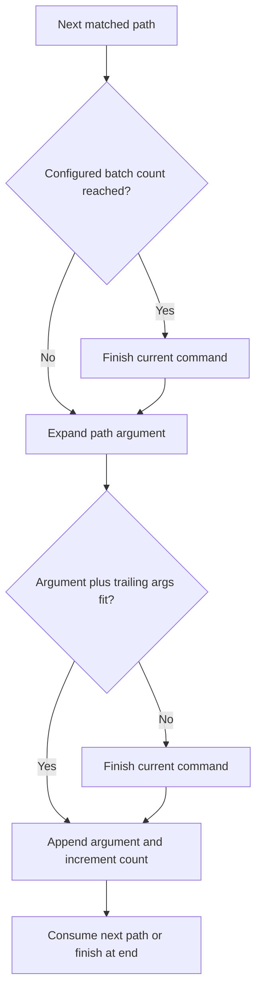

## Overview

Command execution consumes the same accepted entries as normal path printing. With `--exec` (`-x`), each match supplies one input to a set of command templates. With `--exec-batch` (`-X`), each match contributes an argument to batch builders. The receiver selects these consumers before creating the normal output buffer, so command mode does not use the sorting and path-printing pipeline in [[Output and Formatting]]. Search roots and expressions still follow [[Search Patterns and Paths]].

Sources: [src/main.rs:75-111](repo://src/main.rs#L75-L111), [src/walk.rs:408-438](repo://src/walk.rs#L408-L438), [src/exec/mod.rs:76-116](repo://src/exec/mod.rs#L76-L116)

## Command arguments and validation

The CLI collects repeated occurrences of an execution option as grouped command arguments and constructs a `CommandSet`. Arguments after the execution option belong to the command until a semicolon terminates it; the help recommends placing execution last and shows an escaped semicolon when more fd arguments must follow. Per-result and batch execution conflict with each other and with detailed listing. The execution group also conflicts with quiet mode and result limits.

Sources: [src/cli.rs:29-30](repo://src/cli.rs#L29-L30), [src/cli.rs:861-873](repo://src/cli.rs#L861-L873), [src/cli.rs:884-899](repo://src/cli.rs#L884-L899), [src/cli.rs:922-934](repo://src/cli.rs#L922-L934)

Each argument is parsed with the shared format engine in [[Output and Formatting]]. If none contains a placeholder, the template appends an implicit `{}` argument. Empty command templates are rejected so discovered entries do not accidentally become executables. Per-result execution permits a placeholder in the executable position, but batch mode requires a fixed executable.

Sources: [src/exec/mod.rs:220-255](repo://src/exec/mod.rs#L220-L255), [src/exec/mod.rs:438-443](repo://src/exec/mod.rs#L438-L443)

Batch validation rejects more than one argument containing placeholder tokens. Despite the error text saying “Only one placeholder allowed,” the implementation counts arguments with tokens, not individual substitutions inside an argument. That one argument template is expanded once for each matching path. Fixed arguments before and after it retain their position around the expanded path arguments.

Sources: [src/exec/mod.rs:51-69](repo://src/exec/mod.rs#L51-L69), [src/exec/mod.rs:136-161](repo://src/exec/mod.rs#L136-L161), [src/exec/mod.rs:258-260](repo://src/exec/mod.rs#L258-L260), [src/exec/mod.rs:173-194](repo://src/exec/mod.rs#L173-L194)

Generation uses `argmax::Command` with separate OS-string arguments. It does not introduce a shell parser: the generated first argument selects the program, and remaining generated arguments are passed through `try_arg`. Paths come from the entry's presentation-path helpers, and custom separators apply through the shared formatter. Filename colorization, hyperlink wrapping, and terminal sanitization are not part of argument generation.

Sources: [src/exec/mod.rs:10-11](repo://src/exec/mod.rs#L10-L11), [src/exec/mod.rs:266-271](repo://src/exec/mod.rs#L266-L271), [src/exec/job.rs:33-39](repo://src/exec/job.rs#L33-L39), [src/exec/job.rs:51-63](repo://src/exec/job.rs#L51-L63), [src/fmt/mod.rs:112-140](repo://src/fmt/mod.rs#L112-L140)

## Per-result execution

`WorkerState::receive` starts as many job threads as the configured thread count. Each consumes batches from a cloned receiver and runs `exec::job` over their entries. A job processes its own entries sequentially, but several jobs can execute concurrently. `--threads=1` makes command execution sequential; it does not introduce a sorted match order. The producer-side scheduling is explained in [[Directory Traversal and Ignore Rules]].

Sources: [src/walk.rs:416-431](repo://src/walk.rs#L416-L431), [src/exec/job.rs:11-43](repo://src/exec/job.rs#L11-L43), [src/cli.rs:895-896](repo://src/cli.rs#L895-L896), [src/walk.rs:449-457](repo://src/walk.rs#L449-L457)

For one entry, `CommandSet::execute` generates commands in template order and passes them to `execute_commands`. Each command finishes before the next command for that entry begins. A nonzero child status or an execution error stops that entry's remaining command sequence, while the surrounding job continues consuming later entries and remembers the failure in its aggregate result.

Sources: [src/exec/mod.rs:76-88](repo://src/exec/mod.rs#L76-L88), [src/exec/command.rs:60-98](repo://src/exec/command.rs#L60-L98), [src/exec/job.rs:19-43](repo://src/exec/job.rs#L19-L43)

## Child output

With more than one execution thread, `job` enables output buffering and `execute_commands` captures child stdout and stderr. `OutputBuffer::write` acquires both output locks before emitting the captured results for an entry, keeping concurrent fd job writes from interleaving inside that emission. It writes stdout and stderr as separate stored streams, so this mechanism does not preserve the child's original cross-stream timing.

Sources: [src/exec/job.rs:16-17](repo://src/exec/job.rs#L16-L17), [src/exec/command.rs:9-55](repo://src/exec/command.rs#L9-L55), [src/exec/command.rs:71-85](repo://src/exec/command.rs#L71-L85)

With a single execution thread, the code uses the unbuffered spawn path to permit viewing and interacting with intermediate command output. In per-result mode, `--print0` adds one NUL after the output for each entry, including the unbuffered case; it does not rewrite child output into NUL-delimited filename records. The output buffer intentionally ignores errors from its writes, unlike the normal path receiver's error handling.

Sources: [src/exec/command.rs:30-55](repo://src/exec/command.rs#L30-L55), [src/exec/command.rs:71-77](repo://src/exec/command.rs#L71-L77), [src/walk.rs:252-258](repo://src/walk.rs#L252-L258)

## Building and flushing batches

Batch execution filters error records out of the stream and passes owned paths to `execute_batch`. For each template, `CommandBuilder` separates fixed leading arguments, the path-dependent argument, and fixed trailing arguments. The builder creates a command with inherited stdin, stdout, and stderr, then adds one generated argument for every input path.

Sources: [src/exec/job.rs:46-63](repo://src/exec/job.rs#L46-L63), [src/exec/mod.rs:90-108](repo://src/exec/mod.rs#L90-L108), [src/exec/mod.rs:136-188](repo://src/exec/mod.rs#L136-L188)

Sources: [src/exec/mod.rs:100-114](repo://src/exec/mod.rs#L100-L114), [src/exec/mod.rs:173-202](repo://src/exec/mod.rs#L173-L202)

`--batch-size` limits matching-path arguments per invocation. Zero is the default and removes that explicit count limit, but the command-line size check can still flush a batch. The fit check includes trailing fixed arguments, reserving room before appending another path. If even a fresh command cannot accept an argument, `try_arg` can fail and execution returns an error.

Sources: [src/cli.rs:492-508](repo://src/cli.rs#L492-L508), [src/exec/mod.rs:173-188](repo://src/exec/mod.rs#L173-L188), [src/exec/mod.rs:100-106](repo://src/exec/mod.rs#L100-L106)

Finishing a nonempty builder appends its trailing arguments, waits for the command's status, records any failure, and recreates the command for another batch. An empty builder runs nothing, including when there are no matches. Each configured batch template has its own builder, so repeated templates can flush as their argument limits require. Batch argument order follows received entries and is explicitly documented as nondeterministic.

Sources: [src/exec/mod.rs:94-116](repo://src/exec/mod.rs#L94-L116), [src/exec/mod.rs:191-207](repo://src/exec/mod.rs#L191-L207), [src/cli.rs:933-934](repo://src/cli.rs#L933-L934)

## Detailed listing

`--list-details` uses the same batch machinery. `extract_command` builds a batch command from `determine_ls_command`: most Unix targets use `ls` with long, human-readable, directory-entry, and color options. macOS and the listed BSD targets probe for `gls`, falling back to BSD-style `ls` options. Windows probes for `ls --version` and reports an error if it cannot run that probe; other unsupported platforms also fail.

Sources: [src/main.rs:395-429](repo://src/main.rs#L395-L429), [src/main.rs:430-493](repo://src/main.rs#L430-L493)

## Failures and final status

Filesystem error records obey `--show-errors` and are skipped by both execution consumers. Child failures are different: per-result execution treats any status other than numeric zero as a general error; batch builders retain a general error after an unsuccessful status. Spawn failures distinguish a missing program from another execution problem in their diagnostic. Results are merged to success only when every contributing result succeeds, so child exit codes are not propagated numerically.

Sources: [src/exec/job.rs:23-43](repo://src/exec/job.rs#L23-L43), [src/exec/job.rs:51-63](repo://src/exec/job.rs#L51-L63), [src/exec/command.rs:80-114](repo://src/exec/command.rs#L80-L114), [src/exec/mod.rs:191-207](repo://src/exec/mod.rs#L191-L207), [src/exit_codes.rs:14-21](repo://src/exit_codes.rs#L14-L21), [src/exit_codes.rs:46-50](repo://src/exit_codes.rs#L46-L50)
