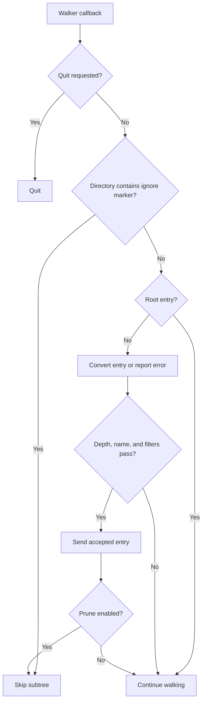

## Overview

Traversal determines which entries can reach the matching pipeline. After the roots and expressions described in [[Search Patterns and Paths]] are ready, `WorkerState::scan` constructs an `ignore::WalkParallel`, starts a receiver, and runs producer callbacks. Each callback can continue, skip descent, or stop the walk. Accepted entries go to either the printer or command execution through a shared channel.

Sources: [src/walk.rs:347-403](repo://src/walk.rs#L347-L403), [src/walk.rs:408-438](repo://src/walk.rs#L408-L438), [src/walk.rs:600-651](repo://src/walk.rs#L600-L651)

## Ignore controls

`construct_config` derives separate switches for hidden entries, fd ignore files, VCS rules, parent rules, and the global fd ignore file. These are separate inputs to walker construction. The `read_fdignore` switch enables both the walker's ordinary ignore support and the custom `.fdignore` filename; VCS support enables Git ignore, Git global ignore, and Git exclude handling together.

Sources: [src/main.rs:310-320](repo://src/main.rs#L310-L320), [src/walk.rs:352-369](repo://src/walk.rs#L352-L369)

| Option | Effect on traversal policy |
| --- | --- |
| `--hidden` | Include hidden entries without disabling ignore rules |
| `--no-ignore` | Disable ordinary/fd, VCS, and automatic global fd ignore handling |
| `--unrestricted` | Combine hidden inclusion with the no-ignore behavior |
| `--no-ignore-vcs` | Disable Git-related rules while retaining ordinary/fd rules |
| `--no-require-git` | Allow Git-related rules without requiring a Git repository |
| `--no-ignore-parent` | Disable loading ignore rules from parent directories |
| `--no-global-ignore-file` | Disable the automatic global fd ignore file |

Sources: [src/cli.rs:33-128](repo://src/cli.rs#L33-L128), [src/main.rs:310-320](repo://src/main.rs#L310-L320), [src/walk.rs:352-375](repo://src/walk.rs#L352-L375)

Parent rules are enabled only when parent handling is allowed and at least ordinary/fd or VCS ignore handling remains enabled. The global fd file is located under the configuration directory returned by `etcetera`, at `fd/ignore`, and is added only if it is a file. Explicit `--ignore-file` paths are processed separately, even when automatic ignore switches are disabled. Partial parse errors are ignored in these add-ignore branches; other returned errors produce diagnostics and walker construction continues.

Sources: [src/walk.rs:352-396](repo://src/walk.rs#L352-L396), [src/main.rs:380-382](repo://src/main.rs#L380-L382)

Exclusions use a separate override builder rooted at the first search path. Configuration prefixes each `--exclude` pattern with `!` before adding it. Malformed override patterns fail walker construction, unlike the diagnostic-only branches for custom ignore files. The CLI describes excludes as overriding other ignore logic, allowing an explicit exclusion even in an otherwise unrestricted search.

Sources: [src/main.rs:378-382](repo://src/main.rs#L378-L382), [src/walk.rs:330-350](repo://src/walk.rs#L330-L350), [src/cli.rs:310-324](repo://src/cli.rs#L310-L324)

## Roots, depth, and links

The first root initializes `WalkBuilder`; subsequent roots are added to the same builder. Maximum depth, symlink following, filesystem boundaries, and thread count are configured there. By default, symlinked directories are not descended into; `--follow` enables traversal through links. `--one-file-system`, with aliases `--mount` and `--xdev`, asks the walker to remain on the starting filesystem.

Sources: [src/walk.rs:347-365](repo://src/walk.rs#L347-L365), [src/walk.rs:398-403](repo://src/walk.rs#L398-L403), [src/cli.rs:240-253](repo://src/cli.rs#L240-L253), [src/cli.rs:682-688](repo://src/cli.rs#L682-L688)

Maximum depth constrains descent in the walker, while minimum depth is checked in the callback and only suppresses an entry's eligibility as a result. The root has depth zero and is always omitted. `--exact-depth` supplies both bounds; a depth of one refers to immediate children of the root. A directory rejected for being too shallow can still have eligible descendants.

Sources: [src/walk.rs:365-365](repo://src/walk.rs#L365-L365), [src/walk.rs:480-512](repo://src/walk.rs#L480-L512), [src/cli.rs:747-753](repo://src/cli.rs#L747-L753), [src/config.rs:49-56](repo://src/config.rs#L49-L56)

## Entry acceptance and pruning

Sources: [src/walk.rs:459-542](repo://src/walk.rs#L459-L542), [src/walk.rs:544-611](repo://src/walk.rs#L544-L611)

`--ignore-contain` is checked before root suppression and before name matching. For a directory, the callback tests whether any configured marker name exists inside it and returns `Skip` if so. This excludes both the directory result and its descendants. `--prune` instead takes effect only after an entry passes the predicates and has been sent: a matching directory is reported, then its descendants are skipped.

Sources: [src/cli.rs:550-552](repo://src/cli.rs#L550-L552), [src/walk.rs:464-483](repo://src/walk.rs#L464-L483), [src/walk.rs:600-611](repo://src/walk.rs#L600-L611)

Most predicate failures return `Continue`, so rejecting a directory's own name does not prevent searching beneath it. The name logic belongs to [[Search Patterns and Paths]], and the subsequent predicates belong to [[File Filters]]. After all checks pass, the callback can precompute the entry's color style in parallel when path printing and colors are enabled, then sends the entry to its consumer.

Sources: [src/walk.rs:514-541](repo://src/walk.rs#L514-L541), [src/walk.rs:544-611](repo://src/walk.rs#L544-L611)

## Broken links and filesystem errors

Successful walker entries become `DirEntry::normal`. A path-associated not-found error is recovered as a broken symlink when `symlink_metadata` confirms that the path is a link. Other walker errors are sent as `WorkerResult::Error`. A recovered broken link has no recorded depth, so a configured minimum-depth check rejects it; without that bound, it can continue through matching.

Sources: [src/walk.rs:485-512](repo://src/walk.rs#L485-L512), [src/dir_entry.rs:24-40](repo://src/dir_entry.rs#L24-L40), [src/dir_entry.rs:98-103](repo://src/dir_entry.rs#L98-L103)

The normal receiver prints filesystem error messages only with `--show-errors`. The per-result and batch command consumers use the same visibility switch and continue past these error records. Those records therefore differ from a failure to build the walker, which propagates as a startup error. Receiver completion and output failures are covered in [[Output and Formatting]].

Sources: [src/walk.rs:227-231](repo://src/walk.rs#L227-L231), [src/exec/job.rs:23-30](repo://src/exec/job.rs#L23-L30), [src/exec/job.rs:51-63](repo://src/exec/job.rs#L51-L63), [src/walk.rs:617-619](repo://src/walk.rs#L617-L619)

## Parallel delivery and shutdown

The thread count defaults to available parallelism capped at 64, with one thread as the fallback. The internal channel capacity is twice that count. Producer batches ordinarily hold up to 256 entries; parallel per-result command execution uses one entry per batch to distribute work among receivers. A batch is sent when its first item arrives, and its shared vector can be taken by the consumer before the producer reaches the nominal limit.

Sources: [src/cli.rs:755-757](repo://src/cli.rs#L755-L757), [src/cli.rs:788-800](repo://src/cli.rs#L788-L800), [src/walk.rs:47-120](repo://src/walk.rs#L47-L120), [src/walk.rs:443-457](repo://src/walk.rs#L443-L457), [src/walk.rs:636-645](repo://src/walk.rs#L636-L645)

Every callback checks the shared quit flag, and a failed channel send also stops traversal. For colored path printing, `scan` installs a Ctrl-C handler: the first interrupt sets quit and interrupt flags, while the second exits immediately. After the receiver is joined, an observed interrupt overrides its result with `KilledBySigint`. Execution mode uses the consumer behavior documented in [[Command Execution]] rather than this path-printing interrupt handler.

Sources: [src/walk.rs:459-462](repo://src/walk.rs#L459-L462), [src/walk.rs:600-604](repo://src/walk.rs#L600-L604), [src/walk.rs:617-652](repo://src/walk.rs#L617-L652), [src/config.rs:138-142](repo://src/config.rs#L138-L142)
