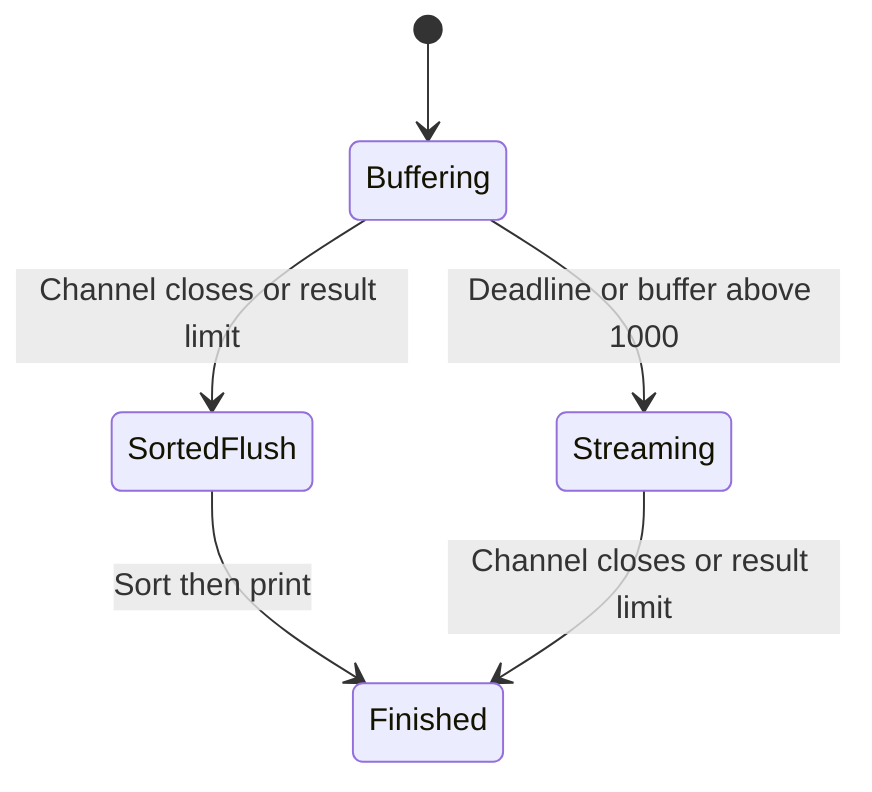

## Overview

When no command is configured, `WorkerState::receive` locks stdout, wraps it in a buffered writer, and gives it to `ReceiverBuffer`. Entries arriving from [[Directory Traversal and Ignore Rules]] are buffered or printed through `output::print_entry`. This page owns path rendering and the shared placeholder engine; subprocess output is handled separately by [[Command Execution]].

Sources: [src/walk.rs:408-438](repo://src/walk.rs#L408-L438), [src/walk.rs:198-218](repo://src/walk.rs#L198-L218), [src/walk.rs:252-258](repo://src/walk.rs#L252-L258), [src/output.rs:17-42](repo://src/output.rs#L17-L42)

## Buffering and ordering

The receiver starts in buffering mode, with a deadline based on `--max-buffer-time` or a default of 100 milliseconds. It waits only until that deadline while buffering. If the deadline expires or the number of accumulated entries exceeds 1,000, it switches to streaming, prints the accumulated entries in arrival order, and flushes. Streaming then waits for more batches without a deadline and flushes when the channel has no batch immediately ready.

Sources: [src/walk.rs:124-169](repo://src/walk.rs#L124-L169), [src/walk.rs:183-245](repo://src/walk.rs#L183-L245), [src/walk.rs:269-279](repo://src/walk.rs#L269-L279), [src/cli.rs:559-564](repo://src/cli.rs#L559-L564)

Sources: [src/walk.rs:198-245](repo://src/walk.rs#L198-L245), [src/walk.rs:269-292](repo://src/walk.rs#L269-L292)

If the search ends while still buffering, `stop` sorts entries by their paths before printing. Once streaming begins, there is no later global sort. `--max-results` stops after the receiver counts the requested number of matches; zero means no limit, and `-1` requests one match. The sorting of a small completed buffer therefore does not imply that a limited search chose the lexically first matching paths.

Sources: [src/walk.rs:220-225](repo://src/walk.rs#L220-L225), [src/walk.rs:281-292](repo://src/walk.rs#L281-L292), [src/dir_entry.rs:125-136](repo://src/dir_entry.rs#L125-L136), [src/cli.rs:566-586](repo://src/cli.rs#L566-L586), [src/cli.rs:759-763](repo://src/cli.rs#L759-L763)

## Paths and record boundaries

`DirEntry::stripped_path` removes a leading `./` only when configuration permits it, and retains the original path if stripping would expose an initial dash. Automatic stripping is enabled for ordinary printing without explicit roots, but disabled for NUL output and command execution. `--strip-cwd-prefix` controls the policy for searches without explicit roots. This presentation choice is independent of the matching target described in [[Search Patterns and Paths]].

Sources: [src/dir_entry.rs:56-79](repo://src/dir_entry.rs#L56-L79), [src/main.rs:389-390](repo://src/main.rs#L389-L390), [src/cli.rs:674-680](repo://src/cli.rs#L674-L680), [src/cli.rs:765-773](repo://src/cli.rs#L765-L773), [src/walk.rs:656-677](repo://src/walk.rs#L656-L677)

`print_entry` optionally opens a hyperlink, chooses custom formatting before colored or plain rendering, closes the hyperlink, then writes one delimiter. The delimiter is NUL with `--print0`, otherwise newline. Ordinary colored and plain rendering append a separator for directory entries. Custom formatting supplies its own text and does not call the trailing-directory-separator helper.

Sources: [src/output.rs:17-85](repo://src/output.rs#L17-L85), [src/output.rs:131-155](repo://src/output.rs#L131-L155)

## Shared format placeholders

`--format` and command arguments use `FormatTemplate`. The parser recognizes placeholders and escaped braces, preserving other text. A template without a placeholder becomes fixed `Text`; a template with placeholders becomes a token vector. Generation returns an `OsString`, substituting path-derived tokens and preserving fixed text.

Sources: [src/main.rs:374-377](repo://src/main.rs#L374-L377), [src/exec/mod.rs:228-233](repo://src/exec/mod.rs#L228-L233), [src/fmt/mod.rs:58-106](repo://src/fmt/mod.rs#L58-L106), [src/fmt/mod.rs:112-140](repo://src/fmt/mod.rs#L112-L140)

| Placeholder | Generated value |
| --- | --- |
| `{}` | Input path |
| `{/}` | Basename |
| `{//}` | Parent directory |
| `{.}` | Path with its final extension removed |
| `{/.}` | Basename with its final extension removed |
| `{{` and `}}` | Literal opening and closing braces |

Sources: [src/fmt/mod.rs:58-90](repo://src/fmt/mod.rs#L58-L90), [src/fmt/mod.rs:119-135](repo://src/fmt/mod.rs#L119-L135), [src/fmt/input.rs:6-31](repo://src/fmt/input.rs#L6-L31)

The parent of a bare filename is rendered as `.`. Extension removal uses the path's file stem and strips a leading current-directory component from its reconstructed result; the tests show that `.foo` remains `.foo`. Custom separator substitution walks path components for placeholder values, including special handling for Windows UNC prefixes. It does not rewrite fixed template text.

Sources: [src/fmt/input.rs:11-31](repo://src/fmt/input.rs#L11-L31), [src/fmt/input.rs:56-70](repo://src/fmt/input.rs#L56-L70), [src/fmt/mod.rs:109-140](repo://src/fmt/mod.rs#L109-L140), [src/fmt/mod.rs:147-195](repo://src/fmt/mod.rs#L147-L195)

## Colors, hyperlinks, and separators

Color configuration accepts always, never, or auto. Auto requires an interactive stdout, ANSI support, and no nonempty `NO_COLOR` value. Enabled colors load `LS_COLORS` or the built-in fallback. Hyperlink auto follows the color decision. The colored printer styles the parent portion as a directory and the basename using the entry's cached style, reusing the style preparation described in [[File Filters]].

Sources: [src/main.rs:271-297](repo://src/main.rs#L271-L297), [src/output.rs:89-136](repo://src/output.rs#L89-L136), [src/dir_entry.rs:105-109](repo://src/dir_entry.rs#L105-L109)

Hyperlinks are OSC 8 sequences pointing at an absolute file URL. `PathUrl` percent-encodes bytes outside its allowed ASCII set, including all non-ASCII bytes; the comment explains that encoded path bytes are not necessarily valid UTF-8 on every platform. Unix uses a cached hostname when available. If absolute-path construction fails, the entry prints without a hyperlink.

Sources: [src/output.rs:17-24](repo://src/output.rs#L17-L24), [src/hyperlink.rs:8-56](repo://src/hyperlink.rs#L8-L56)

An explicit `--path-separator` overrides the normal separator. On Windows, a nonempty `MSYSTEM` supplies `/` as the default override. Windows rejects an explicit separator longer than one byte. Plain rendering replaces native separators in its string representation, while custom formatting applies the component-based substitution above.

Sources: [src/main.rs:234-264](repo://src/main.rs#L234-L264), [src/filesystem.rs:123-135](repo://src/filesystem.rs#L123-L135), [src/output.rs:12-14](repo://src/output.rs#L12-L14), [src/output.rs:142-155](repo://src/output.rs#L142-L155), [src/fmt/mod.rs:147-195](repo://src/fmt/mod.rs#L147-L195)

## Terminal escaping and pipeline bytes

Terminal rendering sanitizes control characters and selected invisible or directional Unicode characters to prevent filename-driven terminal escape injection. Tab is permitted. Values through 255 use hexadecimal byte escapes; higher values use Unicode escapes. Safe strings are borrowed without allocating an escaped copy. The decision follows whether stdout is a terminal, independently of the color mode.

Sources: [src/sanitize.rs:1-55](repo://src/sanitize.rs#L1-L55), [src/main.rs:277-285](repo://src/main.rs#L277-L285), [src/output.rs:75-85](repo://src/output.rs#L75-L85), [src/output.rs:120-129](repo://src/output.rs#L120-L129)

On Unix, plain output to a pipe or file writes the original path bytes when no custom separator is configured, preserving invalid UTF-8 filenames. Terminal output or a separator override uses the string-based renderer. Custom formats and colored rendering also convert paths lossily to strings, so they do not provide the same raw-byte preservation as the plain pipeline branch.

Sources: [src/output.rs:75-85](repo://src/output.rs#L75-L85), [src/output.rs:95-97](repo://src/output.rs#L95-L97), [src/output.rs:142-181](repo://src/output.rs#L142-L181)

## Quiet mode and write failures

Quiet mode returns a successful existence result on the first entry without printing it. If the channel ends without a match, it returns a negative existence result. Ordinary completion returns success regardless of match count. These become numeric statuses 0 for success or a positive existence result, and 1 for a negative existence result or general error.

Sources: [src/walk.rs:198-206](repo://src/walk.rs#L198-L206), [src/walk.rs:281-292](repo://src/walk.rs#L281-L292), [src/exit_codes.rs:14-21](repo://src/exit_codes.rs#L14-L21)

The print wrapper reports non-broken-pipe write errors and returns a general error, but suppresses broken-pipe errors from that call. A flush failure still returns a general error. An observed interrupt flushes best-effort and returns `KilledBySigint`. Whenever processing ends, the receiver sets the quit flag so producers can stop; Unix exit handling restores and raises SIGINT for the explicit interrupt result before falling back to process exit.

Sources: [src/walk.rs:173-180](repo://src/walk.rs#L173-L180), [src/walk.rs:251-266](repo://src/walk.rs#L251-L266), [src/walk.rs:295-301](repo://src/walk.rs#L295-L301), [src/exit_codes.rs:30-42](repo://src/exit_codes.rs#L30-L42)
