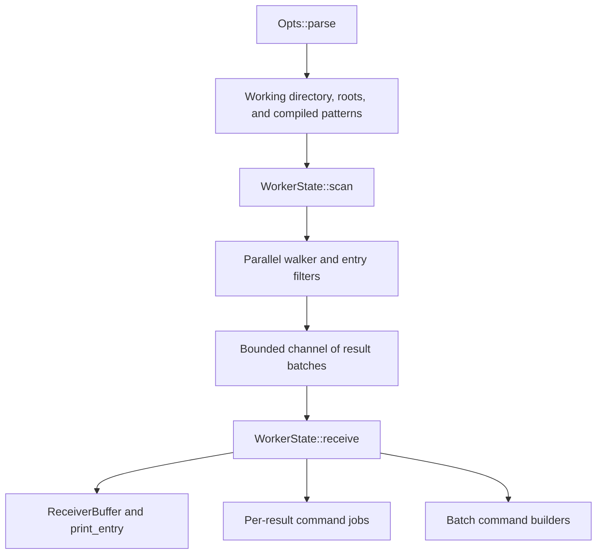

## Overview

`fd` finds filesystem entries by name or path and can either print matches or pass them to commands. The Cargo package is `fd-find`, while the executable is `fd`. This checkout declares version 10.4.2, Rust edition 2024, and a minimum Rust version of 1.90.0. The executable starts in `main`, which runs the search and converts its outcome into a process exit status.

Sources: [Cargo.toml:1-31](repo://Cargo.toml#L1-L31), [src/main.rs:62-112](repo://src/main.rs#L62-L112)

## System map

| Area | Responsibility | Documentation |
| --- | --- | --- |
| Local setup | Build the executable and run initial searches | [[Quickstart]] |
| Search setup | Interpret arguments, choose roots, compile patterns | [[Search Patterns and Paths]] |
| Directory scanning | Apply ignore rules and traverse roots in parallel | [[Directory Traversal and Ignore Rules]] |
| Entry selection | Apply extension, type, ownership, size, and time constraints | [[File Filters]] |
| Result presentation | Buffer paths, render formats, and write terminal or pipeline output | [[Output and Formatting]] |
| Process execution | Execute commands per match or in batches | [[Command Execution]] |

Sources: [Cargo.toml:29-31](repo://Cargo.toml#L29-L31), [src/main.rs:75-112](repo://src/main.rs#L75-L112), [src/walk.rs:347-438](repo://src/walk.rs#L347-L438), [src/walk.rs:526-611](repo://src/walk.rs#L526-L611), [src/output.rs:17-42](repo://src/output.rs#L17-L42)

## A search from input to result

Sources: [src/main.rs:75-112](repo://src/main.rs#L75-L112), [src/walk.rs:408-438](repo://src/walk.rs#L408-L438), [src/walk.rs:593-651](repo://src/walk.rs#L593-L651)

The first step parses options, changes the working directory if requested, resolves valid search roots, and builds regular expressions. [[Search Patterns and Paths]] explains the distinction between the text being matched and the directories being searched. Configuration is constructed before scanning, so invalid patterns and certain path mistakes fail before traversal begins.

Sources: [src/main.rs:75-112](repo://src/main.rs#L75-L112), [src/main.rs:131-180](repo://src/main.rs#L131-L180)

The second step constructs the walker with hidden-file, ignore-file, symlink, filesystem, and maximum-depth policies. [[Directory Traversal and Ignore Rules]] follows those policies into the callback that visits each entry. The callback skips the root entry itself, so naming a directory as a search root does not also return that root as a match.

Sources: [src/walk.rs:347-403](repo://src/walk.rs#L347-L403), [src/walk.rs:459-484](repo://src/walk.rs#L459-L484)

The third step applies the name expressions and entry constraints before sending a result. [[File Filters]] explains the predicates that run after the name match. A result must satisfy every search expression, and size and time constraints are also combined as requirements rather than alternatives.

Sources: [src/walk.rs:514-591](repo://src/walk.rs#L514-L591)

The final step selects the consumer. Without a command, [[Output and Formatting]] follows results through the receiver and printer. With a command, [[Command Execution]] follows either a pool of per-entry jobs or a batch executor. These are alternative consumers of the same filtered entries; formatted path printing is not an intermediate stage of subprocess execution.

Sources: [src/walk.rs:408-438](repo://src/walk.rs#L408-L438)

## Design decisions across the flow

The walker checks names before metadata-dependent predicates because name matching does not require metadata. It also checks an entry's type before looking for an ignore marker inside a directory, explicitly avoiding unnecessary system calls. This makes the sequence of checks meaningful: inexpensive rejection can prevent later filesystem work.

Sources: [src/walk.rs:464-479](repo://src/walk.rs#L464-L479), [src/walk.rs:514-560](repo://src/walk.rs#L514-L560)

Producer batches and a bounded channel constrain delivery. The channel holds twice the configured thread count, while the batch sender limits its current vector to provide backpressure. For parallel per-result execution, the producer reduces batches to one item so work is distributed evenly among receivers. Batch size here concerns internal delivery, distinct from the number of arguments passed to an external command.

Sources: [src/walk.rs:74-120](repo://src/walk.rs#L74-L120), [src/walk.rs:443-457](repo://src/walk.rs#L443-L457), [src/walk.rs:636-645](repo://src/walk.rs#L636-L645)

Printed results initially accumulate so a fast search can finish with sorted output. The receiver switches to streaming when its deadline expires or its buffer exceeds 1,000 entries; the default deadline is 100 milliseconds. This choice allows early display for longer searches, but means output order is not a universal sorting guarantee. [[Output and Formatting]] owns the exact transition and stopping behavior.

Sources: [src/walk.rs:124-169](repo://src/walk.rs#L124-L169), [src/walk.rs:198-245](repo://src/walk.rs#L198-L245), [src/walk.rs:269-292](repo://src/walk.rs#L269-L292)

Command templates require an executable: the validation comment explains that an empty command could otherwise execute each discovered file or directory. Batch templates also require a fixed executable. Relative paths normally retain their leading `./` with command execution and NUL-delimited output, reducing the risk that a filename beginning with a dash becomes an option to another program.

Sources: [src/exec/mod.rs:220-253](repo://src/exec/mod.rs#L220-L253), [src/cli.rs:674-680](repo://src/cli.rs#L674-L680), [src/main.rs:378-391](repo://src/main.rs#L378-L391)

## Completion and errors

Normal searches return success even when they find nothing. Quiet searches instead report whether a match exists. Startup errors are printed by `main` and become a general error; traversal errors can be displayed when configured without automatically changing the normal receiver's final status. Numeric statuses are 0 for success, 1 for a general error or a quiet search without matches, and 130 for the explicit interrupt result.

Sources: [src/main.rs:62-72](repo://src/main.rs#L62-L72), [src/walk.rs:198-231](repo://src/walk.rs#L198-L231), [src/walk.rs:281-292](repo://src/walk.rs#L281-L292), [src/exit_codes.rs:14-21](repo://src/exit_codes.rs#L14-L21)
