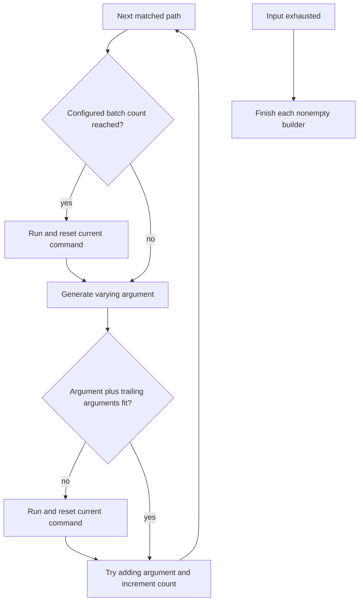

## Overview

Execution modes consume the same accepted entries described in [[Traversal and Filtering]], replacing ordinary path printing with subprocess invocations. `-x`/`--exec` executes a command set for each result, while `-X`/`--exec-batch` accumulates result arguments into commands. Both use the placeholder transformations documented in [[Output and Formatting]]. Command selection happens before traversal, and execution receivers return the status used for the fd process.

Sources: [src/main.rs:298-299](repo://src/main.rs#L298-L299), [src/walk.rs:408-438](repo://src/walk.rs#L408-L438), [src/exec/mod.rs:36-87](repo://src/exec/mod.rs#L36-L87), [src/exec/mod.rs:220-255](repo://src/exec/mod.rs#L220-L255)

## Command-line interface

Put execution options after the pattern and roots. The parser accepts command arguments beginning with hyphens and consumes subsequent positional values as command arguments until the `;` terminator. The shell-facing spelling `\;` shown in the help lets fd receive that terminator. Repeated execution-option occurrences become a vector of command templates. Per-result and batch modes conflict with one another and with detailed listing; execution modes also conflict with quiet mode and result limits.

Sources: [src/cli.rs:29-30](repo://src/cli.rs#L29-L30), [src/cli.rs:861-873](repo://src/cli.rs#L861-L873), [src/cli.rs:882-950](repo://src/cli.rs#L882-L950)

This read-only example from the command help searches `src` and invokes `echo` for each accepted entry. Since no explicit placeholder is present, construction appends the full-path placeholder as the last argument. The path representation follows the prefix and separator policy in [[Output and Formatting]].

Sources: [src/cli.rs:914-915](repo://src/cli.rs#L914-L915), [src/exec/mod.rs:250-253](repo://src/exec/mod.rs#L250-L253), [src/exec/job.rs:33-39](repo://src/exec/job.rs#L33-L39)

```bash
fd . src -x echo
```

Sources: [src/cli.rs:914-915](repo://src/cli.rs#L914-L915)

## Template validation and argument construction

`CommandTemplate::new` parses each command argument independently. An empty command is rejected so fd cannot accidentally execute every discovered path merely because no executable was supplied. If none of the arguments contains a placeholder, it appends one. In per-result mode, even the executable may be generated from a placeholder; batch mode requires a fixed executable in the first argument.

Sources: [src/exec/mod.rs:220-255](repo://src/exec/mod.rs#L220-L255)

Batch validation additionally rejects more than one argument containing placeholders. The implementation counts placeholder-bearing arguments, not individual tokens within an argument. A template can therefore combine multiple transformations inside its one varying argument, but cannot vary two separate arguments for each path. Fixed arguments before and after the varying argument retain their positions around the expanded list.

Sources: [src/exec/mod.rs:51-69](repo://src/exec/mod.rs#L51-L69), [src/exec/mod.rs:136-149](repo://src/exec/mod.rs#L136-L149), [src/exec/mod.rs:258-259](repo://src/exec/mod.rs#L258-L259)

Generation creates an `argmax::Command` from the generated first argument and adds each subsequent generated argument separately. The code does not concatenate the template into a shell command string or start a shell automatically. Consequently, placeholders are fd's substitutions; shell behavior requires explicitly choosing an executable that provides it. Argument construction can itself fail before a child starts.

Sources: [src/exec/mod.rs:10-15](repo://src/exec/mod.rs#L10-L15), [src/exec/mod.rs:266-271](repo://src/exec/mod.rs#L266-L271), [src/exec/command.rs:65-77](repo://src/exec/command.rs#L65-L77)

## Per-result jobs

The per-result receiver creates `config.threads` scoped workers, each consuming the shared channel. Every `exec::job` skips filesystem-error messages after optionally reporting them, extracts an entry's presentation path, and executes the command set. The thread count also controls search parallelism. `--threads=1` makes command execution sequential, but the CLI explicitly provides no command-order guarantee.

Sources: [src/walk.rs:408-432](repo://src/walk.rs#L408-L432), [src/exec/job.rs:11-43](repo://src/exec/job.rs#L11-L43), [src/cli.rs:554-557](repo://src/cli.rs#L554-L557), [src/cli.rs:895-899](repo://src/cli.rs#L895-L899)

For one path, `CommandSet::execute` generates commands in template order. `execute_commands` runs them in sequence and stops that path's command set at the first failed child or launch error. The surrounding job loop records the failure and continues processing later entries. After channel exhaustion, the receiver joins all workers and merges their outcomes, so a failed job does not by itself cancel the rest of discovery.

Sources: [src/exec/mod.rs:76-87](repo://src/exec/mod.rs#L76-L87), [src/exec/command.rs:60-98](repo://src/exec/command.rs#L60-L98), [src/exec/job.rs:19-43](repo://src/exec/job.rs#L19-L43), [src/walk.rs:430-431](repo://src/walk.rs#L430-L431)

With more than one execution thread, fd captures child stdout and stderr, then writes the accumulated buffers while holding both output locks. This avoids interleaving separate jobs' buffered output. With one thread, the child is spawned without that capture step so intermediate output and interaction remain available. `--print0` adds a NUL to stdout after each per-result command set's output; it does not reformat each line emitted by the child.

Sources: [src/exec/job.rs:16-17](repo://src/exec/job.rs#L16-L17), [src/exec/command.rs:30-55](repo://src/exec/command.rs#L30-L55), [src/exec/command.rs:71-98](repo://src/exec/command.rs#L71-L98)

## Batch construction and limits

The batch receiver converts entry messages into owned paths and passes the iterator to `execute_batch`. That function makes one `CommandBuilder` per template, then pushes every path into every builder. Each builder separates fixed leading arguments, the one varying argument, and fixed trailing arguments. Its child processes inherit stdin, stdout, and stderr directly.

Sources: [src/exec/job.rs:46-64](repo://src/exec/job.rs#L46-L64), [src/exec/mod.rs:90-118](repo://src/exec/mod.rs#L90-L118), [src/exec/mod.rs:136-170](repo://src/exec/mod.rs#L136-L170)



Sources: [src/exec/mod.rs:100-116](repo://src/exec/mod.rs#L100-L116), [src/exec/mod.rs:173-202](repo://src/exec/mod.rs#L173-L202)

`--batch-size` limits the number of path-derived arguments per invocation. Zero means no configured count limit, but `args_would_fit` still checks the argument budget with trailing fixed arguments included. A full builder runs before the next path is added. If an argument cannot be added after resetting, the error propagates rather than silently discarding that path. Batch invocation and argument order should not be relied on as a sorted traversal order.

Sources: [src/cli.rs:492-508](repo://src/cli.rs#L492-L508), [src/cli.rs:932-934](repo://src/cli.rs#L932-L934), [src/exec/mod.rs:100-106](repo://src/exec/mod.rs#L100-L106), [src/exec/mod.rs:173-188](repo://src/exec/mod.rs#L173-L188)

`finish` executes only when at least one path has been accumulated, appends trailing arguments, waits for the child, and resets the command while retaining an accumulated failure status. No matches therefore cause no child invocation. A nonzero child status marks failure but permits later batches; an I/O error during builder creation, push, or finish returns immediately through the command-error handler.

Sources: [src/exec/mod.rs:90-118](repo://src/exec/mod.rs#L90-L118), [src/exec/mod.rs:191-206](repo://src/exec/mod.rs#L191-L206)

## Detailed listings

`--list-details` constructs a batch command through `determine_ls_command`. On most Unix targets it selects `ls` with long, human-readable, directory-entry listing and a color argument. On macOS and the listed BSD targets it probes for `gls`, otherwise using BSD-style options and adding `-G` only where supported. Windows requires the `ls --version` probe to succeed; otherwise the option returns an unsupported diagnostic. Detailed listings therefore run an external listing program through the same batch machinery.

Sources: [src/main.rs:395-429](repo://src/main.rs#L395-L429), [src/main.rs:430-493](repo://src/main.rs#L430-L493)

## Failure reporting

A missing executable produces `Command not found` with the program name; other execution errors use `Problem while executing command`. Any failed child or worker becomes fd's general error status, numerically 1, rather than forwarding the original child exit code. With no failures, including no matched entries, the aggregate succeeds. Filesystem-error messages remain controlled by `--show-errors` and are skipped by the execution iterators.

Sources: [src/exec/command.rs:80-114](repo://src/exec/command.rs#L80-L114), [src/exit_codes.rs:14-21](repo://src/exit_codes.rs#L14-L21), [src/exit_codes.rs:46-50](repo://src/exit_codes.rs#L46-L50), [src/exec/job.rs:19-63](repo://src/exec/job.rs#L19-L63)
