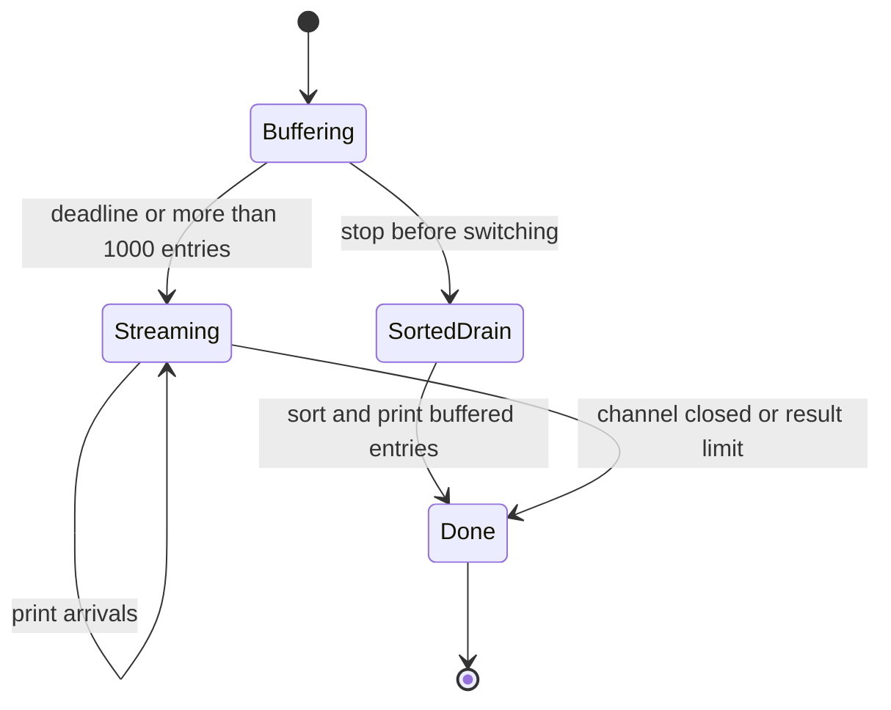

## Overview

Ordinary searches send accepted entries from [[Traversal and Filtering]] to `ReceiverBuffer`, which owns a buffered stdout writer. It chooses when to print, while `output::print_entry` chooses how an entry looks. The same path-template engine also supplies arguments for [[Command Execution]], but subprocess output has its own buffering rules.

Sources: [src/walk.rs:408-438](repo://src/walk.rs#L408-L438), [src/walk.rs:251-278](repo://src/walk.rs#L251-L278), [src/output.rs:17-42](repo://src/output.rs#L17-L42), [src/exec/mod.rs:220-233](repo://src/exec/mod.rs#L220-L233), [src/exec/command.rs:60-98](repo://src/exec/command.rs#L60-L98)

## Buffering and result order

The receiver starts in buffering mode with a deadline 100 milliseconds after initialization unless `--max-buffer-time` supplies another millisecond duration. Each entry is added to a vector. If the vector grows beyond 1000 entries, or the deadline expires, `stream` drains that vector in arrival order and permanently switches to streaming. A search that finishes while still buffering instead sorts the vector by entry path before draining it.

Sources: [src/walk.rs:124-169](repo://src/walk.rs#L124-L169), [src/walk.rs:198-245](repo://src/walk.rs#L198-L245), [src/walk.rs:269-292](repo://src/walk.rs#L269-L292), [src/dir_entry.rs:132-136](repo://src/dir_entry.rs#L132-L136), [src/cli.rs:559-564](repo://src/cli.rs#L559-L564)

Sources: [src/walk.rs:198-245](repo://src/walk.rs#L198-L245), [src/walk.rs:269-292](repo://src/walk.rs#L269-L292)

Streaming flushes stdout when the result channel has no immediately available batch, before waiting again. `--max-results` stops after the requested positive number of accepted entries; zero removes that limit, while `-1` selects one result. A limit stops at results already received rather than selecting the globally first sorted paths. These result limits conflict with command-execution modes at argument parsing.

Sources: [src/walk.rs:220-244](repo://src/walk.rs#L220-L244), [src/cli.rs:29-30](repo://src/cli.rs#L29-L30), [src/cli.rs:566-586](repo://src/cli.rs#L566-L586), [src/cli.rs:759-763](repo://src/cli.rs#L759-L763)

## Path rendering

`print_entry` optionally opens a hyperlink, then selects a custom format, colored output, or plain output in that priority order. It closes any hyperlink before writing the entry terminator. The terminator is a newline by default or NUL with `-0`/`--print0`. Ordinary colored and plain renderers append the configured separator to directory paths; custom formats produce exactly their generated text before the terminator.

Sources: [src/output.rs:17-85](repo://src/output.rs#L17-L85), [src/output.rs:124-155](repo://src/output.rs#L124-L155), [src/cli.rs:266-276](repo://src/cli.rs#L266-L276)

The current-directory prefix policy is applied through `DirEntry::stripped_path`. In automatic mode, searches without explicit roots strip `./` unless using command execution or NUL separation. `--strip-cwd-prefix` can request always or never, but stripping still preserves the original path when removing `./` would expose a leading dash. This guard also applies to the owned paths used by batch commands.

Sources: [src/main.rs:378-391](repo://src/main.rs#L378-L391), [src/cli.rs:765-772](repo://src/cli.rs#L765-L772), [src/dir_entry.rs:56-79](repo://src/dir_entry.rs#L56-L79)

`--path-separator` changes rendered separators. Without an explicit value, Windows environments with a nonempty `MSYSTEM` select `/`; otherwise the platform default is used. The Windows validation rejects separator strings longer than one byte. Template replacement walks path components, whereas plain text rendering replaces the native separator in its display string.

Sources: [src/main.rs:234-264](repo://src/main.rs#L234-L264), [src/filesystem.rs:123-136](repo://src/filesystem.rs#L123-L136), [src/fmt/mod.rs:143-195](repo://src/fmt/mod.rs#L143-L195), [src/output.rs:142-155](repo://src/output.rs#L142-L155)

## Shared placeholder templates

`--format` parses one `FormatTemplate` that is generated for each result. Command templates parse each argument with this same engine. The parser recognizes the five placeholder forms below and doubled braces for literal braces. It retains fixed text between placeholders; a template without placeholders remains fixed text. Unlike command construction, printing a fixed format does not automatically append a path placeholder.

Sources: [src/main.rs:374-377](repo://src/main.rs#L374-L377), [src/fmt/mod.rs:58-106](repo://src/fmt/mod.rs#L58-L106), [src/output.rs:69-85](repo://src/output.rs#L69-L85), [src/exec/mod.rs:228-253](repo://src/exec/mod.rs#L228-L253)

| Token | Generated value for `dir/foo.txt` |
| --- | --- |
| `{}` | `dir/foo.txt` |
| `{/}` | `foo.txt` |
| `{//}` | `dir` |
| `{.}` | `dir/foo` |
| `{/.}` | `foo` |
| `{{` and `}}` | Literal opening and closing braces |

Sources: [src/fmt/mod.rs:58-90](repo://src/fmt/mod.rs#L58-L90), [src/fmt/mod.rs:112-140](repo://src/fmt/mod.rs#L112-L140), [src/fmt/input.rs:6-31](repo://src/fmt/input.rs#L6-L31)

The parent of a bare filename is rendered as `.`. Extension removal uses the file stem, joins it to the parent, and strips an initial current-directory component; a hidden name such as `.foo` remains unchanged. A custom separator is substituted only within generated placeholder values. Literal text in the template is preserved, allowing a template to mix path components and fixed labels without rewriting those labels.

Sources: [src/fmt/input.rs:11-31](repo://src/fmt/input.rs#L11-L31), [src/fmt/input.rs:56-72](repo://src/fmt/input.rs#L56-L72), [src/fmt/mod.rs:109-140](repo://src/fmt/mod.rs#L109-L140)

## Terminal text and pipeline bytes

Terminal rendering sanitizes control characters and selected invisible or direction-changing Unicode characters to visible escapes. Horizontal tabs remain permitted. Values through byte value 255 use hexadecimal byte escapes; larger values use Unicode escapes. The sanitizer returns the original string without allocation when no escaping is needed. Error messages apply the same policy based on whether stderr is a terminal.

Sources: [src/sanitize.rs:6-55](repo://src/sanitize.rs#L6-L55), [src/error.rs:5-8](repo://src/error.rs#L5-L8)

On Unix, plain nonterminal output with no custom separator writes the path's raw OS bytes, preserving invalid UTF-8 filenames for downstream tools. Terminal output, custom-separator output, colored output, and custom-format printing use lossy string conversion instead. NUL separation changes entry boundaries but does not itself force raw-byte rendering or turn off explicitly selected presentation features.

Sources: [src/output.rs:17-42](repo://src/output.rs#L17-L42), [src/output.rs:75-85](repo://src/output.rs#L75-L85), [src/output.rs:95-98](repo://src/output.rs#L95-L98), [src/output.rs:142-181](repo://src/output.rs#L142-L181)

## Colors and hyperlinks

Automatic color requires terminal stdout, ANSI support, and an absent or empty `NO_COLOR`. Always and never modes bypass that automatic choice. When enabled, styles come from `LS_COLORS` or the built-in palette. Parent path components use the directory style, while the basename uses the cached entry style. Custom formatting takes priority over color rendering even if color configuration exists.

Sources: [src/main.rs:271-292](repo://src/main.rs#L271-L292), [src/output.rs:26-32](repo://src/output.rs#L26-L32), [src/output.rs:110-136](repo://src/output.rs#L110-L136)

Automatic hyperlinks follow the color decision. `PathUrl` converts the original entry path to absolute form, prefixes a file URL host, and percent-encodes bytes outside its allowed ASCII set; Windows backslashes become slashes. Unix uses a cached hostname, with an empty fallback. Failure to obtain an absolute path simply omits the hyperlink, leaving the visible result available.

Sources: [src/main.rs:293-297](repo://src/main.rs#L293-L297), [src/hyperlink.rs:8-62](repo://src/hyperlink.rs#L8-L62), [src/output.rs:17-24](repo://src/output.rs#L17-L24)

## Quiet mode, errors, and interruption

Quiet mode returns success immediately on the first entry without printing it; exhausting the channel without one returns status 1. Normal completed searches return 0 even with no matches. Filesystem errors are optionally printed and do not independently change that completion result. Other startup or output failures use the general error status. A direct print error of `BrokenPipe` is ignored, but a stdout flush failure returns a general error.

Sources: [src/walk.rs:198-231](repo://src/walk.rs#L198-L231), [src/walk.rs:251-301](repo://src/walk.rs#L251-L301), [src/main.rs:62-72](repo://src/main.rs#L62-L72), [src/exit_codes.rs:14-21](repo://src/exit_codes.rs#L14-L21)

The custom Ctrl-C handler is installed when colors are configured and results are being printed. The first interrupt sets quit and interrupt flags; a second exits immediately. Printing checks the interrupt flag and attempts a final flush, and scan completion also checks it. The interrupted status maps to 130, with Unix exit handling attempting to restore and raise SIGINT before falling back to a process exit.

Sources: [src/walk.rs:260-263](repo://src/walk.rs#L260-L263), [src/walk.rs:617-652](repo://src/walk.rs#L617-L652), [src/config.rs:138-142](repo://src/config.rs#L138-L142), [src/exit_codes.rs:14-42](repo://src/exit_codes.rs#L14-L42)
