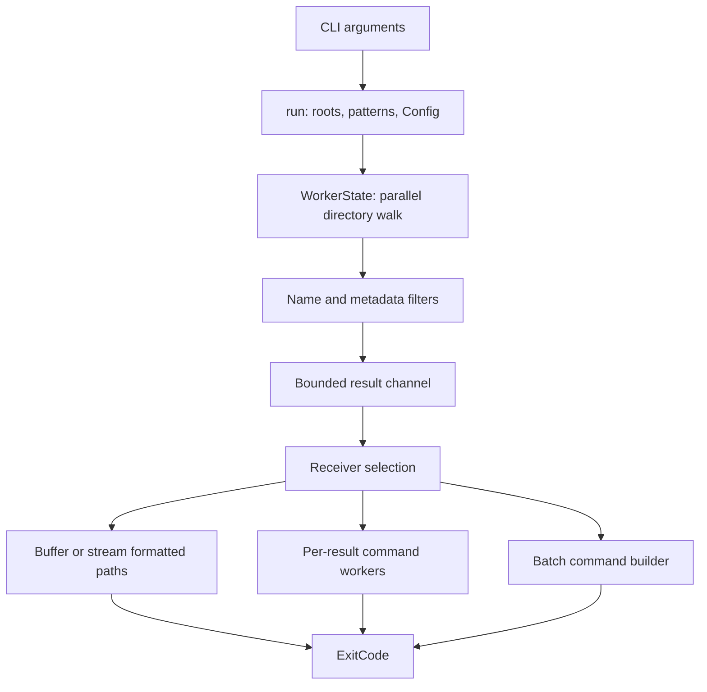

## Overview

`fd` finds entries in the filesystem using a command-line search pattern and optional root directories. The repository builds the `fd` executable from the Rust package `fd-find`. Its default search is recursive, uses regular expressions, and skips hidden and ignored entries. It also supports running external commands against the discovered paths. [[Quickstart]] walks through building this checkout and making the first searches.

Sources: [Cargo.toml:1-31](repo://Cargo.toml#L1-L31), [README.md:8-26](repo://README.md#L8-L26), [src/main.rs:75-111](repo://src/main.rs#L75-L111)

## Parts of the system

| Area | What it does | Documentation |
| --- | --- | --- |
| Build and first use | Produces the executable and introduces searches and command-line help | [[Quickstart]] |
| Search definition | Resolves directories, validates patterns, compiles expressions, and chooses case behavior | [[Search Patterns and Roots]] |
| Discovery | Traverses directories in parallel, applies ignore rules, and checks entry metadata | [[Traversal and Filtering]] |
| Presentation | Buffers results, renders paths and templates, and adapts output to terminals | [[Output and Formatting]] |
| Subprocesses | Turns matches into individual jobs or batches and combines command outcomes | [[Command Execution]] |

Sources: [Cargo.toml:29-31](repo://Cargo.toml#L29-L31), [src/main.rs:75-111](repo://src/main.rs#L75-L111), [src/walk.rs:347-438](repo://src/walk.rs#L347-L438), [src/walk.rs:514-591](repo://src/walk.rs#L514-L591), [src/output.rs:17-42](repo://src/output.rs#L17-L42), [src/exec/job.rs:11-64](repo://src/exec/job.rs#L11-L64)

## Main flow

Sources: [src/main.rs:62-111](repo://src/main.rs#L62-L111), [src/walk.rs:408-438](repo://src/walk.rs#L408-L438), [src/walk.rs:514-591](repo://src/walk.rs#L514-L591), [src/walk.rs:617-652](repo://src/walk.rs#L617-L652)

1. The command starts in `run`, which parses options, selects roots, translates patterns, and constructs `Config`; [[Search Patterns and Roots]] follows that preparation to the compiled matchers.
2. The walker discovers candidate entries and runs the filters before sending accepted entries through a bounded channel; [[Traversal and Filtering]] explains which gates stop an entry or a whole subtree.
3. Ordinary searches feed `ReceiverBuffer`, which eventually calls the path printer; [[Output and Formatting]] explains when results are sorted and when they stream.
4. Execution searches choose either parallel `exec::job` receivers or `exec::batch`; [[Command Execution]] explains how these consumers form commands and report their outcomes.

Sources: [src/main.rs:75-111](repo://src/main.rs#L75-L111), [src/walk.rs:408-438](repo://src/walk.rs#L408-L438), [src/walk.rs:514-611](repo://src/walk.rs#L514-L611), [src/walk.rs:636-652](repo://src/walk.rs#L636-L652)

## Design decisions

Matching runs before metadata-dependent filtering. The walker explicitly checks the name first because that does not require metadata, then extensions, file types, ownership, size, and modification time. Color computation is also performed by traversal workers for entries that will be printed, distributing that work across the parallel scan. These choices place inexpensive rejection before later work without changing the requirement that every active filter pass.

Sources: [src/walk.rs:514-598](repo://src/walk.rs#L514-L598)

The producer-consumer boundary uses batches and a bounded channel. `BatchSender` limits each batch to provide backpressure; parallel per-result execution reduces the batch size to one so work is distributed evenly among receivers. The channel itself holds twice the configured thread count. This couples discovery to consumption instead of giving producers an unlimited queue of pending results.

Sources: [src/walk.rs:74-120](repo://src/walk.rs#L74-L120), [src/walk.rs:442-457](repo://src/walk.rs#L442-L457), [src/walk.rs:636-645](repo://src/walk.rs#L636-L645)

Printed output begins with a short buffering window so a search that finishes quickly can be sorted. The default window is 100 milliseconds; exceeding the buffer threshold or reaching its deadline changes the receiver to streaming. Thus sorting is a conditional presentation behavior, not a guarantee of the parallel traversal. The explicit state transition is described in [[Output and Formatting]].

Sources: [src/walk.rs:124-169](repo://src/walk.rs#L124-L169), [src/walk.rs:198-245](repo://src/walk.rs#L198-L245), [src/walk.rs:269-292](repo://src/walk.rs#L269-L292)

Paths passed to commands or emitted with NUL separation retain the current-directory prefix by default. The option documentation gives the reason: a relative name beginning with a dash could otherwise be interpreted as a command option. This policy is decided while constructing the configuration and can be overridden with `--strip-cwd-prefix` when no explicit search roots are supplied.

Sources: [src/cli.rs:674-680](repo://src/cli.rs#L674-L680), [src/cli.rs:765-772](repo://src/cli.rs#L765-L772), [src/main.rs:378-391](repo://src/main.rs#L378-L391)

Parallel command output is captured and written while holding stdout and stderr locks, keeping different jobs' buffered output from interleaving. Single-thread execution leaves output unbuffered so intermediate output and interaction remain available. The execution path therefore makes its own output decision independently of the ordinary search-result buffer.

Sources: [src/exec/job.rs:16-40](repo://src/exec/job.rs#L16-L40), [src/exec/command.rs:30-55](repo://src/exec/command.rs#L30-L55), [src/exec/command.rs:71-98](repo://src/exec/command.rs#L71-L98)

## Completion and failures

Startup errors return through `main`, which prints the error and exits with the general error status. Once traversal begins, filesystem errors are delivered alongside entries and are printed only when error reporting is enabled. An ordinary completed search returns success even if it found nothing; quiet mode instead expresses whether a result exists. External command failures are combined into a general failure rather than preserving each child's numeric exit status.

Sources: [src/main.rs:62-72](repo://src/main.rs#L62-L72), [src/walk.rs:198-231](repo://src/walk.rs#L198-L231), [src/walk.rs:281-292](repo://src/walk.rs#L281-L292), [src/exit_codes.rs:14-21](repo://src/exit_codes.rs#L14-L21), [src/exit_codes.rs:46-50](repo://src/exit_codes.rs#L46-L50)
