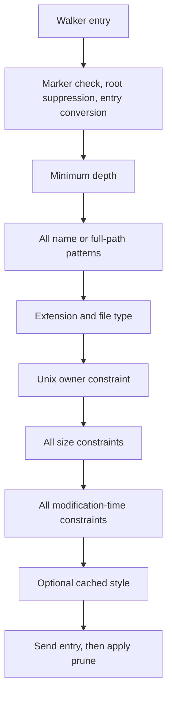

## Overview

Traversal determines which filesystem entries become results. It starts with the roots and matchers prepared in [[Search Patterns and Roots]], configures an ignore-aware parallel walker, and runs candidate entries through ordered filters. A candidate that passes is sent to a result consumer; a directory can also stop descent through marker-file checks or pruning. Printing and subprocess execution share this discovery path.

Sources: [src/walk.rs:347-403](repo://src/walk.rs#L347-L403), [src/walk.rs:459-483](repo://src/walk.rs#L459-L483), [src/walk.rs:514-611](repo://src/walk.rs#L514-L611), [src/walk.rs:617-645](repo://src/walk.rs#L617-L645)

## Ignore-aware walker construction

`build_walker` creates `WalkBuilder` from the first root, adds remaining roots, applies the configured thread count, and builds a parallel walker. It forwards hidden-file behavior, ordinary ignore rules, Git ignore sources, the Git-repository requirement, parent rules, link following, filesystem boundaries, and maximum depth. Exclusion patterns become overrides based on the first root; malformed override patterns fail walker construction.

Sources: [src/walk.rs:330-403](repo://src/walk.rs#L330-L403)

| Control | Effect on discovery |
| --- | --- |
| `-H`, `--hidden` | Disables hidden-entry suppression |
| `-I`, `--no-ignore` | Disables ordinary, Git, and default global fd ignore sources |
| `-u`, `--unrestricted` | Enables hidden entries and disables those ignore sources |
| `--no-ignore-vcs` | Disables Git ignore sources while preserving ordinary ignore rules |
| `--no-require-git` | Allows Git ignore rules without requiring repository detection |
| `--no-ignore-parent` | Disables reading parent-directory ignore rules |
| `-E`, `--exclude` | Adds explicit override patterns |
| `--ignore-file` | Adds each requested ignore file to the walker |

Sources: [src/cli.rs:33-128](repo://src/cli.rs#L33-L128), [src/cli.rs:310-324](repo://src/cli.rs#L310-L324), [src/main.rs:310-320](repo://src/main.rs#L310-L320), [src/main.rs:378-381](repo://src/main.rs#L378-L381), [src/walk.rs:330-396](repo://src/walk.rs#L330-L396)

When ordinary ignore reading is enabled, the builder registers `.fdignore` in addition to its standard ignore support. The default global fd ignore file is the chosen base strategy's configuration directory joined with `fd/ignore`; it is added only when it exists as a file and global reading is enabled. Explicit ignore files are added separately, even when default sources are disabled. Partial errors from adding these files are ignored by this wrapper; other returned errors print a diagnostic without aborting construction.

Sources: [src/walk.rs:352-396](repo://src/walk.rs#L352-L396)

## Depth, links, and subtree boundaries

`--max-depth` constrains the walker, while minimum depth is checked against each returned entry. `--exact-depth` supplies both bounds. The root directory entry at depth zero is always skipped. By default fd does not descend into symlinked directories; `--follow` enables link following, and `--one-file-system` passes a same-filesystem restriction to the builder on supported platforms.

Sources: [src/cli.rs:240-249](repo://src/cli.rs#L240-L249), [src/cli.rs:278-308](repo://src/cli.rs#L278-L308), [src/cli.rs:682-688](repo://src/cli.rs#L682-L688), [src/cli.rs:747-753](repo://src/cli.rs#L747-L753), [src/walk.rs:352-365](repo://src/walk.rs#L352-L365), [src/walk.rs:480-511](repo://src/walk.rs#L480-L511)

An `ignore_contain` marker is checked before root suppression or name matching: if any configured child path exists within a directory, that directory returns `WalkState::Skip`. Pruning acts later, after a matching entry has been sent to the consumer. With `--prune`, a matching directory is therefore reported but its descendants are skipped. Ordinary filter rejection returns `Continue`, allowing traversal to keep exploring directories that do not themselves match.

Sources: [src/walk.rs:459-483](repo://src/walk.rs#L459-L483), [src/walk.rs:514-541](repo://src/walk.rs#L514-L541), [src/walk.rs:600-611](repo://src/walk.rs#L600-L611)

## Candidate filtering order

Sources: [src/walk.rs:459-555](repo://src/walk.rs#L459-L555), [src/walk.rs:557-611](repo://src/walk.rs#L557-L611)

Name matching runs before metadata checks because it does not require metadata. Extension matching then tests the filename against a case-insensitive regex set: leading dots are removed from requested extensions, each extension is escaped, and each suffix requires a preceding character and literal dot. Multiple extensions form alternatives in that set. Extension filtering does not implicitly select regular files; combine it with a type filter when that restriction is needed.

Sources: [src/main.rs:361-373](repo://src/main.rs#L361-L373), [src/walk.rs:514-541](repo://src/walk.rs#L514-L541), [src/cli.rs:380-393](repo://src/cli.rs#L380-L393)

## Type and metadata filters

Type choices enable files, directories, symlinks, devices, sockets, or pipes. Executable and empty selections add predicates: executable implies files, while empty alone enables both files and directories. `FileTypes::should_ignore` rejects unknown types, disabled types, failed executable checks, and failed emptiness checks. An empty file has zero length; an empty directory has no entry from `read_dir`, so ignored children still make it nonempty. Failed directory reads do not count as empty.

Sources: [src/main.rs:333-360](repo://src/main.rs#L333-L360), [src/filetypes.rs:21-41](repo://src/filetypes.rs#L21-L41), [src/filesystem.rs:44-59](repo://src/filesystem.rs#L44-L59)

Size constraints use an integer and unit, optionally prefixed by `+` or `-`. The bounds are inclusive: `+1ki` means at least 1024 bytes, `-1k` means at most 1000 bytes, and an unsigned constraint requires exact equality. Units are case-insensitive and support decimal or binary prefixes. When any size constraint is active, the entry must resolve as a file and provide metadata; every supplied constraint must pass.

Sources: [src/filter/size.rs:15-74](repo://src/filter/size.rs#L15-L74), [src/walk.rs:557-575](repo://src/walk.rs#L557-L575)

Modification-time bounds are strict: `--changed-within` constructs an after predicate, and `--changed-before` constructs a before predicate. Parsing tries a duration subtracted from the current time, a timestamp, a local civil datetime, then an `@`-prefixed integer Unix timestamp. Local datetime conversion selects the later interpretation. An entry must provide a modification time and satisfy every constraint; invalid constraint strings fail configuration construction before traversal.

Sources: [src/main.rs:496-518](repo://src/main.rs#L496-L518), [src/filter/time.rs:28-62](repo://src/filter/time.rs#L28-L62), [src/walk.rs:577-590](repo://src/walk.rs#L577-L590)

On Unix, `--owner` accepts a user or numeric UID and an optional group or numeric GID separated by a colon. Either side can be omitted or negated with `!`. Names are resolved during parsing, extra colons are rejected, and both active checks must match the metadata. A constraint that ignores both sides is removed from configuration; a real constraint rejects entries without metadata.

Sources: [src/cli.rs:460-473](repo://src/cli.rs#L460-L473), [src/filter/owner.rs:24-101](repo://src/filter/owner.rs#L24-L101), [src/main.rs:266-269](repo://src/main.rs#L266-L269), [src/walk.rs:544-555](repo://src/walk.rs#L544-L555)

## Entry caching and filesystem failures

`DirEntry` wraps either a normal walker entry or a broken symlink path. Metadata and style are initialized lazily once per entry, including caching an unavailable result. A walker `NotFound` error becomes a broken-symlink entry only if `symlink_metadata` confirms the path is still a symlink. That special entry has no depth, so an active minimum-depth filter excludes it. Other walker errors are sent to the consumer as errors rather than entries.

Sources: [src/dir_entry.rs:11-39](repo://src/dir_entry.rs#L11-L39), [src/dir_entry.rs:82-108](repo://src/dir_entry.rs#L82-L108), [src/walk.rs:485-511](repo://src/walk.rs#L485-L511)

## Delivery and shutdown

Accepted entries pass through a bounded channel to printing or execution. The default worker batch limit is 256 entries; parallel per-result execution uses one-entry batches to distribute jobs. A failed send tells traversal to quit, and each callback also checks the shared quit flag. Thread count comes from `--threads` or available parallelism, with a default cap of 64 and fallback of one.

Sources: [src/walk.rs:442-462](repo://src/walk.rs#L442-L462), [src/walk.rs:600-611](repo://src/walk.rs#L600-L611), [src/walk.rs:636-645](repo://src/walk.rs#L636-L645), [src/cli.rs:755-757](repo://src/cli.rs#L755-L757), [src/cli.rs:788-800](repo://src/cli.rs#L788-L800)

The receiver determines whether errors are displayed and how completion is represented. [[Output and Formatting]] covers the printing receiver's buffering, limits, and quiet mode; [[Command Execution]] covers execution receivers that consume the same accepted entries and accumulate subprocess outcomes. This boundary lets filtering remain the same whether the user lists paths or acts on them.

Sources: [src/walk.rs:408-438](repo://src/walk.rs#L408-L438), [src/walk.rs:198-231](repo://src/walk.rs#L198-L231), [src/exec/job.rs:11-64](repo://src/exec/job.rs#L11-L64)
