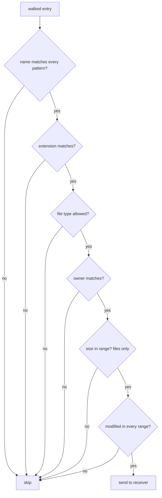

## Overview

Every entry the walk yields passes through one closure in the sender thread, and that closure decides whether the entry is sent to the receiver. The checks run in a fixed order, from the cheapest to the most expensive, so most entries are rejected by a name match before any file metadata is read. The walk itself, and the directories it skips, are on [[Walker and Ignore Rules]]. The `DirEntry` the checks read is described below, and [[Result Receiver and Ordering]] covers what happens after an entry is sent.

Sources: [src/walk.rs:459-462](repo://src/walk.rs#L459-L462), [src/walk.rs:514-524](repo://src/walk.rs#L514-L524)

Sources: [src/walk.rs:514-611](repo://src/walk.rs#L514-L611)

## Name and path matching

The pattern check uses the file name by default. `search_str_for_entry` returns only the last path component, so `fd foo` matches a file called `foo` in any directory. With `--full-path`, the entry's absolute path is matched instead, and any leading `./` is removed from the relative path before it is joined to the working directory.

Sources: [src/walk.rs:656-678](repo://src/walk.rs#L656-L678)

All the patterns must match, not just one. The `--and` patterns are compiled with the primary pattern, and an entry is sent only when `patterns.iter().all(...)` is true for its search string. The bytes compared come from `osstr_to_bytes`, which on Unix passes the raw bytes through and on Windows converts the string.

Sources: [src/walk.rs:519-523](repo://src/walk.rs#L519-L523), [src/filesystem.rs:103-115](repo://src/filesystem.rs#L103-L115)

The check runs on the file name, so it does not need metadata. The code says so on the line before the check, which is why it is placed first.

Sources: [src/walk.rs:514-515](repo://src/walk.rs#L514-L515)

## Extensions and file types

`--extension` is compiled into one `RegexSet` of `\.ext$` patterns, and an entry must match it on its file name. An entry with no file name is rejected.

Sources: [src/walk.rs:526-535](repo://src/walk.rs#L526-L535), [src/main.rs:361-373](repo://src/main.rs#L361-L373)

`--type` is built into a `FileTypes` value. Each flag in `--type` sets one kind of entry to show. `executable` also sets `files`, and `empty` alone sets both `files` and `directories`. `FileTypes::should_ignore` rejects an entry whose kind is not selected, and also rejects an entry whose kind is unknown or unavailable.

Sources: [src/main.rs:333-360](repo://src/main.rs#L333-L360), [src/walk.rs:537-542](repo://src/walk.rs#L537-L542), [src/filetypes.rs:20-42](repo://src/filetypes.rs#L20-L42)

For `empty`, the check is `is_empty`: a directory with no entries, or a regular file of zero length. Any other kind is not empty.

Sources: [src/filesystem.rs:44-60](repo://src/filesystem.rs#L44-L60), [src/filetypes.rs:31-31](repo://src/filetypes.rs#L31-L31)

## Owner, size and time

`--owner` is parsed once in `construct_config`, through `OwnerFilter::filter_ignore`. On Unix, when an owner filter is set, an entry whose metadata cannot be read is rejected, and any other entry is compared against the filter with its metadata.

Sources: [src/walk.rs:544-555](repo://src/walk.rs#L544-L555), [src/main.rs:268-269](repo://src/main.rs#L268-L269), [src/filter/owner.rs:61-75](repo://src/filter/owner.rs#L61-L75)

Size limits apply only to regular files. The walk asks `is_file` before it reads the size, so a directory is rejected whenever any size constraint is set. An entry whose metadata cannot be read is rejected too, and an entry passes only when every size limit accepts its length.

Sources: [src/walk.rs:557-575](repo://src/walk.rs#L557-L575), [src/filter/size.rs:68-69](repo://src/filter/size.rs#L68-L69)

The `--changed-within` and `--changed-before` values are parsed into `TimeFilter`s in `construct_config`. In the closure, an entry's modification time must be accepted by every time filter, so the two options together form a window. An entry without a readable modification time is rejected.

Sources: [src/walk.rs:577-591](repo://src/walk.rs#L577-L591), [src/main.rs:496-519](repo://src/main.rs#L496-L519), [src/filter/time.rs:57-60](repo://src/filter/time.rs#L57-L60)

## The DirEntry the checks read

`DirEntry` wraps either an `ignore` entry or a broken symbolic link, which the walk reports separately. A broken link has no depth, and its file type comes from the link's own metadata. This is why `--type l` can list broken links.

Sources: [src/dir_entry.rs:11-22](repo://src/dir_entry.rs#L11-L22), [src/dir_entry.rs:82-103](repo://src/dir_entry.rs#L82-L103)

Metadata and the `LS_COLORS` style are computed at most once per entry and cached in `OnceCell`s. The sender computes the style itself when colour is on, so the work happens on the sender thread and not in the printer.

Sources: [src/dir_entry.rs:18-22](repo://src/dir_entry.rs#L18-L22), [src/dir_entry.rs:89-109](repo://src/dir_entry.rs#L89-L109), [src/walk.rs:593-598](repo://src/walk.rs#L593-L598)

`stripped_path` removes a leading `./` for output, unless the result would begin with `-`, in which case the `./` is kept so that a downstream command does not read the name as an option. Printing and `--exec` both use it.

Sources: [src/dir_entry.rs:56-71](repo://src/dir_entry.rs#L56-L71), [src/dir_entry.rs:112-114](repo://src/dir_entry.rs#L112-L114)

After the last check, `tx.send` hands the entry to the batch. The next stage is the receiver, on [[Result Receiver and Ordering]].

Sources: [src/walk.rs:600-605](repo://src/walk.rs#L600-L605)
