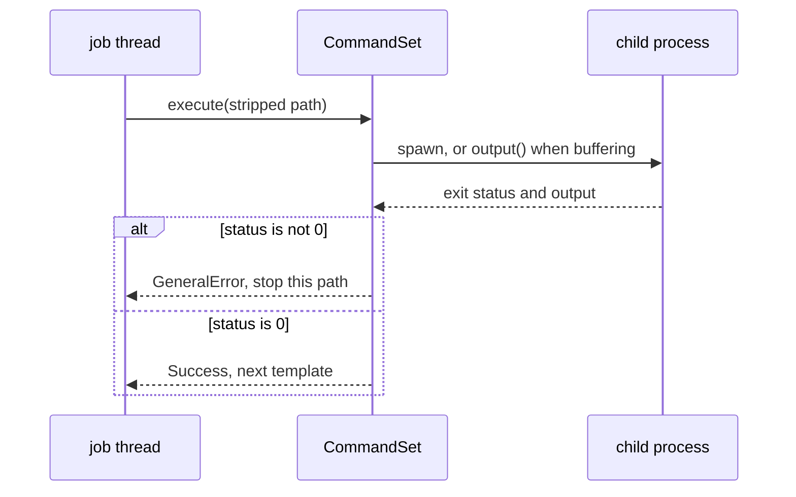

## Overview

`--exec` runs a command once per result, and `--exec-batch` runs it over groups of results. Both are built from a `CommandSet`, which holds the parsed templates. Without batch mode, the receiver starts one `exec::job` thread per configured thread, and each takes entries from the same channel. In batch mode, it passes all the entries to `exec::batch` on one thread. The template syntax is on [[Format Templates]], and the receiver that dispatches to these functions is on [[Result Receiver and Ordering]].

Sources: [src/exec/mod.rs:29-33](repo://src/exec/mod.rs#L29-L33), [src/walk.rs:408-433](repo://src/walk.rs#L408-L433)

## Templates and modes

`CommandSet::new` builds one `CommandTemplate` per `--exec` and sets the mode to one command per result. `CommandSet::new_batch` sets the batch mode, and it refuses any command that has more than one placeholder, because a batch command takes its paths in a single argument list.

Sources: [src/exec/mod.rs:35-70](repo://src/exec/mod.rs#L35-L70)

`CommandTemplate::new` parses each argument with `FormatTemplate::parse`. It refuses an empty command. In batch mode it also refuses a placeholder in the program name, because the program must be fixed. When no argument holds a placeholder, it adds `{}` to the end, so `fd -x echo` prints each path as the last argument.

Sources: [src/exec/mod.rs:219-256](repo://src/exec/mod.rs#L219-L256)

`generate` builds one `Command` from a template and a path. The first argument becomes the program, and each further argument is added with `try_arg`, which reports an error for an argument that cannot be passed.

Sources: [src/exec/mod.rs:266-272](repo://src/exec/mod.rs#L266-L272)

## One command per result

`job` runs on each thread of the receiver. Its output is buffered when there is more than one thread, because the threads would otherwise write over each other. It takes each entry in turn, uses `stripped_path` as the placeholder value, and merges each command's exit status into one for the thread. A walk error in the stream is printed if errors are shown, and it does not run a command.

Sources: [src/exec/job.rs:8-44](repo://src/exec/job.rs#L8-L44)

`CommandSet::execute` generates every command in the set for the path and passes them to `execute_commands`, together with an `OutputBuffer` and the buffering flag. With one thread, each command is spawned and waited for, so its output goes straight to the terminal and can be interacted with.

Sources: [src/exec/mod.rs:76-88](repo://src/exec/mod.rs#L76-L88), [src/exec/command.rs:60-78](repo://src/exec/command.rs#L60-L78)

Sources: [src/exec/command.rs:60-99](repo://src/exec/command.rs#L60-L99), [src/exec/job.rs:33-41](repo://src/exec/job.rs#L33-L41)

A command that exits with a non-zero status makes `execute_commands` return `GeneralError` straight away, so the rest of the commands for that path are not run. The job thread continues with the next entry, and the status is still part of the run's result.

Sources: [src/exec/command.rs:80-89](repo://src/exec/command.rs#L80-L89), [src/exec/job.rs:40-43](repo://src/exec/job.rs#L40-L43)

## Buffered output

When buffering is on, each command's stdout and stderr are captured with `output()`, and each capture is pushed into an `OutputBuffer`. The buffer writes all captured output in one locked block when the path's commands are done, so output from two threads never interleaves within one entry.

Sources: [src/exec/command.rs:9-57](repo://src/exec/command.rs#L9-L57), [src/exec/command.rs:72-78](repo://src/exec/command.rs#L72-L78)

With `--print0`, the buffer writes a null byte after each entry's output, even when the command printed nothing, so the consumer gets one record per entry.

Sources: [src/exec/command.rs:30-56](repo://src/exec/command.rs#L30-L56)

## Batch mode

`exec::batch` collects the stripped path of every entry and calls `execute_batch` with the `--batch-size` limit. `execute_batch` creates one `CommandBuilder` per command and pushes each path into every builder. A builder's `push` finishes its current command before adding the path when the count has reached the limit, or when the path would not fit in the argument list. `args_would_fit` is the check against the operating system's limit.

Sources: [src/exec/job.rs:46-64](repo://src/exec/job.rs#L46-L64), [src/exec/mod.rs:90-120](repo://src/exec/mod.rs#L90-L120), [src/exec/mod.rs:173-189](repo://src/exec/mod.rs#L173-L189)

A `CommandBuilder` keeps the arguments before the placeholder as a prefix and the ones after it as a suffix, and it copies both into each command it starts. `finish` runs the built command when it holds at least one path, records a general error if the command fails, and starts a new command from the prefix. A builder that has pushed no paths runs nothing.

Sources: [src/exec/mod.rs:124-171](repo://src/exec/mod.rs#L124-L171), [src/exec/mod.rs:191-203](repo://src/exec/mod.rs#L191-L203)

Batch mode returns the merged status of all builders. A failed command does not stop later batches, but an error while spawning one does, because the builder returns it immediately.

Sources: [src/exec/mod.rs:101-119](repo://src/exec/mod.rs#L101-L119), [src/exec/mod.rs:205-207](repo://src/exec/mod.rs#L205-L207)

## Errors while spawning

`handle_cmd_error` reports a missing program as "Command not found" with its name. Any other spawn failure is reported as a problem while executing the command with the system's message. Both return `GeneralError`, and the message goes through the same sanitizer as the other error text.

Sources: [src/exec/command.rs:101-115](repo://src/exec/command.rs#L101-L115), [src/error.rs:5-8](repo://src/error.rs#L5-L8)
