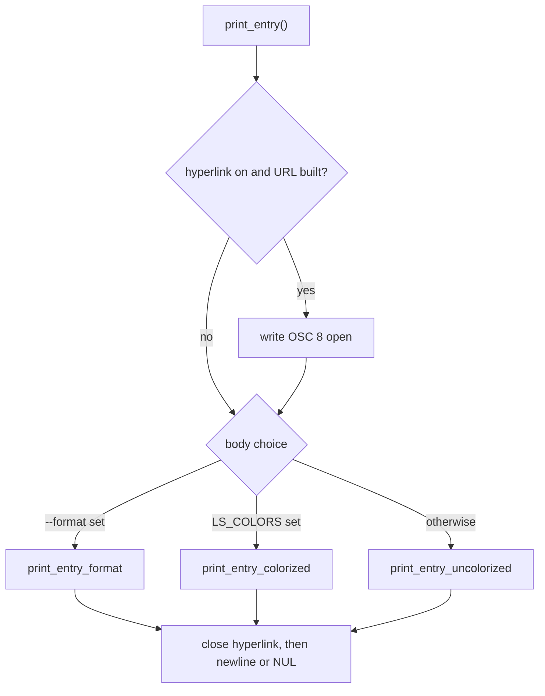

## Overview

`output::print_entry` writes one result as one line. The receiver calls it for each entry it is streaming, and it chooses one of three ways to write the path: a format template, a colourised path, or a plain path. Around that choice it may add a hyperlink, a trailing separator, or a null byte, and it passes any text that might reach a terminal through the sanitizer. The receiver that calls it is on [[Result Receiver and Ordering]]. The template syntax is on [[Format Templates]].

Sources: [src/output.rs:17-43](repo://src/output.rs#L17-L43), [src/walk.rs:251-258](repo://src/walk.rs#L251-L258)

## The write order

`print_entry` writes things in a fixed order: an opening hyperlink escape if hyperlinks are on and the path can become a URL, then the body, then the closing hyperlink escape, then either a null byte (with `--print0`) or a newline. The body is chosen by the first configured option that applies: `--format`, then colour, then plain text.

Sources: [src/output.rs:17-43](repo://src/output.rs#L17-L43)

Sources: [src/output.rs:17-43](repo://src/output.rs#L17-L43)

`--format` output is the template's result for the path, with the `./` prefix already stripped, converted to a string, and sanitized. Nothing else is added to the line, so a format string controls the whole line.

Sources: [src/output.rs:69-86](repo://src/output.rs#L69-L86)

## Colour

With colour on, `print_entry_colorized` writes the parent directory and the base name as two separately styled parts. The split point is the parent's length, plus any separators that follow it, so the separator is styled with the parent. The parent takes the directory style from `LS_COLORS`, and the base name takes the style that `DirEntry::style` computed on the sender thread.

Sources: [src/output.rs:89-129](repo://src/output.rs#L89-L129), [src/dir_entry.rs:105-109](repo://src/dir_entry.rs#L105-L109)

A directory gets a trailing separator, painted with the directory style and left out of the colour when no style is set. `print_trailing_slash` adds it in both the coloured and the plain paths.

Sources: [src/output.rs:45-66](repo://src/output.rs#L45-L66), [src/output.rs:131-136](repo://src/output.rs#L131-L136)

When `--path-separator` is set, the parent and the whole path have each `MAIN_SEPARATOR` replaced by the given string before they are styled, so the replacement is visible in the colour split as well.

Sources: [src/output.rs:12-14](repo://src/output.rs#L12-L14), [src/output.rs:110-114](repo://src/output.rs#L110-L114)

## Plain output and pipes

The plain path depends on the platform. On Windows, and on Unix when stdout is a terminal or a path separator is set, the path is written as text and sanitized. On Unix when output goes to a pipe or file, the path's raw bytes are written. This keeps file names that are not valid UTF-8 intact for the program reading the pipe.

Sources: [src/output.rs:142-165](repo://src/output.rs#L142-L165), [src/output.rs:167-182](repo://src/output.rs#L167-L182)

## Hyperlinks

When `Config.hyperlink` is on, `PathUrl::new` makes an absolute `file://` URL from the entry's path, and `print_entry` wraps the line in an OSC 8 hyperlink escape. Path bytes are kept when they are ASCII letters, digits, or one of `/ : - . _ ~`, and every other byte is percent-encoded. On Windows, backslashes become forward slashes. The host name is the machine's, read once on Unix, and `/` elsewhere.

Sources: [src/hyperlink.rs:5-22](repo://src/hyperlink.rs#L5-L22), [src/hyperlink.rs:24-41](repo://src/hyperlink.rs#L24-L41), [src/hyperlink.rs:43-62](repo://src/hyperlink.rs#L43-L62), [src/output.rs:19-24](repo://src/output.rs#L19-L24)

## Terminal sanitization

File names can hold control characters, which a terminal would act on. When the output is a terminal, `sanitize_for_terminal` escapes every character that `needs_escape` flags: C0 and C1 controls except tab, DEL, soft hyphen, bidi overrides, zero-width and format characters, and tag characters. Characters up to 0xFF are written as `\xHH`, and larger ones as `\u{HHHH}`. A string with nothing to escape is returned unchanged, without an allocation.

Sources: [src/sanitize.rs:6-46](repo://src/sanitize.rs#L6-L46)

`maybe_sanitize` applies the escape only when its flag is set. The printer passes `interactive_terminal` for stdout, and `print_error` passes whether stderr is a terminal. Piped output and error text are therefore unchanged when the stream is not a terminal.

Sources: [src/sanitize.rs:48-55](repo://src/sanitize.rs#L48-L55), [src/error.rs:5-8](repo://src/error.rs#L5-L8), [src/output.rs:84-84](repo://src/output.rs#L84-L84)

## Separators and the null byte

With `--print0`, each entry ends in a null byte, and no newline is written. The same flag makes `OutputBuffer` write a null after each command's output in the `--exec` path, so the two stay in step.

Sources: [src/output.rs:38-43](repo://src/output.rs#L38-L43), [src/exec/command.rs:30-56](repo://src/exec/command.rs#L30-L56)
