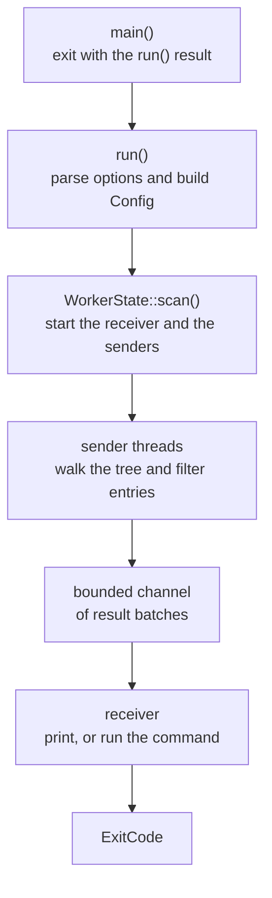

## Overview

fd is a command-line file finder written in Rust. Its manifest calls it "a simple, fast and user-friendly alternative to find" and names the repository's homepage and documentation links.

Sources: [Cargo.toml:4-4](repo://Cargo.toml#L4-L4)

One run walks a directory tree on several threads, keeps the entries whose names (or full paths) match the regular expressions given on the command line, and then either prints each match or runs a command for each one. `main` is the only entry point, and it calls `run`, which starts every other stage. The modules that make up the binary are declared at the top of `main.rs`.

Sources: [src/main.rs:62-73](repo://src/main.rs#L62-L73), [src/main.rs:75-112](repo://src/main.rs#L75-L112), [src/main.rs:1-15](repo://src/main.rs#L1-L15)

## The parts

| Area | What it does | Page |
| --- | --- | --- |
| Startup | Parses options, sets the working directory, compiles the patterns, and builds the `Config` | [[Startup and Configuration]] |
| Walker | Builds the parallel directory walk and its ignore rules, and runs the sender threads | [[Walker and Ignore Rules]] |
| Entry filters | Decides whether each walked entry is sent: pattern, extension, type, owner, size, time | [[Entry Filters]] |
| Result receiver | Orders and batches the results, enforces `--max-results` and `--quiet`, and returns the exit code | [[Result Receiver and Ordering]] |
| Printing | Writes one line per entry: colours, hyperlinks, separators, and terminal sanitization | [[Printing Results]] |
| Format templates | Parses `--format` and `{}` placeholders and fills them in for one path | [[Format Templates]] |
| Command execution | Runs the `--exec` or `--exec-batch` command for each result or batch | [[Running Commands with --exec]] |

Sources: [src/main.rs:75-112](repo://src/main.rs#L75-L112), [src/walk.rs:617-653](repo://src/walk.rs#L617-L653), [src/walk.rs:408-440](repo://src/walk.rs#L408-L440), [src/exec/mod.rs:29-33](repo://src/exec/mod.rs#L29-L33)

## Main flow

Sources: [src/main.rs:62-112](repo://src/main.rs#L62-L112), [src/walk.rs:617-653](repo://src/walk.rs#L617-L653)

The steps, in the order a search takes them:

Sources: [src/main.rs:75-112](repo://src/main.rs#L75-L112), [src/walk.rs:617-653](repo://src/walk.rs#L617-L653)

1. `run()` parses the command line, checks that a search path exists and that the pattern is not a path, and turns the options into a `Config`. See [[Startup and Configuration]].
2. `scan()` opens a bounded channel and starts the receiver on one thread while the walker's sender threads run. See [[Walker and Ignore Rules]].
3. Each sender applies the entry filters and sends the entries that pass in batches. See [[Entry Filters]].
4. The receiver buffers the first results so they can be sorted, then streams them. It prints each one, or hands it to the command runner. See [[Result Receiver and Ordering]].
5. Each entry is printed through the printing code, which uses format templates when `--format` is set. See [[Printing Results]] and [[Format Templates]].
6. With `--exec` or `--exec-batch`, the receiver passes each entry to the command runner instead. See [[Running Commands with --exec]].

Sources: [src/main.rs:83-111](repo://src/main.rs#L83-L111), [src/walk.rs:617-653](repo://src/walk.rs#L617-L653), [src/walk.rs:408-440](repo://src/walk.rs#L408-L440), [src/output.rs:17-32](repo://src/output.rs#L17-L32)

## Cross-cutting decisions

The walk is parallel, and the channel between senders and receiver is bounded at two slots per thread. A full channel blocks the senders, so a slow printer limits how far the walk runs ahead.

Sources: [src/walk.rs:636-646](repo://src/walk.rs#L636-L646)

Each sender batches its results. The batch holds up to 256 entries, but drops to one entry per batch when `--exec` runs with more than one thread, so that several command threads receive work evenly.

Sources: [src/walk.rs:448-457](repo://src/walk.rs#L448-L457), [src/walk.rs:91-98](repo://src/walk.rs#L91-L98)

Output is ordered only when the search is fast. The receiver keeps up to 1,000 entries and waits up to 100 ms, by default, before it sorts what it has and switches to streaming. A slow search therefore prints in arrival order.

Sources: [src/walk.rs:124-127](repo://src/walk.rs#L124-L127), [src/walk.rs:270-285](repo://src/walk.rs#L270-L285)

Terminal output is sanitized, and piped output is not. Control, bidi and zero-width characters in a path are escaped only when stdout is a terminal, so a file name cannot change what the user's screen shows. Piped output keeps the raw bytes, so downstream tools receive the exact name.

Sources: [src/sanitize.rs:49-55](repo://src/sanitize.rs#L49-L55), [src/output.rs:175-181](repo://src/output.rs#L175-L181)

The run has one exit status that merges every worker's result. Any error among the workers makes the whole run exit with a general error. In quiet mode the status reports whether anything matched: 0 when there is a match, 1 when there is none.

Sources: [src/exit_codes.rs:6-23](repo://src/exit_codes.rs#L6-L23), [src/exit_codes.rs:46-51](repo://src/exit_codes.rs#L46-L51), [src/walk.rs:282-292](repo://src/walk.rs#L282-L292)

The walker owns the `Config` for the whole run, so every stage reads one set of settings that `construct_config` built before the walk started.

Sources: [src/walk.rs:306-310](repo://src/walk.rs#L306-L310), [src/main.rs:248-263](repo://src/main.rs#L248-L263)
