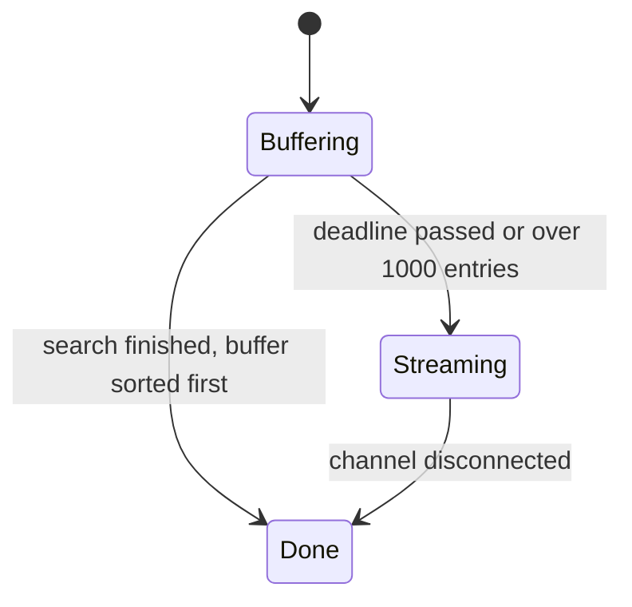

## Overview

The receiver is the one thread that takes results from the walk and decides what happens to them. It prints each entry, or hands the entries to the command runner, and it decides when to stop. [[Walker and Ignore Rules]] and [[Entry Filters]] produce the batches it reads, and [[Printing Results]] and [[Running Commands with --exec]] consume them. This page covers the order in which results are shown, the early stops, and the exit status.

Sources: [src/walk.rs:408-440](repo://src/walk.rs#L408-L440), [src/walk.rs:129-149](repo://src/walk.rs#L129-L149)

`WorkerState::receive` picks the consumer. With `--exec`, it runs the batch command or one job thread per configured thread. Without it, it wraps stdout in a buffered writer and runs a `ReceiverBuffer`.

Sources: [src/walk.rs:408-440](repo://src/walk.rs#L408-L440)

## Buffering and streaming

`ReceiverBuffer` starts in `Buffering` mode with a deadline set `max_buffer_time` after it starts, which is 100 ms when the option is not given. While it buffers, it waits only until that deadline. Found entries are stored in a vector, and nothing is printed.

Sources: [src/walk.rs:124-127](repo://src/walk.rs#L124-L127), [src/walk.rs:153-171](repo://src/walk.rs#L153-L171), [src/walk.rs:184-189](repo://src/walk.rs#L184-L189), [src/walk.rs:208-214](repo://src/walk.rs#L208-L214)

The receiver switches to `Streaming` in one of three cases: the deadline passes with no batch, more than 1,000 entries are buffered, or the channel is disconnected while the search is still in the buffering mode. Switching prints the buffered entries in the order they were stored, flushes, and never buffers again.

Sources: [src/walk.rs:240-242](repo://src/walk.rs#L240-L242), [src/walk.rs:211-213](repo://src/walk.rs#L211-L213), [src/walk.rs:270-279](repo://src/walk.rs#L270-L279)

Sources: [src/walk.rs:198-245](repo://src/walk.rs#L198-L245), [src/walk.rs:282-286](repo://src/walk.rs#L282-L286)

While streaming, the receiver flushes stdout whenever the channel has no further batch ready. A slow search therefore shows its results as they arrive, and a fast search shows them sorted.

Sources: [src/walk.rs:236-238](repo://src/walk.rs#L236-L238)

## Ordering

When the search ends while still buffering, the receiver sorts the vector before streaming it. `DirEntry` orders by its full path, so a fast search prints in path order. An entry that arrives after streaming has started is printed as it comes, so the order of a slow search depends on the walk.

Sources: [src/walk.rs:282-286](repo://src/walk.rs#L282-L286), [src/dir_entry.rs:132-136](repo://src/dir_entry.rs#L132-L136)

Each result is counted. When the count reaches `--max-results`, or `--max-one-result` sets it to 1, the receiver calls `stop`, which sorts and streams any buffered entries before it returns.

Sources: [src/walk.rs:218-225](repo://src/walk.rs#L218-L225), [src/cli.rs:759-763](repo://src/cli.rs#L759-L763), [src/walk.rs:282-286](repo://src/walk.rs#L282-L286)

## Quiet mode and printing

In `--quiet` mode nothing is printed. The receiver returns at the first entry with a `HasResults(true)` status, so the search stops as soon as one match is known. A search that ends with no entries returns `HasResults(false)`.

Sources: [src/walk.rs:203-206](repo://src/walk.rs#L203-L206), [src/walk.rs:288-292](repo://src/walk.rs#L288-L292)

`print` writes one entry through `output::print_entry`. A broken pipe is ignored, so a downstream command that exits early does not produce an error. Any other write error prints a message and stops with a general error. After each line, the receiver checks the interrupt flag, and if Ctrl-C has been pressed it flushes and returns the interrupt status.

Sources: [src/walk.rs:251-267](repo://src/walk.rs#L251-L267), [src/output.rs:17-32](repo://src/output.rs#L17-L32)

Walk errors are printed only when `show_filesystem_errors` is set. They do not stop the search.

Sources: [src/walk.rs:227-231](repo://src/walk.rs#L227-L231)

## Exit status

`ExitCode` has four values: `Success`, `HasResults`, `GeneralError` and `KilledBySigint`. `Success` is 0, `GeneralError` is 1, and `KilledBySigint` is 130. `HasResults(true)` is 0 and `HasResults(false)` is 1, which is how quiet mode reports whether anything matched.

Sources: [src/exit_codes.rs:6-23](repo://src/exit_codes.rs#L6-L23)

`ExitCode::exit` restores the default SIGINT handler and raises the signal before exiting when the status is `KilledBySigint`, so the shell sees the process die from Ctrl-C.

Sources: [src/exit_codes.rs:30-43](repo://src/exit_codes.rs#L30-L43)

`merge_exitcodes` combines the statuses of several workers. Any error among them gives `GeneralError`, and an empty list or only successes give `Success`. The walk uses it for the `--exec` job threads and for batch commands.

Sources: [src/exit_codes.rs:46-51](repo://src/exit_codes.rs#L46-L51), [src/walk.rs:416-431](repo://src/walk.rs#L416-L431)

After the receiver returns, `scan` checks the interrupt flag once more. If the flag is set, the run's status is `KilledBySigint` whatever the receiver returned.

Sources: [src/walk.rs:645-652](repo://src/walk.rs#L645-L652)
