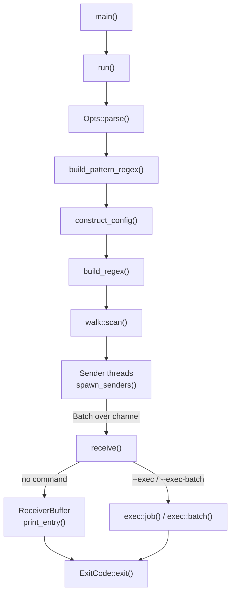

## Overview

`fd` finds entries in a filesystem. The README describes it as a simple, fast and user-friendly alternative to `find` that does not try to cover all of `find`'s features but gives opinionated defaults for most uses: `fd PATTERN` instead of `find -iname '*PATTERN*'`, regular expressions or globs, a parallel directory walk, `ls`-style colours, parallel command execution, smart case, and skipping hidden and `.gitignore`d files by default.

Sources: [README.md:8-28](repo://README.md#L8-L28)

The crate is published as `fd-find` and builds one binary, `fd`, from `src/main.rs`. Its main dependencies show the shape of the program: `clap` parses arguments, `ignore` walks directories in parallel and applies ignore files, `regex` and `globset` match names, `crossbeam-channel` carries results between threads, `lscolors` colours output, and `argmax` builds command lines for `--exec`.

Sources: [Cargo.toml:16-57](repo://Cargo.toml#L16-L57)

## Parts of fd

| Area | What it does | Page |
| --- | --- | --- |
| Arguments and configuration | Parses argv into `Opts` with clap and turns it into the immutable `Config` the search reads | [[Command-Line Options and Config]] |
| Patterns | Builds regexes from regex, glob, fixed-string or exact patterns and applies smart case | [[Pattern Matching]] |
| Ignore rules | Configures which hidden and ignored files the walker never yields | [[Ignore Rules and Hidden Files]] |
| Directory walk | Runs the parallel walk and the per-entry check chain on sender threads | [[Parallel Directory Walk]] |
| Filters | File type, size, modification time and owner constraints | [[Entry Filters]] |
| Receiver | Buffers or streams results, stops early, computes the exit code | [[Result Buffering and Exit Codes]] |
| Output | Writes one entry with colours, hyperlinks, separators and sanitization | [[Printing Results]] |
| Templates | Parses and expands `{}`, `{/}`, `{//}`, `{.}`, `{/.}` | [[Format Templates]] |
| Execution | Runs `--exec`, `--exec-batch` and `--list-details` commands | [[Command Execution]] |
| Tests and tooling | Integration test environment, CI, Makefile | [[Testing and Development]] |

Sources: [src/main.rs:1-15](repo://src/main.rs#L1-L15)

## Main flow

Sources: [src/main.rs:62-112](repo://src/main.rs#L62-L112), [src/walk.rs:408-440](repo://src/walk.rs#L408-L440), [src/walk.rs:617-653](repo://src/walk.rs#L617-L653)

1. `main` calls `run` and converts its result into a process exit; any error is printed with `print_error` and exits with `ExitCode::GeneralError` ([[Result Buffering and Exit Codes]]).
2. `run` parses `Opts`, optionally prints shell completions, changes into `--base-directory`, and resolves the search paths ([[Command-Line Options and Config]]).
3. It rejects patterns that contain a path separator, turns every `--and` pattern and the main pattern into regex strings, and builds the `Config` ([[Pattern Matching]]).
4. After `construct_config`, it compiles the regexes with the case sensitivity the config decided and hands paths, regexes and config to `walk::scan`.
5. `walk::scan` builds the `ignore` walker ([[Ignore Rules and Hidden Files]]) and runs sender threads that check each entry ([[Parallel Directory Walk]], [[Entry Filters]]).
6. One receiver thread either prints results ([[Result Buffering and Exit Codes]], [[Printing Results]]) or hands them to command jobs ([[Command Execution]]).

Sources: [src/main.rs:62-112](repo://src/main.rs#L62-L112), [src/walk.rs:685-687](repo://src/walk.rs#L685-L687)

## Design decisions

### Many walkers, one receiver

The `ignore` crate's `WalkParallel` runs the filesystem traversal and all per-entry checks on a pool of `config.threads` threads, while a single receiver thread owns stdout. Workers send `WorkerResult` values in batches over a bounded channel of capacity `2 * config.threads`, which gives backpressure when output is slower than the walk. Even colour styles are computed on the sender side ("Compute colors in parallel") so the receiver only writes.

Sources: [src/walk.rs:402-403](repo://src/walk.rs#L402-L403), [src/walk.rs:593-598](repo://src/walk.rs#L593-L598), [src/walk.rs:636-646](repo://src/walk.rs#L636-L646)

### Sorted output when the search is fast

A parallel walk yields entries in no fixed order. The receiver starts in `ReceiverMode::Buffering`, which its comment explains is "still buffering in order to sort the results, if the search finishes fast enough". If the walk finishes within `max_buffer_time` (100 ms by default) and under 1000 results, the buffer is sorted before printing; otherwise fd switches to streaming.

Sources: [src/walk.rs:26-35](repo://src/walk.rs#L26-L35), [src/walk.rs:124-127](repo://src/walk.rs#L124-L127), [src/walk.rs:281-293](repo://src/walk.rs#L281-L293)

### Smart case

Searches are case-insensitive unless `--case-sensitive` is set or one of the patterns contains an uppercase character; `--ignore-case` overrides both.

Sources: [src/main.rs:248-255](repo://src/main.rs#L248-L255)

### Hidden and ignored files skipped by default

`Config` turns each negative flag into a positive setting: `ignore_hidden`, `read_fdignore`, `read_vcsignore` and `read_global_ignore` are all true unless `--hidden`, `--no-ignore`, `--no-ignore-vcs`, `--no-global-ignore-file` or `-u` turns them off.

Sources: [src/main.rs:310-320](repo://src/main.rs#L310-L320)

### File names are untrusted terminal input

Every path written to a terminal goes through `maybe_sanitize`, and errors go through `print_error`, which sanitizes when stderr is a terminal. The module's doc comment states the reason: "TTY-output sanitization to prevent terminal escape injection via filenames." Output to a pipe passes raw bytes.

Sources: [src/sanitize.rs:1-1](repo://src/sanitize.rs#L1-L1), [src/sanitize.rs:48-55](repo://src/sanitize.rs#L48-L55), [src/error.rs:5-9](repo://src/error.rs#L5-L9)

### jemalloc as the allocator

On most Unix targets with the `use-jemalloc` feature, fd sets `tikv_jemallocator::Jemalloc` as the global allocator "for performance reasons". It is disabled on macOS because of a jemalloc bug with macOS Catalina, and the target list in `src/main.rs` must be kept in sync with `Cargo.toml`.

Sources: [src/main.rs:38-54](repo://src/main.rs#L38-L54), [Cargo.toml:65-71](repo://Cargo.toml#L65-L71)
