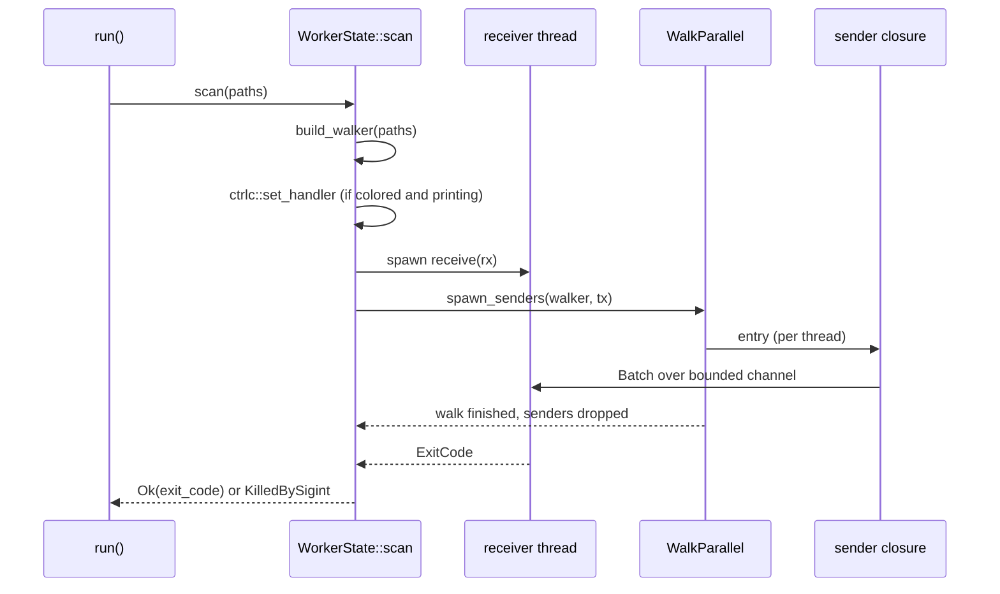
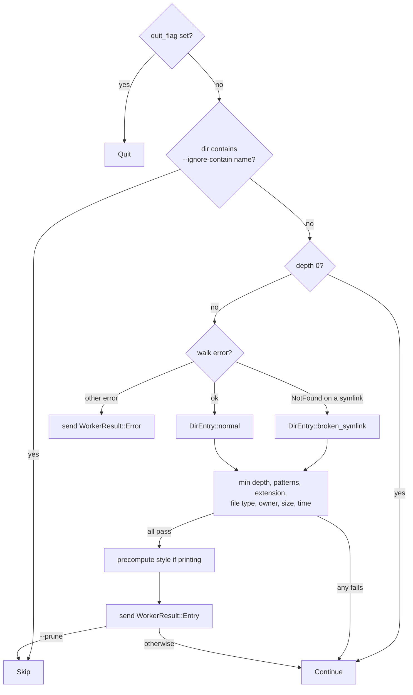

## Overview

fd's speed comes from walking the filesystem on many threads. `walk::scan` wraps the compiled patterns and the `Config` in a `WorkerState` and calls its `scan` method, which builds an `ignore::WalkParallel`, starts one receiver thread, and runs the walk on `config.threads` sender threads. Each sender runs a closure on every entry the walker yields: it applies fd's checks in a fixed order and sends the entries that pass to the receiver in batches.

Sources: [src/walk.rs:305-328](repo://src/walk.rs#L305-L328), [src/walk.rs:680-687](repo://src/walk.rs#L680-L687)

This page follows one entry from the walker to the channel. The ignore rules the walker applies before an entry reaches fd are on [[Ignore Rules and Hidden Files]], the semantics of each metadata filter are on [[Entry Filters]], and what the receiver does with the batches is on [[Result Buffering and Exit Codes]].

Sources: [src/walk.rs:347-404](repo://src/walk.rs#L347-L404), [src/walk.rs:408-440](repo://src/walk.rs#L408-L440)

## Starting the scan

Sources: [src/walk.rs:617-653](repo://src/walk.rs#L617-L653)

`scan` first builds the walker, so a malformed exclude pattern fails before any thread starts. If output is coloured and no command is set, it installs a Ctrl-C handler: the first press sets `quit_flag` and `interrupt_flag`, and a second press, detected because `fetch_or` returns true, exits at once with `ExitCode::KilledBySigint`.

Sources: [src/walk.rs:617-634](repo://src/walk.rs#L617-L634)

The channel is a `crossbeam_channel::bounded` channel of capacity `2 * config.threads`. Inside a `thread::scope`, the receiver is spawned first and `spawn_senders` then blocks on `walker.run` until the walk ends. When all senders, and with them every `Sender`, are dropped, the receiver sees the channel disconnect and returns. `scan` reports `KilledBySigint` if the interrupt flag was set, otherwise the receiver's code.

Sources: [src/walk.rs:636-653](repo://src/walk.rs#L636-L653)

## The per-entry checks

### The sender closure

`spawn_senders` passes `walker.run` a factory that each walker thread calls once to get its own closure. The closure captures the patterns, the config, the quit flag and a per-thread `BatchSender`, and returns a `WalkState` for every entry: `Continue` to go on, `Skip` to not descend into a directory, `Quit` to stop the walk.

Sources: [src/walk.rs:443-459](repo://src/walk.rs#L443-L459)

Sources: [src/walk.rs:459-535](repo://src/walk.rs#L459-L535), [src/walk.rs:536-612](repo://src/walk.rs#L536-L612)

### Before the entry is wrapped

The quit flag is checked first, so the walk winds down as soon as the receiver stops or Ctrl-C is pressed. A directory containing an `--ignore-contain` marker is skipped ([[Ignore Rules and Hidden Files]]). The search root itself, at depth 0, is never reported.

Sources: [src/walk.rs:460-484](repo://src/walk.rs#L460-L484)

A walk error for a path that no longer exists is reclassified when the path is itself a symlink: that is a broken symlink, and it becomes `DirEntry::broken_symlink(path)` so it can still be matched and reported. Any other error is sent as `WorkerResult::Error`; the receiver prints it only with `--show-errors`.

Sources: [src/walk.rs:485-506](repo://src/walk.rs#L485-L506), [src/walk.rs:37-45](repo://src/walk.rs#L37-L45)

### Filters in order

The order puts cheap checks first. `--min-depth` rejects shallow entries, and broken symlinks, whose depth is `None`, always fail it. The name is matched next "since it doesn't require metadata" ([[Pattern Matching]]), then the extension set. Only after that do the checks that may need a `stat` run: file type, owner (Unix only), size and modification time ([[Entry Filters]]).

Sources: [src/walk.rs:508-591](repo://src/walk.rs#L508-L591)

The size filter only accepts regular files: when size constraints exist, directories and other types are rejected, and so is an entry whose metadata cannot be read. The time filter requires every constraint to hold and rejects entries without a readable modification time.

Sources: [src/walk.rs:557-591](repo://src/walk.rs#L557-L591)

### After an entry passes

When results are printed with colours, the sender calls `entry.style(ls_colors)` "to compute colors in parallel", so the single receiver thread only writes. It then sends the entry; a failed send means the receiver has gone, and the walk quits. With `--prune`, a matching directory is not descended into.

Sources: [src/walk.rs:593-611](repo://src/walk.rs#L593-L611)

## Batching and backpressure

Sending one entry per channel message would make the channel a bottleneck, so senders group results into a `Batch`: an `Arc<Mutex<Option<Vec<WorkerResult>>>>` shared between the sender and the receiver.

Sources: [src/walk.rs:47-72](repo://src/walk.rs#L47-L72)

`BatchSender::send` pushes the item into its current batch. Only when the batch holds its first item is a clone of it sent over the channel; later items are appended to the same shared vector until the receiver takes it. Taking it, via `into_iter`, replaces the `Option` with `None`. The sender starts a new batch when it finds `None`, or when the vector has reached the limit, which bounds a batch "to provide some backpressure".

Sources: [src/walk.rs:74-122](repo://src/walk.rs#L74-L122)

A receiver that is waiting gets a batch as soon as the first item exists, while a busy receiver finds many items waiting in each batch. Together with the bounded channel, senders block when two batches per thread are already queued.

Sources: [src/walk.rs:101-121](repo://src/walk.rs#L101-L121), [src/walk.rs:636-636](repo://src/walk.rs#L636-L636)

The limit is 256 items, except for `--exec` with more than one thread, where it is 1 to "evenly distribute work between multiple receivers": each command thread then takes one entry at a time ([[Command Execution]]).

Sources: [src/walk.rs:449-457](repo://src/walk.rs#L449-L457)

## DirEntry

`DirEntry` in `src/dir_entry.rs` wraps either an `ignore::DirEntry` or the path of a broken symlink. It caches `metadata` and `style` in `OnceCell`s, so the type, owner, size and time filters and the colour lookup share at most one metadata call per entry. For a normal entry `file_type()` comes from the walker without a `stat`; for a broken symlink it comes from `symlink_metadata`.

Sources: [src/dir_entry.rs:11-110](repo://src/dir_entry.rs#L11-L110)

Entries compare and sort by path, which is what the receiver uses to sort buffered results. `DirEntry` also implements `lscolors::Colorable`; for a broken symlink, `file_name` takes the last path component itself because `Path::file_name` returns nothing for some component kinds.

Sources: [src/dir_entry.rs:116-167](repo://src/dir_entry.rs#L116-L167)

`stripped_path` and `into_stripped_path`, which remove the `./` prefix for display, are described on [[Printing Results]].

Sources: [src/dir_entry.rs:56-80](repo://src/dir_entry.rs#L56-L80)
