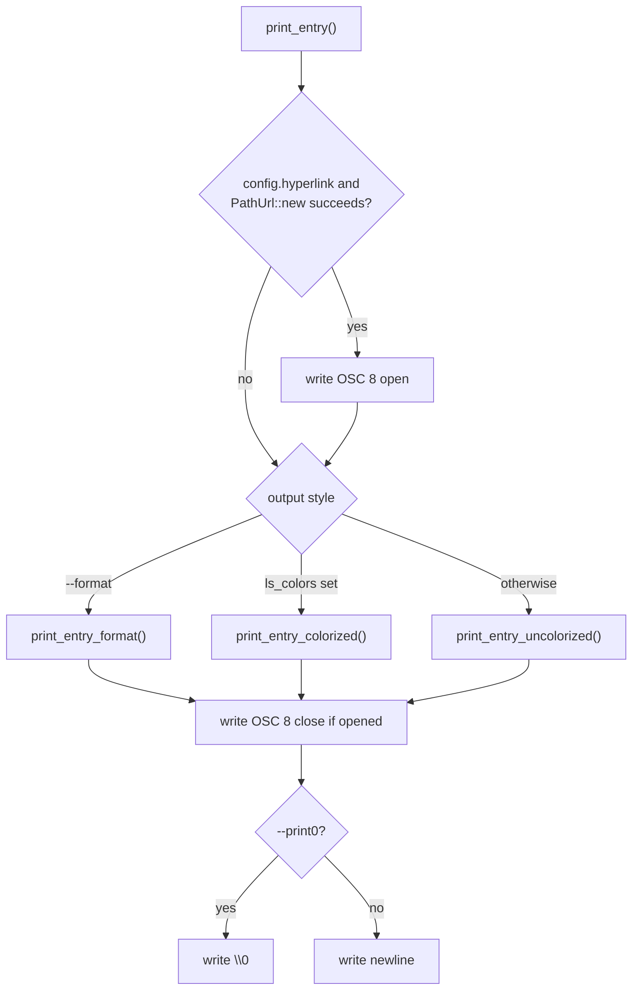

## Overview

When no command is given, every result ends in one call to `output::print_entry`, made by the receiver for each entry it prints ([[Result Buffering and Exit Codes]]). `print_entry` writes the entry's path to the receiver's buffered stdout in one of three styles, `--format` template, coloured or plain, optionally wrapped in a terminal hyperlink, and ends it with a newline or a NUL byte. All of its choices come from fields `construct_config` prepared: `format`, `ls_colors`, `hyperlink`, `path_separator`, `null_separator`, `strip_cwd_prefix` and `interactive_terminal` ([[Command-Line Options and Config]]).

Sources: [src/output.rs:16-43](repo://src/output.rs#L16-L43), [src/walk.rs:251-258](repo://src/walk.rs#L251-L258)

The functions in `src/output.rs` carry the comment "this function is performance critical and can probably be optimized", because they run once per result on the single receiver thread. Colour styles are already computed by the senders ([[Parallel Directory Walk]]).

Sources: [src/output.rs:16-17](repo://src/output.rs#L16-L17), [src/walk.rs:593-598](repo://src/walk.rs#L593-L598)

## The print_entry flow

Sources: [src/output.rs:17-43](repo://src/output.rs#L17-L43)

`--format` wins over colours: a template is printed uncoloured even on a terminal. `--print0` makes the terminator a NUL byte, which its help recommends for piping into `xargs`; it conflicts with `--list-details`.

Sources: [src/output.rs:26-42](repo://src/output.rs#L26-L42), [src/cli.rs:266-276](repo://src/cli.rs#L266-L276)

## Which path is printed

Every style starts from `DirEntry::stripped_path(config)`. When `config.strip_cwd_prefix` is true, it removes a leading `./` with `strip_current_dir`; but if the stripped path would start with `-`, it keeps `./` so that downstream tools do not read the path as an option.

Sources: [src/dir_entry.rs:56-80](repo://src/dir_entry.rs#L56-L80), [src/dir_entry.rs:112-114](repo://src/dir_entry.rs#L112-L114), [src/filesystem.rs:118-121](repo://src/filesystem.rs#L118-L121)

`strip_cwd_prefix` is only ever true when no search path was given, so `fd foo dir` prints `dir/...` as given. Without `--strip-cwd-prefix`, fd strips `./` unless `--print0`, `--exec` or `--exec-batch` is in use: the help states that the prefix is kept then "to reduce the risk of a path starting with '-' being treated as a command line option".

Sources: [src/cli.rs:674-680](repo://src/cli.rs#L674-L680), [src/cli.rs:765-773](repo://src/cli.rs#L765-L773), [src/main.rs:390-390](repo://src/main.rs#L390-L390)

With `--absolute-path`, each search root was already made absolute in `normalize_path`, so every entry under it is absolute and nothing is stripped.

Sources: [src/cli.rs:723-726](repo://src/cli.rs#L723-L726)

## Output styles

### Coloured

`print_entry_colorized` splits the path into its parent part and its last component. The offset is the length of the parent's string plus any separators that follow it. The parent part, with `--path-separator` substitution, is painted in the `LS_COLORS` style for directories; the last component is painted in the entry's own style from `entry.style(ls_colors)`, which senders usually computed already; a directory then gets a trailing separator in the directory style.

Sources: [src/output.rs:88-139](repo://src/output.rs#L88-L139)

`ls_colors` is parsed from the `LS_COLORS` environment variable, falling back to `DEFAULT_LS_COLORS`, a table generated with `vivid --color-mode 8-bit generate molokai`. The README notes that `LS_COLORS` is usually set by `dircolors` and that fd honours `NO_COLOR`.

Sources: [src/main.rs:56-60](repo://src/main.rs#L56-L60), [src/main.rs:288-292](repo://src/main.rs#L288-L292), [README.md:408-420](repo://README.md#L408-L420)

### Plain

`print_entry_uncolorized_base` converts the path with `to_string_lossy`, replaces the platform separator with `--path-separator` if one is set, sanitizes, writes it, and adds the trailing separator for directories.

Sources: [src/output.rs:141-156](repo://src/output.rs#L141-L156), [src/output.rs:12-14](repo://src/output.rs#L12-L14)

On Unix, `print_entry_uncolorized` uses that path only when stdout is a terminal or a custom separator is set. Otherwise, output is going to a pipe or file and fd writes the path's raw bytes with `as_bytes()`, so "invalid UTF-8 filenames reach downstream tools intact". Other platforms always use the lossy path.

Sources: [src/output.rs:158-182](repo://src/output.rs#L158-L182)

### Format template

`print_entry_format` expands `config.format` with the stripped path and the custom separator, converts the result lossily to a string, and sanitizes it. It adds no trailing separator. The template syntax is on [[Format Templates]].

Sources: [src/output.rs:68-86](repo://src/output.rs#L68-L86)

### Trailing separator

`print_trailing_slash` writes `config.actual_path_separator`, the custom separator or the platform one, after every directory, using the directory style when colouring. Entries whose file type is unknown get none.

Sources: [src/output.rs:45-66](repo://src/output.rs#L45-L66), [src/main.rs:257-263](repo://src/main.rs#L257-L263)

## Path separators

`--path-separator` replaces the platform separator in printed paths; its help gives the defaults as `/` on Unix and `\` on Windows. On Windows under MSYS or MSYS2, which set `MSYSTEM`, fd defaults to `/`. The coloured and plain styles replace `std::path::MAIN_SEPARATOR` characters in the string, while templates rebuild the path from its components ([[Format Templates]]).

Sources: [src/cli.rs:641-650](repo://src/cli.rs#L641-L650), [src/filesystem.rs:123-136](repo://src/filesystem.rs#L123-L136), [src/output.rs:12-14](repo://src/output.rs#L12-L14)

## Hyperlinks

`--hyperlink` (alias `--hyper`) defaults to `never`; given without a value it means `auto`, which follows the colour decision. It has no effect with `--exec` or `--exec-batch`, since those never call `print_entry`.

Sources: [src/cli.rs:532-548](repo://src/cli.rs#L532-L548), [src/main.rs:293-297](repo://src/main.rs#L293-L297)

When enabled, `print_entry` builds a `PathUrl` from the entry's absolute path and writes the OSC 8 sequence `ESC ]8;;URL ESC \` before the path and `ESC ]8;; ESC \` after it. If the absolute path cannot be computed, the entry is printed without a link.

Sources: [src/output.rs:18-36](repo://src/output.rs#L18-L36), [src/hyperlink.rs:5-11](repo://src/hyperlink.rs#L5-L11)

`PathUrl` displays as `file://`, the host, then the path bytes. On Unix the host is the machine's hostname, looked up once with `gethostname` and cached; elsewhere it is `/`. `encode` keeps ASCII letters, digits and `/ : - . _ ~`, turns `\` into `/` on Windows, and percent-encodes every other byte. Its comment explains that all non-ASCII bytes are encoded because, notably on Windows, the path bytes may not be valid UTF-8.

Sources: [src/hyperlink.rs:13-62](repo://src/hyperlink.rs#L13-L62)

## Terminal sanitization

File names can contain bytes a terminal interprets, so a crafted name could rewrite the screen, forge output, set the clipboard or plant a link. `sanitize.rs` exists "to prevent terminal escape injection via filenames". `maybe_sanitize` escapes only when the output is a terminal (`config.interactive_terminal`); on pipes and files the text passes through unchanged and without copying.

Sources: [src/sanitize.rs:1-1](repo://src/sanitize.rs#L1-L1), [src/sanitize.rs:48-55](repo://src/sanitize.rs#L48-L55)

`needs_escape` flags every control character except tab, which covers C0, C1 and DEL, plus invisible or reordering characters: soft hyphen, the Mongolian vowel separator, zero-width characters and LRM/RLM, bidi embeddings and overrides, word joiners and related invisibles, the BOM, interlinear annotation characters, and language tags. `sanitize_for_terminal` returns the input borrowed when nothing needs escaping, and otherwise replaces each flagged character with `\xNN` (code points up to `0xFF`) or `\u{NNNN}`, keeping the original value visible.

Sources: [src/sanitize.rs:6-46](repo://src/sanitize.rs#L6-L46)

The tests document the attacks this blocks and what it leaves alone.

Sources: [src/sanitize.rs:57-168](repo://src/sanitize.rs#L57-L168)

| Input | Result |
| --- | --- |
| OSC 52 clipboard payload `innocent\x1b]52;c;...` | `\x1B` escaped |
| Carriage return `A\rFAKE OUTPUT` | `A\x0DFAKE OUTPUT` |
| C1 CSI `\u{9b}31m` | `\x9B31m` |
| Bidi override `safe\u{202E}fil\u{202D}gnp.exe` | `safe\u{202E}fil\u{202D}gnp.exe` |
| `résumé.pdf`, `文档.txt`, `🦀.rs`, `a\tb` | unchanged |
| Variation selectors, private-use icon characters | unchanged |

Sources: [src/sanitize.rs:57-168](repo://src/sanitize.rs#L57-L168)

Sanitization applies to every terminal output path: the parent and basename in coloured output, the plain path, the expanded template, and error messages through `print_error`.

Sources: [src/output.rs:120-128](repo://src/output.rs#L120-L128), [src/output.rs:153-153](repo://src/output.rs#L153-L153), [src/output.rs:84-84](repo://src/output.rs#L84-L84), [src/error.rs:5-9](repo://src/error.rs#L5-L9)
