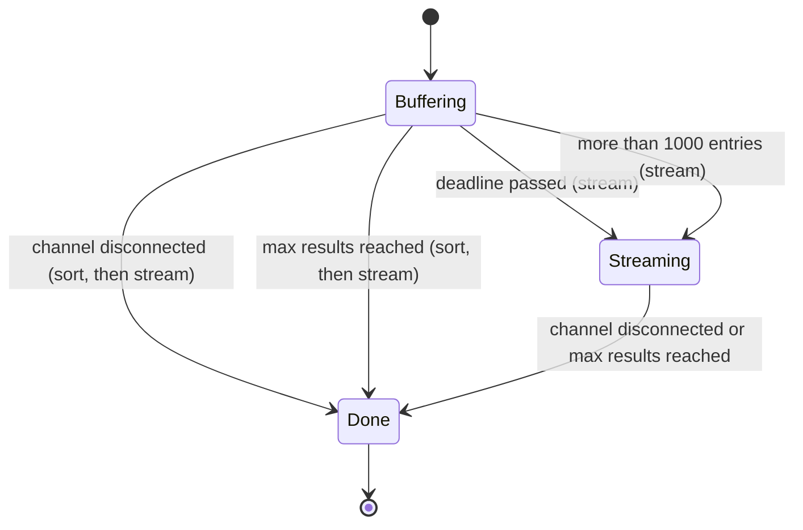

## Overview

All sender threads feed one receiver thread, and the receiver decides what fd prints, in which order, when it stops, and which exit code the process returns. `WorkerState::receive` picks the receiver's job from the configuration: with `--exec` or `--exec-batch` the batches go to command jobs, and otherwise a `ReceiverBuffer` writes each entry to a `BufWriter` around the locked stdout.

Sources: [src/walk.rs:406-440](repo://src/walk.rs#L406-L440)

This page follows the printing receiver and the `ExitCode` values every path ends in. How batches are produced is on [[Parallel Directory Walk]], how one entry is formatted is on [[Printing Results]], and the command jobs are on [[Command Execution]].

Sources: [src/walk.rs:252-267](repo://src/walk.rs#L252-L267)

## Choosing the receiver

| Configuration | Receiver |
| --- | --- |
| No command | `ReceiverBuffer::new(self, rx, stdout).process()` on the receiver thread |
| `--exec-batch` or `--list-details` | `exec::batch` over all results, on the receiver thread |
| `--exec` | `config.threads` scoped threads, each running `exec::job` on a clone of the channel; their exit codes are merged |

Sources: [src/walk.rs:408-440](repo://src/walk.rs#L408-L440)

In every case the receiver flattens the `Batch` values back into individual `WorkerResult`s. The `--exec` threads compete for batches on the same channel, which is why senders use a batch limit of 1 in that mode.

Sources: [src/walk.rs:414-425](repo://src/walk.rs#L414-L425), [src/walk.rs:449-457](repo://src/walk.rs#L449-L457)

## Buffering, then streaming

### The two modes

A parallel walk produces entries in no fixed order. `ReceiverBuffer` starts in `ReceiverMode::Buffering`, which its comment describes as "still buffering in order to sort the results, if the search finishes fast enough", and switches to `Streaming`, where each entry is printed as it arrives. The deadline for the switch is now plus `--max-buffer-time` (a hidden option in milliseconds), defaulting to `DEFAULT_MAX_BUFFER_TIME` of 100 ms; the buffer is pre-allocated for `MAX_BUFFER_LENGTH`, 1000 entries.

Sources: [src/walk.rs:26-35](repo://src/walk.rs#L26-L35), [src/walk.rs:124-171](repo://src/walk.rs#L124-L171), [src/cli.rs:559-564](repo://src/cli.rs#L559-L564)

### The receive loop

`process` calls `poll` until it returns an `Err(ExitCode)`, then sets `quit_flag` so the senders stop walking, and returns the code. `recv` waits with `recv_deadline(self.deadline)` while buffering and with a plain blocking `recv` while streaming.

Sources: [src/walk.rs:173-195](repo://src/walk.rs#L173-L195)

Sources: [src/walk.rs:198-293](repo://src/walk.rs#L198-L293)

For each entry in a batch, `poll` pushes to the buffer while buffering and switches to streaming once the buffer holds more than `MAX_BUFFER_LENGTH` entries; while streaming it prints the entry directly. A `Timeout` from `recv` switches to streaming, and `Disconnected`, meaning every sender has finished, calls `stop`.

Sources: [src/walk.rs:198-249](repo://src/walk.rs#L198-L249)

### Ordering guarantee

Only `stop` sorts: if the receiver is still buffering when the walk ends, `self.buffer.sort()` orders the entries by path (the `Ord` on `DirEntry`) before they are printed. A search that finishes within the deadline and under 1000 results therefore prints sorted output; any longer search prints the buffered entries unsorted, followed by the rest in arrival order.

Sources: [src/walk.rs:269-293](repo://src/walk.rs#L269-L293), [src/dir_entry.rs:132-137](repo://src/dir_entry.rs#L132-L137)

### Flushing

`stream` prints the whole buffer and flushes. While streaming, `poll` flushes after a batch only if the channel is empty, so output is written in large chunks during a busy walk and appears promptly when results trickle in.

Sources: [src/walk.rs:235-238](repo://src/walk.rs#L235-L238), [src/walk.rs:269-279](repo://src/walk.rs#L269-L279)

## Stopping early

`--quiet` (alias `--has-results`) prints nothing: the first entry returns `Err(ExitCode::HasResults(true))` at once, and the quit flag ends the walk. If the walk ends without an entry, `stop` returns `HasResults(false)`.

Sources: [src/walk.rs:203-206](repo://src/walk.rs#L203-L206), [src/walk.rs:281-293](repo://src/walk.rs#L281-L293), [src/cli.rs:588-601](repo://src/cli.rs#L588-L601)

`--max-results N` (or `-1` for one) counts printed or buffered entries and calls `stop` when the count reaches the limit, so a buffered result set is still sorted before printing. clap rejects combining these options with `--exec`, `--exec-batch` or `--list-details`.

Sources: [src/walk.rs:220-225](repo://src/walk.rs#L220-L225), [src/cli.rs:29-30](repo://src/cli.rs#L29-L30), [src/cli.rs:759-763](repo://src/cli.rs#L759-L763)

Filesystem errors arrive as `WorkerResult::Error` and are printed only with `--show-errors`, which the help describes as covering insufficient permissions or dead symlinks. They never change the exit code.

Sources: [src/walk.rs:227-231](repo://src/walk.rs#L227-L231), [src/cli.rs:603-611](repo://src/cli.rs#L603-L611)

## Output errors and Ctrl-C

`print` calls `output::print_entry`. A write error other than `BrokenPipe` prints "Could not write to output" and ends with `GeneralError`. A broken pipe is ignored at that point, but the next `flush` fails, and `flush` treats any failure as "Probably a broken pipe" and also ends with `GeneralError`.

Sources: [src/walk.rs:251-267](repo://src/walk.rs#L251-L267), [src/walk.rs:295-302](repo://src/walk.rs#L295-L302)

After every printed entry, `print` checks `interrupt_flag`, set by the Ctrl-C handler that `scan` installs when printing with colour. On an interrupt it flushes, ignoring errors, and returns `KilledBySigint`; `scan` also reports `KilledBySigint` whenever the flag is set.

Sources: [src/walk.rs:260-264](repo://src/walk.rs#L260-L264), [src/walk.rs:621-652](repo://src/walk.rs#L621-L652)

## Exit codes

`ExitCode` has four variants, one of which carries a flag, converted to a process status by `From<ExitCode> for i32`.

Sources: [src/exit_codes.rs:6-23](repo://src/exit_codes.rs#L6-L23)

| Value | Status | Produced by |
| --- | --- | --- |
| `Success` | 0 | a normal run |
| `HasResults(true)` | 0 | `--quiet` with a match |
| `HasResults(false)` | 1 | `--quiet` without a match |
| `GeneralError` | 1 | any error, including a failed command |
| `KilledBySigint` | 130 | Ctrl-C |

Sources: [src/exit_codes.rs:6-23](repo://src/exit_codes.rs#L6-L23)

`ExitCode::exit` ends the process. For `KilledBySigint` on Unix it first restores the default `SIGINT` handler and raises `SIGINT`, so the parent shell sees fd killed by the signal; `process::exit(130)` only runs if that does not terminate the process.

Sources: [src/exit_codes.rs:25-44](repo://src/exit_codes.rs#L25-L44)

`merge_exitcodes` combines the codes of several commands or threads: any non-zero code yields `GeneralError`, so an interrupt among them also becomes `GeneralError`, and otherwise the result is `Success`.

Sources: [src/exit_codes.rs:46-51](repo://src/exit_codes.rs#L46-L51), [src/exit_codes.rs:62-84](repo://src/exit_codes.rs#L62-L84)

## Error messages

Every error fd reports goes through `print_error`, which writes `[fd error]: ` and the message to stderr, sanitized with `maybe_sanitize` when stderr is a terminal so that a file name in a message cannot inject escape sequences ([[Printing Results]]). `main` uses it for any `anyhow::Error` returned by `run`, printed with `{err:#}` to include the context chain, and then exits with `GeneralError`.

Sources: [src/error.rs:1-9](repo://src/error.rs#L1-L9), [src/main.rs:62-73](repo://src/main.rs#L62-L73)
