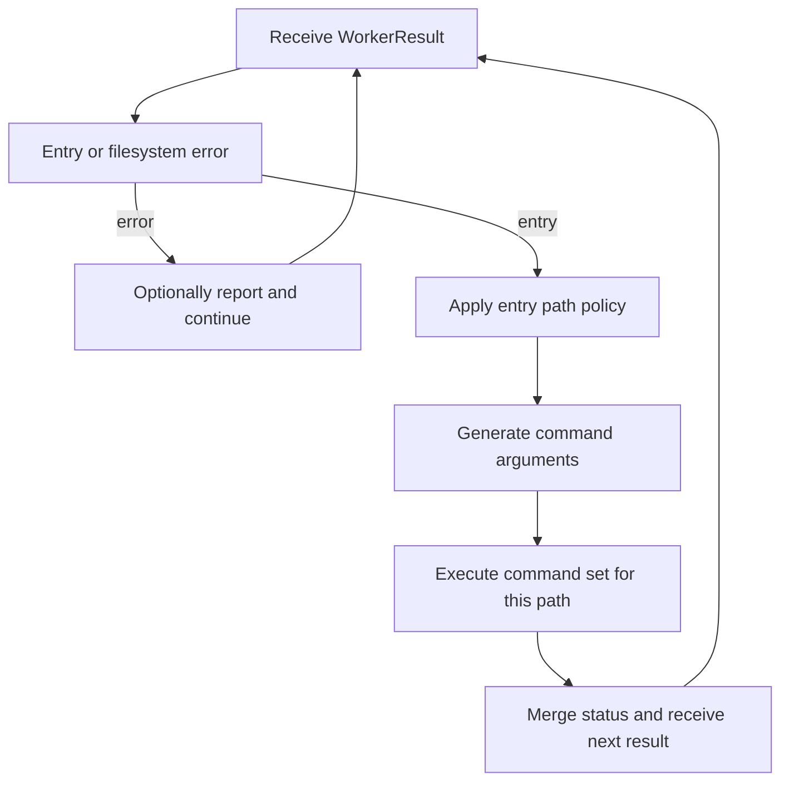

## Overview

Command mode consumes accepted paths as arguments to external processes. `--exec` or `-x` runs commands per match, while `--exec-batch` or `-X` collects paths into command invocations. `WorkerState::receive` chooses the execution consumer instead of the printing receiver. [[Ignore Rules and Traversal]] describes the unchanged discovery side, and [[Result Output]] documents the shared placeholder transformations and entry path representation used before argument generation.

Sources: [src/cli.rs:882-934](repo://src/cli.rs#L882-L934), [src/walk.rs:408-440](repo://src/walk.rs#L408-L440), [src/exec/job.rs:33-63](repo://src/exec/job.rs#L33-L63)

## Command arguments and templates

Place `-x` or `-X` after the search options, pattern, and roots. Both options accept hyphen-prefixed values and consume following arguments as command arguments. A semicolon terminates a command template; CLI help uses `\;` to protect it from the calling shell when more `fd` options must follow. The options can be repeated to define command sets, but per-entry and batch modes conflict with each other and with detailed listing. The execution group also conflicts with quiet and result-limit options.

Sources: [src/cli.rs:21-30](repo://src/cli.rs#L21-L30), [src/cli.rs:861-872](repo://src/cli.rs#L861-L872), [src/cli.rs:882-934](repo://src/cli.rs#L882-L934)

`Exec::from_arg_matches` reads grouped option occurrences and constructs a `CommandSet`. Each `CommandTemplate` parses every argument with `FormatTemplate::parse`. If no argument contains a path token, it appends an implicit `{}` argument. If the command is empty, validation returns “No executable provided for --exec or --exec-batch” rather than allowing discovered paths to become accidental executables.

Sources: [src/cli.rs:861-874](repo://src/cli.rs#L861-L874), [src/exec/mod.rs:220-255](repo://src/exec/mod.rs#L220-L255)

Generation constructs `argmax::Command` from the generated first argument and adds each remaining generated argument directly with `try_arg`. There is no shell evaluation step in this path: expansion is the format-template transformation applied separately to each argument. The CLI example `fd -e jpg -x convert {} {.}.png` uses two path transformations; [[Result Output]] owns the complete placeholder catalogue and brace-escaping rules.

Sources: [src/exec/mod.rs:262-271](repo://src/exec/mod.rs#L262-L271), [src/cli.rs:900-917](repo://src/cli.rs#L900-L917), [src/fmt/mod.rs:112-140](repo://src/fmt/mod.rs#L112-L140)

## Per-match jobs

In per-entry mode, `receive` starts one scoped job thread for each configured thread. Every thread takes a clone of the receiver and runs `exec::job`, so work is distributed across the pool. The CLI explicitly provides no execution-order guarantee; `--threads=1` makes command execution sequential. Each job turns an entry into its configured display path and invokes the command set with the path-separator and NUL-output settings.

Sources: [src/walk.rs:411-432](repo://src/walk.rs#L411-L432), [src/exec/job.rs:11-40](repo://src/exec/job.rs#L11-L40), [src/cli.rs:894-899](repo://src/cli.rs#L894-L899)

Sources: [src/exec/job.rs:19-43](repo://src/exec/job.rs#L19-L43), [src/exec/mod.rs:76-87](repo://src/exec/mod.rs#L76-L87), [src/exec/mod.rs:266-271](repo://src/exec/mod.rs#L266-L271)

With more than one thread, child stdout and stderr are captured. `OutputBuffer` retains each command's bytes and writes them while holding both output locks, preventing another job's buffered output from being written concurrently. With one thread, commands are spawned without that capture mode so intermediate output can be viewed and interacted with. `--print0` appends a NUL to stdout after the command set's output for an entry; it does not transform the child's own line delimiters.

Sources: [src/exec/job.rs:16-17](repo://src/exec/job.rs#L16-L17), [src/exec/command.rs:18-56](repo://src/exec/command.rs#L18-L56), [src/exec/command.rs:60-98](repo://src/exec/command.rs#L60-L98)

## Batch validation

Batch mode requires a fixed executable: a token-bearing first argument is rejected. It also permits at most one argument containing path tokens. The implementation counts token-bearing arguments, so several transformations inside the same argument still occupy one batch position. A command without an explicit path token receives the implicit trailing `{}` before validation, giving the builder a position where paths can be repeated.

Sources: [src/exec/mod.rs:51-69](repo://src/exec/mod.rs#L51-L69), [src/exec/mod.rs:245-259](repo://src/exec/mod.rs#L245-L259)

`CommandBuilder::new` separates fixed arguments before the path position, the one path template, and fixed arguments after it. For every accepted path, it expands the path template into one argument. Fixed prefix arguments occur once per invocation and fixed suffix arguments are added when that invocation is finished. Batch processes inherit stdin, stdout, and stderr rather than using the per-entry output buffer.

Sources: [src/exec/mod.rs:135-188](repo://src/exec/mod.rs#L135-L188), [src/exec/mod.rs:191-200](repo://src/exec/mod.rs#L191-L200)

## Batch boundaries and multiple commands

`--batch-size` limits path arguments per invocation and requires batch mode. Zero leaves the configured count unlimited, but the builder still checks whether the next expanded argument and fixed suffix fit the operating system's command-line limit. Reaching either limit finishes the current invocation and resets the builder before adding the next path. Consequently a batch search can run the command more than once even when no positive batch size was supplied.

Sources: [src/cli.rs:492-508](repo://src/cli.rs#L492-L508), [src/exec/mod.rs:173-203](repo://src/exec/mod.rs#L173-L203)

The batch consumer filters out worker errors, optionally printing them, and streams accepted paths into `execute_batch`. That method maintains one builder per command template and pushes each path through all builders. Builders may run as limits are reached; after input ends, each remaining builder finishes. It therefore does not run every command once for each individual match. Argument order follows incoming discoveries, which the CLI documents as nondeterministic. An empty batch never launches a child because `finish` checks that its path count is positive.

Sources: [src/exec/job.rs:46-64](repo://src/exec/job.rs#L46-L64), [src/exec/mod.rs:90-119](repo://src/exec/mod.rs#L90-L119), [src/exec/mod.rs:191-203](repo://src/exec/mod.rs#L191-L203), [src/cli.rs:931-934](repo://src/cli.rs#L931-L934)

## Failures and exit status

For one path, `execute_commands` runs the generated commands in sequence. A nonzero or unavailable child exit code flushes buffered output and returns a general error before later commands for that path run. A generation or process error also returns an error; a missing executable gets a command-not-found diagnostic. The surrounding job continues with later entries and merges their statuses, and the receiver merges statuses across job threads. Any failed job therefore makes the final aggregate fail without requiring discovery to stop at its first failed command.

Sources: [src/exec/command.rs:60-115](repo://src/exec/command.rs#L60-L115), [src/exec/job.rs:19-43](repo://src/exec/job.rs#L19-L43), [src/walk.rs:430-431](repo://src/walk.rs#L430-L431), [src/exit_codes.rs:46-50](repo://src/exit_codes.rs#L46-L50)

A batch child returning failure marks its builder's status as a general error, then resets it so later batches can run. An I/O error building, extending, or finishing a command returns immediately through `handle_cmd_error`. General errors map to process status 1; successful execution, including no discovered paths, maps to 0. Error messages use `print_error`, which sanitizes text when stderr is a terminal and adds the fd error prefix.

Sources: [src/exec/mod.rs:100-119](repo://src/exec/mod.rs#L100-L119), [src/exec/mod.rs:191-206](repo://src/exec/mod.rs#L191-L206), [src/exit_codes.rs:14-22](repo://src/exit_codes.rs#L14-L22), [src/error.rs:5-8](repo://src/error.rs#L5-L8)

## Detailed listing

`--list-details` is implemented by constructing a batch command set when no explicit command exists. Most Unix targets select `ls -l -h -d` with an explicit color setting. On macOS and the listed BSD targets, configuration probes `gls --version`, uses GNU-style arguments when available, and otherwise selects BSD `ls` arguments. Windows probes for GNU `ls` and rejects detailed listing if unavailable; unsupported platforms also return an error. The resulting listing follows batch execution rather than `output::print_entry` formatting.

Sources: [src/main.rs:395-429](repo://src/main.rs#L395-L429), [src/main.rs:430-491](repo://src/main.rs#L430-L491), [src/walk.rs:411-415](repo://src/walk.rs#L411-L415)
