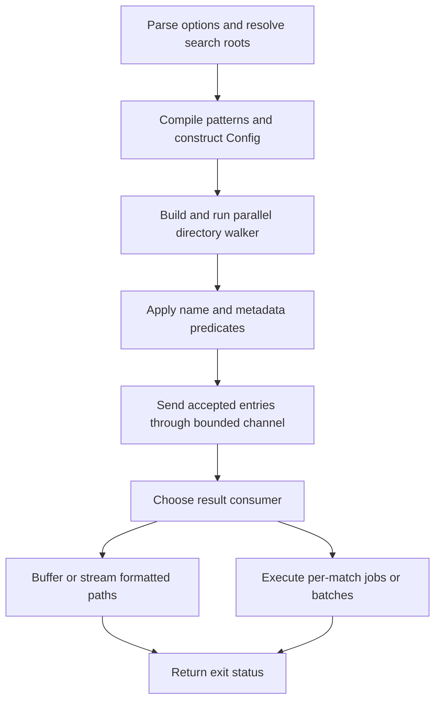

## Overview

`fd` finds entries in a filesystem using regular expressions or glob patterns. Its command line starts with a search pattern and optional root directories; without either, it searches the current directory for every visible entry. Hidden entries and ignore rules shape the default search, and smart case determines whether letter case matters. The package is named `fd-find`, while the executable built from this checkout is `fd`.

Sources: [src/cli.rs:21-60](repo://src/cli.rs#L21-L60), [src/cli.rs:628-672](repo://src/cli.rs#L628-L672), [src/main.rs:248-255](repo://src/main.rs#L248-L255), [Cargo.toml:15-31](repo://Cargo.toml#L15-L31)

The program has one discovery pipeline and two consumers. Accepted paths either become printed results or inputs to external commands. `Config` carries the selected behavior into the walker; `Config::is_printing` identifies the output branch by checking whether a command exists. Begin with [[Quickstart]] to build the checkout and run a first search, then follow the subsystem pages when a default or an execution mode needs closer inspection.

Sources: [src/main.rs:75-112](repo://src/main.rs#L75-L112), [src/config.rs:90-98](repo://src/config.rs#L90-L98), [src/config.rs:138-143](repo://src/config.rs#L138-L143), [src/walk.rs:408-440](repo://src/walk.rs#L408-L440)

## Documentation map

| Area | What it does | Page |
| --- | --- | --- |
| First invocation | Build, test, and perform a search from this checkout | [[Quickstart]] |
| Search preparation | Resolve roots and compile the pattern and case rules | [[Search Patterns and Roots]] |
| Discovery | Apply visibility rules and traverse directories in parallel | [[Ignore Rules and Traversal]] |
| Candidate selection | Check extension, type, ownership, size, and modification time | [[File Filters]] |
| Presentation | Buffer results, render paths, and expand format placeholders | [[Result Output]] |
| External commands | Schedule per-match jobs or batches and aggregate failures | [[Command Execution]] |

Sources: [Cargo.toml:20-31](repo://Cargo.toml#L20-L31), [src/main.rs:75-112](repo://src/main.rs#L75-L112), [src/walk.rs:347-403](repo://src/walk.rs#L347-L403), [src/walk.rs:526-591](repo://src/walk.rs#L526-L591), [src/output.rs:17-86](repo://src/output.rs#L17-L86), [src/exec/job.rs:11-64](repo://src/exec/job.rs#L11-L64)

## Main flow

Sources: [src/main.rs:75-112](repo://src/main.rs#L75-L112), [src/walk.rs:408-440](repo://src/walk.rs#L408-L440), [src/walk.rs:514-542](repo://src/walk.rs#L514-L542), [src/walk.rs:544-611](repo://src/walk.rs#L544-L611), [src/walk.rs:617-652](repo://src/walk.rs#L617-L652)

1. `run` parses `Opts`, changes the working directory if requested, and validates roots before building matchers; [[Search Patterns and Roots]] follows this preparation through the last compiled regex.
2. `WorkerState::build_walker` transfers visibility, filesystem, and depth settings into `WalkBuilder`; [[Ignore Rules and Traversal]] explains which branches can be visited.
3. The worker callback tests names before metadata predicates; [[File Filters]] explains how an entry survives the remaining checks.
4. Accepted entries cross a bounded channel into `receive`; [[Result Output]] follows the printing consumer and [[Command Execution]] follows the command consumers.

Sources: [src/main.rs:75-112](repo://src/main.rs#L75-L112), [src/walk.rs:347-365](repo://src/walk.rs#L347-L365), [src/walk.rs:514-575](repo://src/walk.rs#L514-L575), [src/walk.rs:408-440](repo://src/walk.rs#L408-L440), [src/walk.rs:636-645](repo://src/walk.rs#L636-L645)

## Design decisions

Name matching comes before metadata work because it does not require metadata. The worker first checks every pattern, then extension and type, followed by ownership, size, and time constraints. A rejected name therefore never reaches those later predicates. This order is useful when reading the implementation: the discovery callback is the place where separately configured criteria become one acceptance decision.

Sources: [src/walk.rs:514-591](repo://src/walk.rs#L514-L591)

Discovery and consumption communicate through batches with a bounded channel. `BatchSender` limits a batch to provide backpressure, while the scan bounds the channel to twice the configured thread count. For parallel per-entry commands the batch size becomes one to distribute work evenly among receivers. The implementation can therefore feed either one output receiver or multiple execution receivers without changing the matching callback's result type.

Sources: [src/walk.rs:74-121](repo://src/walk.rs#L74-L121), [src/walk.rs:408-438](repo://src/walk.rs#L408-L438), [src/walk.rs:449-457](repo://src/walk.rs#L449-L457), [src/walk.rs:636-645](repo://src/walk.rs#L636-L645)

Printed results begin in a buffer so that a quickly completed search can be sorted. The default deadline is 100 milliseconds; exceeding the deadline or the 1,000-entry buffer threshold switches to streaming. Sorting occurs only when stopping while still buffering, so discovery does not promise a globally sorted result stream. [[Result Output]] describes the state transition and the result-limit behavior that shares this receiver.

Sources: [src/walk.rs:124-169](repo://src/walk.rs#L124-L169), [src/walk.rs:198-245](repo://src/walk.rs#L198-L245), [src/walk.rs:269-292](repo://src/walk.rs#L269-L292)

Relative paths retain a `./` prefix by default for command execution and NUL-separated output to reduce the risk that a path beginning with `-` becomes a command option. Ordinary display can strip it. This policy is selected centrally while constructing configuration, then applied to entries for both printed and command output; [[Result Output]] owns the detailed path representation rules.

Sources: [src/cli.rs:674-680](repo://src/cli.rs#L674-L680), [src/cli.rs:765-773](repo://src/cli.rs#L765-L773), [src/main.rs:378-391](repo://src/main.rs#L378-L391), [src/exec/job.rs:33-39](repo://src/exec/job.rs#L33-L39)

## Completion and failure

Startup failures are returned to `main`, printed through the error helper, and converted to a general-error exit. During traversal, filesystem errors travel alongside entries and are displayed only when configured. The normal printing receiver returns success even with no matches; quiet mode instead distinguishes whether any result exists. Command jobs merge failures across entries, so finding a path and successfully processing it are separate outcomes.

Sources: [src/main.rs:62-72](repo://src/main.rs#L62-L72), [src/walk.rs:227-231](repo://src/walk.rs#L227-L231), [src/walk.rs:281-292](repo://src/walk.rs#L281-L292), [src/exec/job.rs:19-43](repo://src/exec/job.rs#L19-L43), [src/exit_codes.rs:14-22](repo://src/exit_codes.rs#L14-L22)
