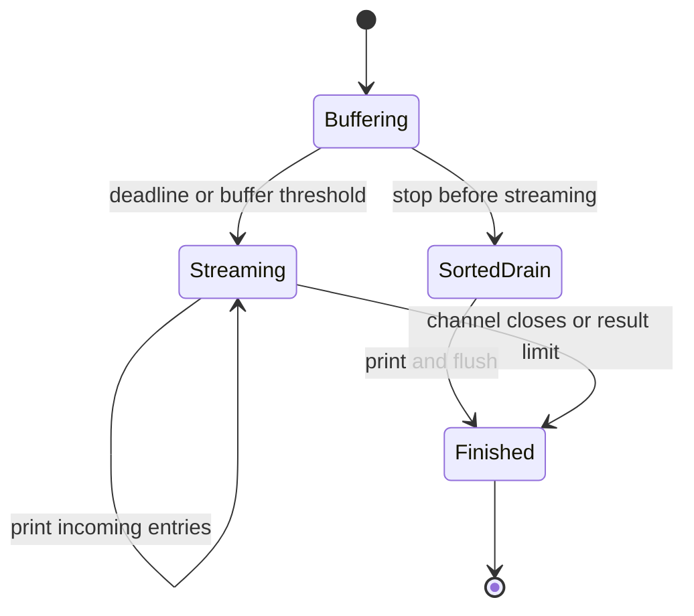

## Overview

When no external command is configured, `WorkerState::receive` locks stdout, wraps it in a buffered writer, and hands results to `ReceiverBuffer`. That receiver controls timing, ordering, limits, and exit status; `output::print_entry` renders each accepted entry. [[Ignore Rules and Traversal]] owns discovery and transport, while [[Command Execution]] describes the alternate consumer. Format templates are shared by output and execution, and their transformations are documented here.

Sources: [src/walk.rs:408-440](repo://src/walk.rs#L408-L440), [src/output.rs:17-42](repo://src/output.rs#L17-L42), [src/exec/mod.rs:220-233](repo://src/exec/mod.rs#L220-L233)

## Buffering and ordering

The receiver begins in buffering mode with a deadline based on `--max-buffer-time`, or 100 milliseconds by default. It collects entries until completion, timeout, or a buffer length greater than 1,000. Completion while still buffering sorts entries by path and prints them. Timeout or exceeding the threshold instead drains the buffer in discovery order and switches permanently to streaming; later entries print as they arrive.

Sources: [src/walk.rs:124-169](repo://src/walk.rs#L124-L169), [src/walk.rs:198-245](repo://src/walk.rs#L198-L245), [src/walk.rs:269-292](repo://src/walk.rs#L269-L292), [src/dir_entry.rs:132-136](repo://src/dir_entry.rs#L132-L136)

Sources: [src/walk.rs:198-245](repo://src/walk.rs#L198-L245), [src/walk.rs:269-301](repo://src/walk.rs#L269-L301)

In streaming mode, an empty input queue triggers a stdout flush before waiting again. `--max-results` stops once the receiver has counted the requested number of accepted entries; zero is treated as no limit and `-1` selects a limit of one. The limit selects received discoveries, so sorting a still-buffered subset does not turn it into the first matches of a global sorted search.

Sources: [src/walk.rs:220-238](repo://src/walk.rs#L220-L238), [src/walk.rs:281-292](repo://src/walk.rs#L281-L292), [src/cli.rs:566-586](repo://src/cli.rs#L566-L586), [src/cli.rs:759-763](repo://src/cli.rs#L759-L763)

## Quiet mode and status

`--quiet` returns immediately on the first entry without printing it. If the channel closes without an entry, stopping returns a false result status. `ExitCode` converts these into 0 for a match and 1 for no match. Ordinary printing returns success even for an empty result set; startup and output errors use the general-error status, and the interrupt status maps to 130.

Sources: [src/walk.rs:198-206](repo://src/walk.rs#L198-L206), [src/walk.rs:281-292](repo://src/walk.rs#L281-L292), [src/exit_codes.rs:14-22](repo://src/exit_codes.rs#L14-L22), [src/main.rs:62-72](repo://src/main.rs#L62-L72)

Filesystem errors are displayed only with `--show-errors` and do not become entries. A non-broken-pipe error while printing produces a diagnostic and a general error; a broken-pipe error from the entry renderer is ignored in that branch. A subsequent stdout flush failure still ends with a general error. On any receiver stop, `process` sets the quit flag so senders can stop discovering more paths.

Sources: [src/walk.rs:173-180](repo://src/walk.rs#L173-L180), [src/walk.rs:227-231](repo://src/walk.rs#L227-L231), [src/walk.rs:251-265](repo://src/walk.rs#L251-L265), [src/walk.rs:295-301](repo://src/walk.rs#L295-L301)

## Path representation and delimiters

`DirEntry::stripped_path` applies the configured current-directory-prefix policy. Even when stripping is enabled, it preserves the original path if stripping would leave a leading `-`. Automatic stripping is enabled only without explicit roots and is disabled by default for NUL output and commands. `--strip-cwd-prefix` can select always, never, or auto, with a valueless option meaning always; the leading-dash protection remains inside the entry method.

Sources: [src/dir_entry.rs:56-80](repo://src/dir_entry.rs#L56-L80), [src/cli.rs:674-680](repo://src/cli.rs#L674-L680), [src/cli.rs:765-773](repo://src/cli.rs#L765-L773), [src/main.rs:389-391](repo://src/main.rs#L389-L391)

`print_entry` chooses an explicit format first, then colored rendering, then plain rendering. After rendering and closing any hyperlink, it writes a newline or NUL according to `--print0`. Ordinary colored and plain renderers append a separator to directory entries; custom-format output uses the template result directly. A custom path separator replaces native separators, and Windows with nonempty `MSYSTEM` defaults to `/`. Windows configuration rejects a supplied separator longer than one byte.

Sources: [src/output.rs:17-86](repo://src/output.rs#L17-L86), [src/output.rs:131-155](repo://src/output.rs#L131-L155), [src/filesystem.rs:123-136](repo://src/filesystem.rs#L123-L136), [src/main.rs:234-264](repo://src/main.rs#L234-L264)

## Colors and terminal text

Color selection accepts always, never, or auto. Auto requires a terminal, ANSI support, and no nonempty `NO_COLOR` variable. Enabled colors use `LS_COLORS` or the built-in fallback. Workers compute entry styles in parallel before sending results. The colored renderer styles the parent using the directory indicator and the basename using the entry's cached style; terminal sanitization is applied to both text pieces before painting.

Sources: [src/main.rs:271-292](repo://src/main.rs#L271-L292), [src/walk.rs:593-598](repo://src/walk.rs#L593-L598), [src/output.rs:89-136](repo://src/output.rs#L89-L136), [src/dir_entry.rs:105-109](repo://src/dir_entry.rs#L105-L109)

Sanitization escapes control characters except tab, together with the listed invisible and directional Unicode ranges. Characters through byte value 255 use hexadecimal byte escapes; larger values use Unicode escapes. `maybe_sanitize` applies this only for terminal output. On Unix, uncolored piped output with no separator override writes raw OS-string bytes, preserving invalid UTF-8 filenames; colored output, formatting, separator replacement, and the non-Unix plain renderer use string rendering instead.

Sources: [src/sanitize.rs:6-55](repo://src/sanitize.rs#L6-L55), [src/output.rs:75-85](repo://src/output.rs#L75-L85), [src/output.rs:89-129](repo://src/output.rs#L89-L129), [src/output.rs:142-181](repo://src/output.rs#L142-L181)

## Hyperlinks

Hyperlinks default to never. A valueless `--hyperlink` selects auto, which follows whether color is enabled; always forces the feature. The renderer wraps displayed text in terminal hyperlink sequences when `PathUrl::new` can construct an absolute path. The target is a file URL, with a cached hostname on Unix and a slash host elsewhere. Unsafe and non-ASCII path bytes are percent encoded, and Windows backslashes become slashes.

Sources: [src/cli.rs:532-548](repo://src/cli.rs#L532-L548), [src/main.rs:293-297](repo://src/main.rs#L293-L297), [src/output.rs:17-36](repo://src/output.rs#L17-L36), [src/hyperlink.rs:7-62](repo://src/hyperlink.rs#L7-L62)

## Shared format templates

| Placeholder | Transformation |
| --- | --- |
| `{}` | Input path |
| `{/}` | Basename |
| `{//}` | Parent directory, with `.` for a bare filename's empty parent |
| `{.}` | Path with its final extension removed |
| `{/.}` | Basename with its final extension removed |
| `{{` and `}}` | Literal opening and closing braces |

Sources: [src/fmt/mod.rs:58-106](repo://src/fmt/mod.rs#L58-L106), [src/fmt/mod.rs:112-140](repo://src/fmt/mod.rs#L112-L140), [src/fmt/input.rs:6-32](repo://src/fmt/input.rs#L6-L32)

`FormatTemplate::parse` recognizes the placeholder and brace-escape strings with a cached Aho-Corasick matcher. A template with no path tokens becomes `Text`; otherwise it stores text segments and transformation tokens. Generation assembles an `OsString`, replacing separators only inside path-derived tokens and leaving literal text unchanged. Extension removal uses the final file stem, with tests preserving the hidden name `.foo`. [[Command Execution]] uses these same templates for each argument and adds its own rules for missing placeholders and batch positions.

Sources: [src/fmt/mod.rs:51-140](repo://src/fmt/mod.rs#L51-L140), [src/fmt/input.rs:11-19](repo://src/fmt/input.rs#L11-L19), [src/fmt/input.rs:56-60](repo://src/fmt/input.rs#L56-L60), [src/exec/mod.rs:220-259](repo://src/exec/mod.rs#L220-L259)
