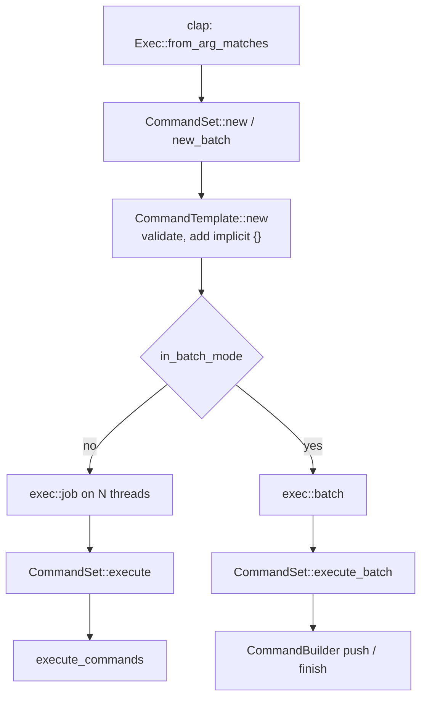

## Overview

With `--exec` (`-x`), `--exec-batch` (`-X`) or `--list-details`, fd runs programs on the matches instead of printing them. The command line is parsed into a `CommandSet` while `Config` is built, and the receiver side of the pipeline in [[Traversal and Result Pipeline]] hands entries to it. `--exec` runs the command once per entry, on several threads; `--exec-batch` runs it as few times as possible with many paths as arguments. Each argument is a template in the language of [[Format Templates and Placeholders]].

Sources: [src/exec/mod.rs:20-34](repo://src/exec/mod.rs#L20-L34), [src/walk.rs:408-440](repo://src/walk.rs#L408-L440)

Sources: [src/cli.rs:861-880](repo://src/cli.rs#L861-L880), [src/walk.rs:412-433](repo://src/walk.rs#L412-L433)

## Parsing the command

clap's derive API cannot capture grouped values, so `Exec` implements `FromArgMatches` and `Args` by hand. Both options take one or more values, allow hyphenated values, and end at a lone `;` (written `\;` in a shell). `--exec` may be given several times; each occurrence becomes a separate command that runs for every entry. The two options conflict with each other and with `--list-details`. A parse error from the command set is reported as a clap `InvalidValue` error.

Sources: [src/cli.rs:855-880](repo://src/cli.rs#L855-L880), [src/cli.rs:883-931](repo://src/cli.rs#L883-L931)

`CommandSet::new` builds `OneByOne` templates. `CommandSet::new_batch` builds `Batch` templates and rejects any command with more than one argument containing a placeholder ("Only one placeholder allowed for batch commands"), since all paths must go into one argument position.

Sources: [src/exec/mod.rs:35-70](repo://src/exec/mod.rs#L35-L70)

`CommandTemplate::new` parses each argument with `FormatTemplate::parse` and enforces three rules:

1. At least one argument is required, so fd never tries to execute the files it finds.
2. In batch mode the first argument, the program, must not contain a placeholder. In one-by-one mode a placeholder as the program is allowed.
3. If no argument contains a placeholder, a bare `{}` is appended, so `fd -e zip -x unzip` runs `unzip <path>`.

Sources: [src/exec/mod.rs:210-256](repo://src/exec/mod.rs#L210-L256)

## One command per entry

`receive` spawns `config.threads` scoped threads, each running `exec::job` over a clone of the channel receiver, and merges their codes. The walker's batch limit is set to 1 for this case so that entries are spread over the threads rather than sitting in one big batch.

Sources: [src/walk.rs:412-433](repo://src/walk.rs#L412-L433), [src/walk.rs:449-457](repo://src/walk.rs#L449-L457)

`job` loops over the received results. Walker errors are printed only with `--show-errors`. For each entry it calls `CommandSet::execute` with the stripped path, the path separator and the null-separator flag, and folds the returned code into the thread's result with `merge_exitcodes`. Output is buffered only when more than one thread is used, so with `--threads=1` a command can talk to the terminal directly.

Sources: [src/exec/job.rs:8-44](repo://src/exec/job.rs#L8-L44)

`execute` expands every command template for the entry with `generate`, and `execute_commands` runs them in order:

- With buffering, `cmd.output()` captures stdout and stderr into an `OutputBuffer`; without it, the command is spawned and waited for with inherited stdio.
- A non-zero exit stops the remaining commands for that entry, flushes the buffer and returns `GeneralError`.
- A spawn or template error flushes the buffer and goes to `handle_cmd_error`.
- When all succeed, the buffer is flushed and the result is `Success`.

Sources: [src/exec/mod.rs:76-88](repo://src/exec/mod.rs#L76-L88), [src/exec/command.rs:59-99](repo://src/exec/command.rs#L59-L99)

`OutputBuffer::write` takes the stdout and stderr locks and writes everything for one entry together, so the output of two parallel jobs does not interleave. With `--print0` it also writes a `\0` after each entry's output, even if the command printed nothing. The order in which entries are processed, and therefore the order of output, is not defined.

Sources: [src/exec/command.rs:9-57](repo://src/exec/command.rs#L9-L57), [src/cli.rs:894-897](repo://src/cli.rs#L894-L897)

## One command for many entries

For `--exec-batch`, `receive` calls `exec::batch` on the whole flattened stream on one thread. `batch` converts each entry to its stripped path, dropping errors (printed with `--show-errors`), and passes the iterator and `--batch-size` to `execute_batch`.

Sources: [src/walk.rs:412-415](repo://src/walk.rs#L412-L415), [src/exec/job.rs:46-64](repo://src/exec/job.rs#L46-L64), [src/config.rs:96-98](repo://src/config.rs#L96-L98)

`execute_batch` makes one `CommandBuilder` per command template and pushes every path into each of them. A builder splits its template into arguments before the placeholder argument (`pre_args`), the placeholder argument, and arguments after it (`post_args`). The command is an `argmax::Command` whose stdio is inherited.

Sources: [src/exec/mod.rs:90-120](repo://src/exec/mod.rs#L90-L120), [src/exec/mod.rs:123-171](repo://src/exec/mod.rs#L123-L171)

`push` expands the placeholder argument for one path and appends it. Before that it runs the current command if either of two limits is reached: `--batch-size` paths already added (0 means unlimited), or `args_would_fit` says the argument plus `post_args` would exceed the operating system's argument size limit. `finish` appends `post_args`, runs the command and records `GeneralError` if it fails, then starts a fresh command from `pre_args`. After all paths, a last `finish` runs the remainder, so a long result list becomes several invocations. A failed invocation does not stop later ones; the result is the merged code of all builders.

Sources: [src/exec/mod.rs:173-208](repo://src/exec/mod.rs#L173-L208), [src/exec/mod.rs:100-117](repo://src/exec/mod.rs#L100-L117)

## Errors

`handle_cmd_error` prints through `print_error`. If a command was not found it says `Command not found: <program>`; any other I/O error says `Problem while executing command: <error>`. Both return `GeneralError`. When the failure occurs before a command exists, as when a builder cannot be created, no program name is available and the generic message is used.

Sources: [src/exec/command.rs:101-115](repo://src/exec/command.rs#L101-L115), [src/exec/mod.rs:94-119](repo://src/exec/mod.rs#L94-L119)

## --list-details

`--list-details` is shorthand for a batch command running `ls`. `extract_command` uses the parsed `--exec` set if there is one, and otherwise, when `list_details` is set, builds `CommandSet::new_batch([cmd])` around the result of `determine_ls_command`.

Sources: [src/main.rs:395-410](repo://src/main.rs#L395-L410)

`determine_ls_command` chooses the program by platform:

| Platform | Command |
| --- | --- |
| Unix other than macOS and the BSDs | `ls -l -h -d --color=always` or `--color=never` |
| macOS, DragonFly, FreeBSD, NetBSD, OpenBSD | `gls` with the same flags if `gls --version` runs; otherwise BSD `ls -l -h -d`, plus `-G` when coloured except on NetBSD and OpenBSD |
| Windows | GNU `ls` if `ls --version` runs; otherwise an error |
| Anything else | an error |

Sources: [src/main.rs:412-494](repo://src/main.rs#L412-L494)

Short options are used on purpose so that more `ls` implementations, such as BusyBox, accept them. Since the command has no placeholder, `CommandTemplate::new` appends `{}`, and all matches are passed to a single `ls`.

Sources: [src/main.rs:413-429](repo://src/main.rs#L413-L429), [src/exec/mod.rs:250-253](repo://src/exec/mod.rs#L250-L253)
