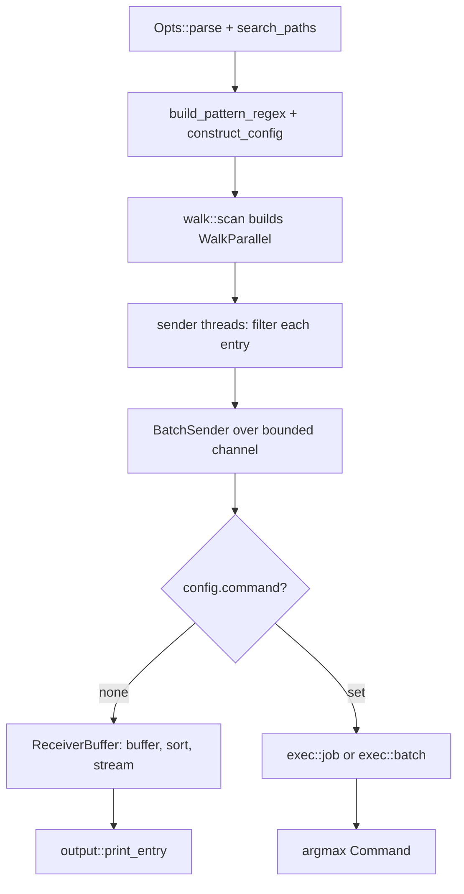

## Overview

`fd` is a command-line program that finds entries in the filesystem. It is a Rust binary (crate `fd-find`, version 10.4.2) described in its manifest as "a simple, fast and user-friendly alternative to find". It takes a regular expression or glob, walks one or more directories in parallel, drops anything the pattern, the ignore files or the filters reject, and prints the rest or runs a command on it.

Sources: [Cargo.toml:1-24](repo://Cargo.toml#L1-L24)

The crate is a single binary. `main` calls `run`, which turns the command line into compiled regexes and a `Config`, then hands both to `walk::scan`. Any error bubbles up as an `anyhow` error, is printed once by `print_error`, and becomes exit code 1.

Sources: [src/main.rs:62-112](repo://src/main.rs#L62-L112)

## Parts of the program

| Area | What it does | Page |
| --- | --- | --- |
| Command line and `Config` | Parses `Opts`, resolves search paths, compiles patterns, derives one immutable `Config` | [[Pattern and Config Setup]] |
| Walker and result channel | Runs the parallel directory walk and moves results to a receiver thread in batches | [[Traversal and Result Pipeline]] |
| Per-entry filters | Extension, type, owner, size, time and depth checks applied to each candidate | [[Entry Filters]] |
| Printing | Colours, hyperlinks, `--format`, null separator, terminal-safe escaping | [[Output Formatting and Terminal Safety]] |
| Placeholders | The `{}`, `{/}`, `{//}`, `{.}`, `{/.}` mini-language shared by `--format` and `--exec` | [[Format Templates and Placeholders]] |
| Command execution | `--exec`, `--exec-batch` and `--list-details` | [[Command Execution]] |
| Build and tests | Cargo features, Makefile, integration test harness | [[Quickstart]] |

Sources: [src/main.rs:1-15](repo://src/main.rs#L1-L15), [src/config.rs:13-20](repo://src/config.rs#L13-L20)

## Main flow

Sources: [src/main.rs:75-112](repo://src/main.rs#L75-L112), [src/walk.rs:408-440](repo://src/walk.rs#L408-L440), [src/walk.rs:617-653](repo://src/walk.rs#L617-L653)

1. `run` parses `Opts`, changes into `--base-directory`, and resolves the search paths, rejecting a pattern that looks like a path. See [[Pattern and Config Setup]].
2. Each pattern string becomes a regex, and `construct_config` decides case sensitivity, colour, depth limits and the command to run, also covered in [[Pattern and Config Setup]].
3. `scan` builds an `ignore::WalkParallel` and spawns the sender threads and one receiver; see [[Traversal and Result Pipeline]].
4. Each sender closure checks the pattern and then the cheaper-to-costlier filters on every entry; see [[Entry Filters]].
5. Survivors are put into batches on a bounded channel, which gives the walkers back-pressure; see [[Traversal and Result Pipeline]].
6. Without a command, the receiver prints entries via [[Output Formatting and Terminal Safety]]; with a command, jobs expand templates from [[Format Templates and Placeholders]] and spawn processes as described in [[Command Execution]].

Sources: [src/main.rs:75-112](repo://src/main.rs#L75-L112), [src/walk.rs:347-404](repo://src/walk.rs#L347-L404), [src/walk.rs:443-470](repo://src/walk.rs#L443-L470), [src/walk.rs:515-524](repo://src/walk.rs#L515-L524), [src/walk.rs:600-604](repo://src/walk.rs#L600-L604), [src/walk.rs:636-646](repo://src/walk.rs#L636-L646)

## Design decisions

**Smart case.** The search is case-sensitive only if `--case-sensitive` is given or a pattern contains a literal uppercase character. `ignore_case` overrides both. The check parses the regex into its syntax tree and looks only at literals and character classes.

Sources: [src/main.rs:249-255](repo://src/main.rs#L249-L255), [src/regex_helper.rs:4-37](repo://src/regex_helper.rs#L4-L37)

**Ignore by default.** Hidden entries, `.fdignore`, VCS ignore files and the global ignore file are all honoured unless `--hidden`, `--no-ignore` and friends switch them off. `-u`-style aliases (`rg_alias_ignore`) turn all of them off at once.

Sources: [src/main.rs:313-320](repo://src/main.rs#L313-L320), [src/cli.rs:742-745](repo://src/cli.rs#L742-L745)

**Byte regexes.** Patterns are compiled with `regex::bytes`, and paths are handed to them as raw bytes on Unix, so file names that are not valid UTF-8 still match.

Sources: [src/main.rs:26](repo://src/main.rs#L26), [src/main.rs:541-555](repo://src/main.rs#L541-L555), [src/filesystem.rs:102-116](repo://src/filesystem.rs#L102-L116)

**Buffer first, then stream.** The receiver collects results for up to 100 ms (or 1,000 entries) and sorts them, so short searches print in a stable order. After that it prints as results arrive.

Sources: [src/walk.rs:124-127](repo://src/walk.rs#L124-L127), [src/walk.rs:282-293](repo://src/walk.rs#L282-L293)

**Terminal safety.** When stdout or stderr is a terminal, control, bidi and zero-width characters in file names are printed as escapes, so a hostile file name cannot inject escape sequences. Pipes and files get the raw bytes.

Sources: [src/sanitize.rs:1-55](repo://src/sanitize.rs#L1-L55), [src/error.rs:1-9](repo://src/error.rs#L1-L9)

**Colour and hyperlinks follow the terminal.** `--color auto` needs an interactive stdout and an unset or empty `NO_COLOR`; hyperlinks follow colour unless forced. `LS_COLORS` is used if set, otherwise a built-in palette.

Sources: [src/main.rs:277-297](repo://src/main.rs#L277-L297)

**jemalloc.** On most Unix targets, with the `use-jemalloc` feature, fd swaps in `tikv_jemallocator` for performance. The cfg list in `main.rs` must be kept in step with `Cargo.toml`, and macOS is excluded because of a known jemalloc bug.

Sources: [src/main.rs:38-54](repo://src/main.rs#L38-L54)

**Exit codes.** Success is 0, `--quiet` maps "found something" to 0 and "found nothing" to 1, errors are 1 and Ctrl-C is 130. Several command jobs merge into 1 if any failed.

Sources: [src/exit_codes.rs:6-51](repo://src/exit_codes.rs#L6-L51)
