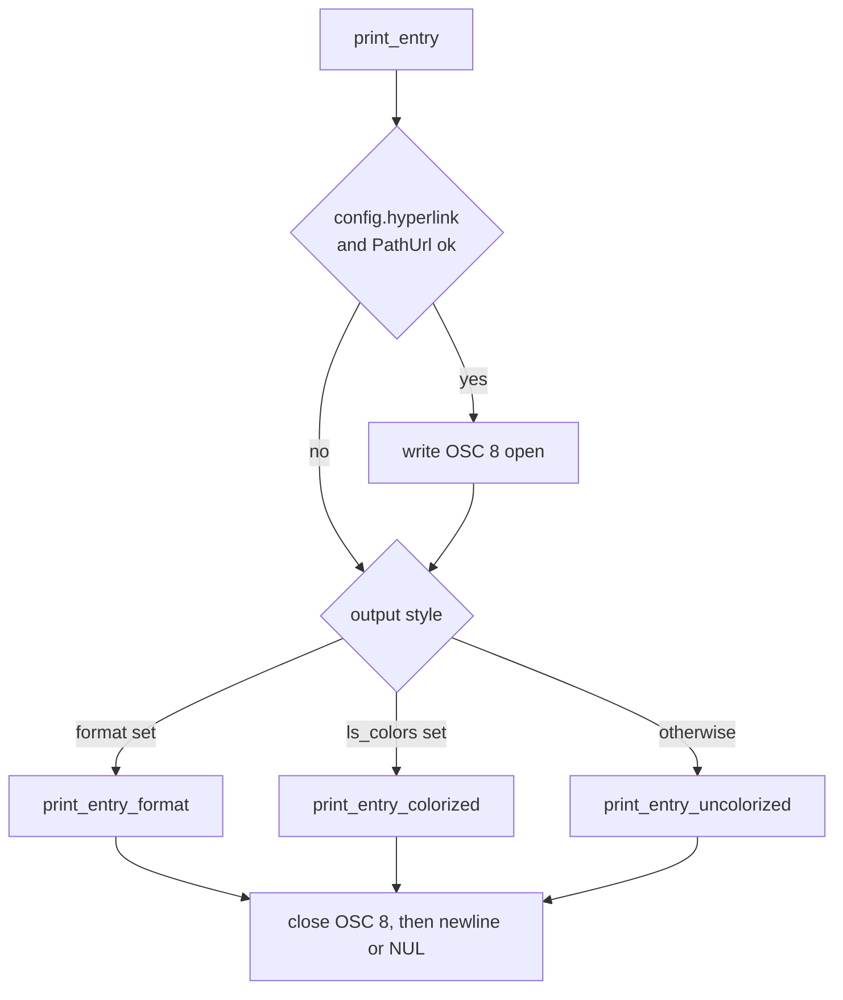

## Overview

When no command is given, each entry that survives [[Entry Filters]] is written by `output::print_entry`, called from the receiver described in [[Traversal and Result Pipeline]]. The function picks one of three output styles, wraps it in an optional hyperlink, and ends the record with a newline or a NUL byte. A file name is attacker-controlled data, so everything printed to a terminal goes through `sanitize.rs` first.

Sources: [src/output.rs:17-43](repo://src/output.rs#L17-L43), [src/walk.rs:252-258](repo://src/walk.rs#L252-L258)



Sources: [src/output.rs:17-43](repo://src/output.rs#L17-L43)

## The path that is shown

All three styles print `DirEntry::stripped_path`, not the raw walker path. When `strip_cwd_prefix` is on, the leading `./` is removed, with one exception: if the result would start with `-`, the original path (with `./`) is kept, so a file named `-rf` cannot be mistaken for an option by a tool that receives fd's output, including commands run by [[Command Execution]].

Sources: [src/dir_entry.rs:56-71](repo://src/dir_entry.rs#L56-L71), [src/dir_entry.rs:112-114](repo://src/dir_entry.rs#L112-L114), [src/filesystem.rs:118-121](repo://src/filesystem.rs#L118-L121)

## Output styles

### Format template

If `--format` was given, `print_entry_format` expands the `FormatTemplate` (see [[Format Templates and Placeholders]]) against the stripped path, applying `--path-separator` inside placeholders. The result is converted lossily to UTF-8 and sanitised. No trailing slash is added and no colour is applied.

Sources: [src/output.rs:68-86](repo://src/output.rs#L68-L86)

### Colorized

When `Config::ls_colors` is `Some`, `print_entry_colorized` splits the path at the last separator. The parent part, including its separators, is painted with the `Directory` indicator style. The file name is painted with the style `DirEntry::style` computes from `LS_COLORS` (cached per entry, and precomputed by the walker threads). Each part is sanitised before painting, and a custom path separator replaces the native one in the parent part.

Sources: [src/output.rs:88-139](repo://src/output.rs#L88-L139), [src/dir_entry.rs:105-109](repo://src/dir_entry.rs#L105-L109), [src/walk.rs:593-598](repo://src/walk.rs#L593-L598)

### Plain

`print_entry_uncolorized_base` prints the path as a string, replaces the separator if one is configured, and sanitises it. On Unix there is a second branch: when stdout is not an interactive terminal and no custom separator is set, the path is written as raw OS bytes, so a file name that is not valid UTF-8 reaches the next program in a pipe unchanged. Other platforms always use the string path.

Sources: [src/output.rs:141-182](repo://src/output.rs#L141-L182)

### Trailing slash

In the colorized and plain styles, a directory is followed by `config.actual_path_separator` (`/` on Unix unless `--path-separator` changed it). In colour mode it takes the directory style; in plain mode it is unstyled.

Sources: [src/output.rs:45-66](repo://src/output.rs#L45-L66), [src/output.rs:131-136](repo://src/output.rs#L131-L136), [src/output.rs:155](repo://src/output.rs#L155)

### Record terminator

After the style, `print_entry` writes `\0` when `--print0` is set (`null_separator`), otherwise a newline.

Sources: [src/output.rs:38-42](repo://src/output.rs#L38-L42)

## Hyperlinks

With hyperlinks on, `print_entry` computes `PathUrl::new(entry.path())`, which makes the path absolute. If that works, it writes the OSC 8 opening sequence `ESC ] 8 ; ; url ESC \` before the text and the closing sequence after it. The URL is `file://` plus the host name, then the path with every byte percent-encoded except ASCII letters, digits and `/ : - . _ ~`. On Windows backslashes become `/`.

Sources: [src/output.rs:18-24](repo://src/output.rs#L18-L24), [src/output.rs:34-36](repo://src/output.rs#L34-L36), [src/hyperlink.rs:5-41](repo://src/hyperlink.rs#L5-L41)

The host comes from `gethostname` on Unix, read once and cached in a `OnceLock`, and is the single character `/` on other platforms, which gives `file:///C:/...` style URLs. Encoding every non-ASCII byte is deliberate: Windows paths may not be valid UTF-8, and a byte above 127 cannot be told apart from part of a valid sequence.

Sources: [src/hyperlink.rs:13-22](repo://src/hyperlink.rs#L13-L22), [src/hyperlink.rs:24-31](repo://src/hyperlink.rs#L24-L31), [src/hyperlink.rs:43-62](repo://src/hyperlink.rs#L43-L62)

Whether hyperlinks are on is decided in [[Pattern and Config Setup]]: `auto` follows colour.

Sources: [src/main.rs:293-297](repo://src/main.rs#L293-L297)

## Terminal sanitisation

`sanitize_for_terminal` returns the input borrowed when it is clean, and otherwise an owned copy in which each offending character is replaced by a visible escape: `\xNN` for code points up to 0xFF and `\u{NNNN}` above that. A character needs escaping if it is a control character other than tab (this covers C0, DEL and C1 such as CSI and OSC introducers), or one of a list of invisible or reordering characters: soft hyphen, Mongolian vowel separator, zero-width and directional marks, bidi embedding and override controls, word joiner and the invisible format block, BOM, interlinear annotation, and tag characters.

Sources: [src/sanitize.rs:6-46](repo://src/sanitize.rs#L6-L46)

Newlines and carriage returns count as control characters, so a file name containing `\r` or `\n` cannot forge extra lines of output. Variation selectors and private-use characters are kept on purpose, because they are legitimate in file names (emoji, CJK, icon fonts).

Sources: [src/sanitize.rs:9-24](repo://src/sanitize.rs#L9-L24), [src/sanitize.rs:90-93](repo://src/sanitize.rs#L90-L93), [src/sanitize.rs:145-157](repo://src/sanitize.rs#L145-L157)

```rust
pub fn maybe_sanitize<'a>(s: &'a str, is_terminal: bool) -> Cow<'a, str> {
    if is_terminal {
        sanitize_for_terminal(s)
    } else {
        Cow::Borrowed(s)
    }
}
```

Sources: [src/sanitize.rs:48-55](repo://src/sanitize.rs#L48-L55)

`maybe_sanitize` only escapes when the destination is a terminal. The printers pass `Config::interactive_terminal`, which is whether stdout is a terminal, so redirected output keeps the real bytes. This also means `--color=always` into a pipe is not sanitised. Errors use the same function with stderr's terminal status: `print_error` writes `[fd error]: message`.

Sources: [src/output.rs:84](repo://src/output.rs#L84), [src/output.rs:120](repo://src/output.rs#L120), [src/output.rs:153](repo://src/output.rs#L153), [src/main.rs:277](repo://src/main.rs#L277), [src/error.rs:5-9](repo://src/error.rs#L5-L9)
