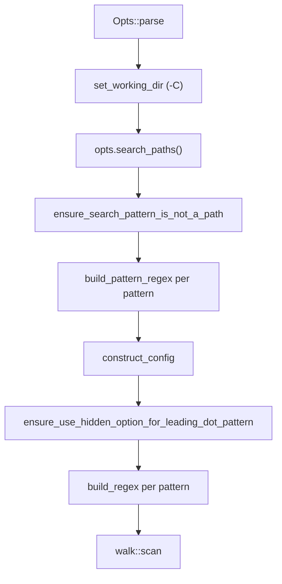

## Overview

Before anything is walked, fd turns the command line into three things: a list of search roots, a list of compiled regexes, and one immutable `Config`. All of it happens in `run` in `src/main.rs`, in a fixed order, and every user mistake it can detect becomes an `anyhow` error that `main` prints and maps to exit code 1. The walk itself is in [[Traversal and Result Pipeline]].

Sources: [src/main.rs:62-112](repo://src/main.rs#L62-L112)

Sources: [src/main.rs:75-112](repo://src/main.rs#L75-L112)

## Search paths and working directory

`Opts` has an optional positional `pattern` (default empty, which matches everything) followed by zero or more positional `path` values. `--search-path` is an alternative way to give paths; it is only consulted when no positional path was given.

Sources: [src/cli.rs:630-665](repo://src/cli.rs#L630-L665), [src/cli.rs:696-701](repo://src/cli.rs#L696-L701)

`-C`/`--base-directory` is applied first by `set_working_dir`, which refuses anything that is not an existing directory and then calls `set_current_dir`. After that `search_paths` runs. With no paths it uses `./` after checking that the current directory still exists. With paths, each non-directory is reported through `print_error` and dropped; if nothing survives, `run` bails with "No valid search paths given."

Sources: [src/main.rs:83-87](repo://src/main.rs#L83-L87), [src/main.rs:131-147](repo://src/main.rs#L131-L147), [src/cli.rs:696-721](repo://src/cli.rs#L696-L721), [src/cli.rs:963-971](repo://src/cli.rs#L963-L971)

`normalize_path` adjusts each root. With `--absolute-path` it becomes an absolute, normalised path. A bare `.` becomes `./`, a workaround for a ripgrep issue, and a bare `-` becomes `./-` so the walker treats it as a path.

Sources: [src/cli.rs:723-736](repo://src/cli.rs#L723-L736)

`strip_cwd_prefix` later decides whether the leading `./` is hidden in output. It is only ever true when no search path was given. Its `auto` default is true unless `--print0` or a command is in play, and `--strip-cwd-prefix` with no value means `always`.

Sources: [src/cli.rs:738-740](repo://src/cli.rs#L738-L740), [src/cli.rs:765-773](repo://src/cli.rs#L765-L773), [src/main.rs:390](repo://src/main.rs#L390)

## Compiling patterns

Every pattern, the positional one plus each `--and` expression in `exprs`, goes through `build_pattern_regex`, which picks one of four forms:

| Option | Resulting regex |
| --- | --- |
| `--glob` (non-empty pattern) | `GlobBuilder` with `literal_separator(true)`, then the glob's own regex |
| `--exact` | `^` + escaped pattern + `$` |
| `--fixed-strings` | the escaped pattern |
| none | the pattern text unchanged |

Sources: [src/main.rs:90-100](repo://src/main.rs#L90-L100), [src/main.rs:218-232](repo://src/main.rs#L218-L232)

Compilation to a `regex::bytes::Regex` comes last, in `build_regex`, because case sensitivity is only known once `Config` exists. It sets `case_insensitive` from the config and `dot_matches_new_line(true)`. A syntax error gets a note suggesting `--fixed-strings`, `--exact` or `--glob`.

Sources: [src/main.rs:104-109](repo://src/main.rs#L104-L109), [src/main.rs:541-555](repo://src/main.rs#L541-L555)

## Guards against silent empty results

Two checks turn a common mistake into an error rather than "no results".

`ensure_search_pattern_is_not_a_path` runs unless `--full-path` is set. Since fd matches the file name, a pattern containing `/` can never match, so the error shows how to list a directory (`fd . 'dir'`) or match the full path. On Windows, a pattern with `\` is only rejected when it also names an existing directory, because `\` is also the regex escape. This applies to the positional pattern and every `--and` pattern.

Sources: [src/main.rs:149-216](repo://src/main.rs#L149-L216)

`ensure_use_hidden_option_for_leading_dot_pattern` runs after `Config` is built. On Unix, if hidden files are being ignored and some pattern only matches names with a leading dot, it errors and suggests `-H`. The detector in `regex_helper.rs` is deliberately simple: it only recognises a start anchor followed by a literal beginning with `.`, and its own comment notes that alternations like `^(\.foo|\.bar)` are not caught.

Sources: [src/main.rs:521-539](repo://src/main.rs#L521-L539), [src/regex_helper.rs:39-72](repo://src/regex_helper.rs#L39-L72)

## Deriving the Config

`construct_config` consumes the `Opts` and fills every field of `Config`; downstream code never reads `Opts` again.

Sources: [src/main.rs:248-392](repo://src/main.rs#L248-L392), [src/config.rs:13-136](repo://src/config.rs#L13-L136)

**Case.** The search is case-sensitive unless `--ignore-case` is set, and sensitive when `--case-sensitive` is set or any pattern has an uppercase literal. `pattern_has_uppercase_char` parses the regex into a syntax tree and inspects literals and character classes, so `\Acargo` and `carg\x6F` do not count as uppercase but `foo.[a-zA-Z]` does.

Sources: [src/main.rs:249-255](repo://src/main.rs#L249-L255), [src/regex_helper.rs:4-37](repo://src/regex_helper.rs#L4-L37), [src/regex_helper.rs:84-92](repo://src/regex_helper.rs#L84-L92)

**Path separator.** `--path-separator` wins; otherwise `default_path_separator` returns `/` on Windows when the `MSYSTEM` variable is set (MSYS/MSYS2). On Windows a separator longer than one byte is rejected with a hint to use `//`. `actual_path_separator` stores whichever separator will really be printed.

Sources: [src/main.rs:257-264](repo://src/main.rs#L257-L264), [src/main.rs:234-246](repo://src/main.rs#L234-L246), [src/filesystem.rs:123-136](repo://src/filesystem.rs#L123-L136)

**Colour and hyperlinks.** `--color always`/`never` are literal. `auto` requires ANSI support, no non-empty `NO_COLOR`, and an interactive stdout. When colour is on, `LS_COLORS` is read from the environment and a built-in molokai-style palette is the fallback. Hyperlinks follow colour unless forced. The output side is in [[Output Formatting and Terminal Safety]].

Sources: [src/main.rs:271-297](repo://src/main.rs#L271-L297), [src/main.rs:56-57](repo://src/main.rs#L56-L57)

**Ignore flags.** `hidden`, `no_ignore` and the `rg_alias_ignore` shorthand combine into `ignore_hidden`, `read_fdignore`, `read_vcsignore`, `read_parent_ignore` and `read_global_ignore`. For example VCS ignore files are read unless `--no-ignore`, the alias, or `--no-ignore-vcs` is given. `--no-require-git` sets `require_git_to_read_vcsignore`.

Sources: [src/main.rs:313-320](repo://src/main.rs#L313-L320), [src/cli.rs:742-745](repo://src/cli.rs#L742-L745)

**Depth, results and threads.** `--exact-depth` fills both `max_depth()` and `min_depth()` unless those are set separately. `max_results()` ignores a value of 0 and otherwise falls back to `--max-one-result`. Threads default to the available parallelism, capped at 64, or 1 if that cannot be read.

Sources: [src/cli.rs:747-763](repo://src/cli.rs#L747-L763), [src/cli.rs:788-800](repo://src/cli.rs#L788-L800)

**Types, extensions and filters.** Each `--type` value flips a flag in `FileTypes`; `executable` also implies files, and a lone `empty` means both files and directories. Extensions become one case-insensitive `RegexSet` of `.\.ext$` patterns with leading dots stripped. Size, time and owner constraints are parsed here and stored; see [[Entry Filters]]. `--exclude` patterns are stored with a `!` prefix for the walker's override builder.

Sources: [src/main.rs:333-373](repo://src/main.rs#L333-L373), [src/main.rs:266-269](repo://src/main.rs#L266-L269), [src/main.rs:380-383](repo://src/main.rs#L380-L383)

**Command and format.** `extract_command` takes the parsed `--exec`/`--exec-batch` command set, or, for `--list-details`, builds a batch command around `ls`. `--format` is parsed into a `FormatTemplate`. Both are covered in [[Command Execution]] and [[Format Templates and Placeholders]].

Sources: [src/main.rs:298-299](repo://src/main.rs#L298-L299), [src/main.rs:374-378](repo://src/main.rs#L374-L378), [src/main.rs:395-410](repo://src/main.rs#L395-L410)

**Full path base.** With `--full-path`, the current directory is read once and cached in `full_path_base` so that each entry can be turned into an absolute path to match against. Failing to read it is an error.

Sources: [src/main.rs:301-308](repo://src/main.rs#L301-L308)

## Shell completions

When built with the `completions` feature, `run` handles `--gen-completions` first, before any search setup. The program name for the generated script comes from `argv[0]`, falling back to `fd`; the shell comes from the argument or from the environment.

Sources: [src/main.rs:78-81](repo://src/main.rs#L78-L81), [src/main.rs:114-129](repo://src/main.rs#L114-L129), [src/cli.rs:775-785](repo://src/cli.rs#L775-L785)
