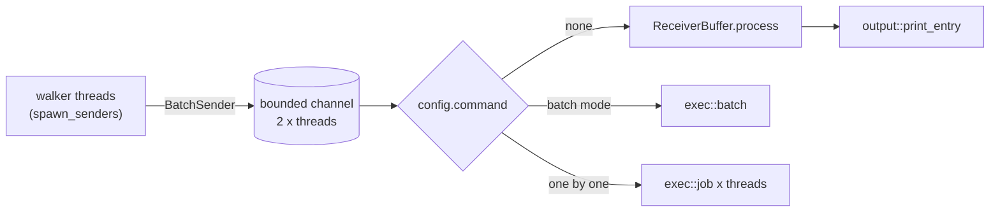

## Overview

`walk::scan` is where a search actually runs. It builds a parallel directory walker from the `ignore` crate, runs one closure per walker thread that filters entries and ships survivors in batches over a bounded channel, and runs a receiver on another thread that either prints the results or feeds them to a command. The inputs are the regexes and `Config` produced by [[Pattern and Config Setup]]; the filter predicates themselves are in [[Entry Filters]].

Sources: [src/walk.rs:680-687](repo://src/walk.rs#L680-L687), [src/walk.rs:305-328](repo://src/walk.rs#L305-L328)

Sources: [src/walk.rs:617-653](repo://src/walk.rs#L617-L653), [src/walk.rs:408-440](repo://src/walk.rs#L408-L440)

## Starting a scan

`WorkerState` holds the patterns, the `Config`, and two atomic flags: `quit_flag`, which tells walker threads to stop, and `interrupt_flag`, set only by Ctrl-C. `scan` builds the walker, optionally installs the Ctrl-C handler, creates a channel bounded to `2 * threads`, and then, inside `thread::scope`, spawns the receiver and runs the senders on the calling thread. The scope's result is the receiver's exit code, unless Ctrl-C was seen, in which case it is `KilledBySigint`.

Sources: [src/walk.rs:305-328](repo://src/walk.rs#L305-L328), [src/walk.rs:617-653](repo://src/walk.rs#L617-L653)

The bound on the channel gives back-pressure: when the receiver is slow (for example printing to a slow terminal, or waiting for commands), walker threads block in `send` instead of buffering the whole tree in memory.

Sources: [src/walk.rs:636-646](repo://src/walk.rs#L636-L646)

## Building the walker

`build_walker` configures `ignore::WalkBuilder` straight from `Config`:

| Builder call | Config field |
| --- | --- |
| `hidden` | `ignore_hidden` |
| `ignore` | `read_fdignore` |
| `parents` | `read_parent_ignore`, and either `read_fdignore` or `read_vcsignore` |
| `git_ignore`, `git_global`, `git_exclude` | `read_vcsignore` |
| `require_git` | `require_git_to_read_vcsignore` |
| `follow_links`, `same_file_system`, `max_depth` | `follow_links`, `one_file_system`, `max_depth` |
| `threads` | `threads` |

Sources: [src/walk.rs:347-365](repo://src/walk.rs#L347-L365), [src/walk.rs:402](repo://src/walk.rs#L402)

On top of those, three extra ignore sources are added when enabled: the custom file name `.fdignore`, the global file `fd/ignore` inside the platform config directory (found with `etcetera`), and every file passed with `--ignore-file`. A malformed pattern in the global or custom file is reported with `print_error` but does not stop the search; a partial parse error is silently accepted.

Sources: [src/walk.rs:367-396](repo://src/walk.rs#L367-L396)

`--exclude` patterns were stored with a `!` prefix, and `build_overrides` feeds them to an `OverrideBuilder` rooted at the first search path. A bad glob gives "Malformed exclude pattern". The walker takes the first search path as its root and the others through `add`.

Sources: [src/walk.rs:330-345](repo://src/walk.rs#L330-L345), [src/walk.rs:398-400](repo://src/walk.rs#L398-L400)

## Sender closure

`spawn_senders` calls `walker.run` with a factory that gives every walker thread its own `BatchSender` and its own closure. For each entry, the closure runs these steps in order, returning early with a `WalkState` as soon as one rejects the entry:

1. If `quit_flag` is set, return `Quit`.
2. If the entry is a directory containing any `--ignore-contain` file name, return `Skip`, so the whole subtree is not visited. The file type is checked first to avoid a syscall for plain files.
3. Skip the root entry at depth 0.
4. An `ignore::Error` for a path that is `NotFound` but is a symlink is turned into `DirEntry::broken_symlink` so dangling links can still be listed. Any other error is sent as `WorkerResult::Error` and the walk continues.
5. Apply the minimum depth, then the filters from [[Entry Filters]].
6. If results are being printed and colours are on, compute the entry's style now so the work is done on the parallel threads rather than the single printer thread.
7. Send `WorkerResult::Entry`; a failed send means the receiver is gone, so return `Quit`.
8. With `--prune`, return `Skip` after a match so matching directories are not descended into.

Sources: [src/walk.rs:459-491](repo://src/walk.rs#L459-L491), [src/walk.rs:485-512](repo://src/walk.rs#L485-L512), [src/walk.rs:593-611](repo://src/walk.rs#L593-L611)

`DirEntry` wraps either an `ignore::DirEntry` or a bare path for a broken symlink. Metadata and style are computed lazily and cached in `OnceCell`s, so an entry that is never inspected for size or colour never pays for a `stat`. Entries order by path, which is what the receiver's sort uses.

Sources: [src/dir_entry.rs:11-40](repo://src/dir_entry.rs#L11-L40), [src/dir_entry.rs:89-96](repo://src/dir_entry.rs#L89-L96), [src/dir_entry.rs:132-137](repo://src/dir_entry.rs#L132-L137)

## Batching

Sending one channel message per entry would be slow, so `BatchSender` groups entries. A `Batch` is an `Arc<Mutex<Option<Vec<WorkerResult>>>>`. The sender pushes into its current batch and, when the first item makes the length 1, sends a clone of the batch handle over the channel. It keeps appending to the same vector while the receiver is busy. When the receiver iterates the batch, `into_iter` takes the vector out and leaves `None`, and the sender's next `send` sees that `needs_flush` is true and starts a new batch. A batch is also replaced once it reaches `limit` items.

Sources: [src/walk.rs:47-72](repo://src/walk.rs#L47-L72), [src/walk.rs:81-122](repo://src/walk.rs#L81-L122)

The limit is `0x100` (256) normally. When commands run one by one on more than one thread it is 1, so each entry is its own batch and work is spread evenly over the job threads; in `--exec-batch` mode the single consumer wants large batches.

Sources: [src/walk.rs:449-457](repo://src/walk.rs#L449-L457)

## Receiver

### Choosing the consumer

`receive` chooses the consumer. With a command set, `--exec-batch` calls `exec::batch` on the flattened stream; otherwise it spawns `threads` scoped threads that each run `exec::job` on a clone of the receiver, and merges their exit codes. See [[Command Execution]]. With no command it locks stdout, wraps it in a `BufWriter` and runs `ReceiverBuffer::process`.

Sources: [src/walk.rs:408-440](repo://src/walk.rs#L408-L440)

### Buffering then streaming

`ReceiverBuffer` has two modes. It starts in `Buffering`, waiting with `recv_deadline` until a deadline of `--max-buffer-time` (default 100 ms) after creation. Entries are pushed into a `Vec<DirEntry>`; the buffer switches to streaming when it holds more than 1,000 entries or the deadline passes. When the walk finishes while still buffering, `stop` sorts the buffer by path before printing, so fast searches give sorted output while slow ones start showing results early.

Sources: [src/walk.rs:124-127](repo://src/walk.rs#L124-L127), [src/walk.rs:151-171](repo://src/walk.rs#L151-L171), [src/walk.rs:183-195](repo://src/walk.rs#L183-L195), [src/walk.rs:208-218](repo://src/walk.rs#L208-L218), [src/walk.rs:240-243](repo://src/walk.rs#L240-L243), [src/walk.rs:281-286](repo://src/walk.rs#L281-L286)

In `Streaming` mode each entry is printed as it arrives, and stdout is flushed whenever the channel is empty, so output is not held back while waiting for the next batch. `stream` also prints and flushes whatever had been buffered.

Sources: [src/walk.rs:215-217](repo://src/walk.rs#L215-L217), [src/walk.rs:235-238](repo://src/walk.rs#L235-L238), [src/walk.rs:269-279](repo://src/walk.rs#L269-L279)

### Stopping conditions

`poll` returns `Err(ExitCode)` to end the loop, which `process` turns into setting `quit_flag` so the walkers stop too. The reasons are:

- `--quiet`: the first entry returns `HasResults(true)` at once, nothing is printed.
- `--max-results`: after counting an entry, reaching the limit calls `stop`.
- The channel disconnects because all walkers finished: `stop` returns `Success`, or `HasResults(n > 0)` in quiet mode.
- A write error other than a broken pipe prints "Could not write to output" and returns `GeneralError`; a failing flush returns `GeneralError` silently.

Sources: [src/walk.rs:174-181](repo://src/walk.rs#L174-L181), [src/walk.rs:203-206](repo://src/walk.rs#L203-L206), [src/walk.rs:220-225](repo://src/walk.rs#L220-L225), [src/walk.rs:243-246](repo://src/walk.rs#L243-L246), [src/walk.rs:251-258](repo://src/walk.rs#L251-L258), [src/walk.rs:282-302](repo://src/walk.rs#L282-L302)

Errors from the walker arrive as `WorkerResult::Error` and are only printed when `--show-errors` is set, in both the printing receiver and the job loops.

Sources: [src/walk.rs:227-231](repo://src/walk.rs#L227-L231), [src/exec/job.rs:23-31](repo://src/exec/job.rs#L23-L31)

## Ctrl-C and exit codes

The Ctrl-C handler is only installed when results are printed in colour. The first signal sets `quit_flag` and `interrupt_flag`; the printer notices the flag after the next entry, flushes and returns `KilledBySigint`. A second Ctrl-C exits immediately. Without colours no handler is installed, so the default SIGINT behaviour applies.

Sources: [src/walk.rs:621-634](repo://src/walk.rs#L621-L634), [src/walk.rs:260-264](repo://src/walk.rs#L260-L264)

`ExitCode` maps `Success` to 0, `HasResults(b)` to 0 or 1, `GeneralError` to 1 and `KilledBySigint` to 130. For `KilledBySigint` on Unix, `exit` first restores the default SIGINT handler and re-raises the signal so the parent shell sees a real signal death. `merge_exitcodes` collapses any set of codes: if any is non-zero (even `KilledBySigint`) the result is `GeneralError`, else `Success`.

Sources: [src/exit_codes.rs:6-51](repo://src/exit_codes.rs#L6-L51)

All user-visible errors share `print_error`, which writes `[fd error]: message` to stderr. See [[Output Formatting and Terminal Safety]] for how the message is sanitised.

Sources: [src/error.rs:1-9](repo://src/error.rs#L1-L9)
