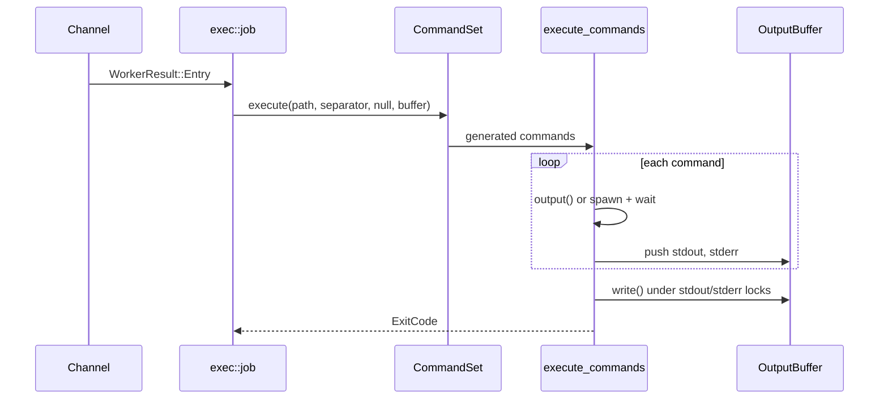
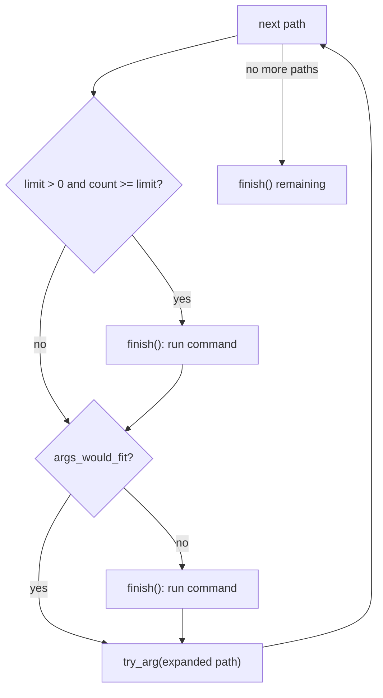

## Overview

`-x`/`--exec` runs a command for every search result, in parallel; `-X`/`--exec-batch` runs a command once with many results as arguments. Both replace printing: when the `Config` holds a command, the walker's receiver hands the results to the `exec` module instead of the output writer. Commands are built from templates whose placeholders (`{}`, `{.}`, `{/}`, `{//}`, `{/.}`) are filled in per path, as [[Format Templates and Placeholders]] describes.

Sources: [src/walk.rs:406-440](repo://src/walk.rs#L406-L440), [src/exec/mod.rs:1-33](repo://src/exec/mod.rs#L1-L33)

`-l`/`--list-details` is the same machinery: it builds a batch `CommandSet` running `ls -l -h -d` with the right color flag (see [[Startup and Configuration]]).

Sources: [src/main.rs:395-410](repo://src/main.rs#L395-L410)

## Command sets and templates

### Parsing

clap collects each occurrence of `--exec` or `--exec-batch` as a list of strings, ending at the end of the command line or at a `;` argument (written `\;` in a shell). `CommandSet::new` or `CommandSet::new_batch` turns every occurrence into a `CommandTemplate`, so `fd -x echo a \; -x echo b` runs two commands per result.

Sources: [src/cli.rs:861-880](repo://src/cli.rs#L861-L880), [src/exec/mod.rs:35-74](repo://src/exec/mod.rs#L35-L74)

`CommandTemplate::new` parses each argument with `FormatTemplate::parse` and enforces three rules.

Sources: [src/exec/mod.rs:219-234](repo://src/exec/mod.rs#L219-L234)

1. An empty command fails with "No executable provided for --exec or --exec-batch"; without this check fd would try to execute each result.
2. In batch mode the first argument must be a fixed program, not a placeholder.
3. If no argument holds a placeholder, a `{}` argument is appended.

Sources: [src/exec/mod.rs:210-256](repo://src/exec/mod.rs#L210-L256)

`new_batch` also refuses a command with more than one argument holding placeholders ("Only one placeholder allowed for batch commands"), since each result must expand to exactly one argument.

Sources: [src/exec/mod.rs:51-70](repo://src/exec/mod.rs#L51-L70)

### Building a command

`CommandTemplate::generate` expands the first argument as the program and every other argument with the result's path and the optional `--path-separator`, adding them with `argmax::Command::try_arg`, which fails instead of building a command line too long for the operating system.

Sources: [src/exec/mod.rs:262-272](repo://src/exec/mod.rs#L262-L272)

## Per-result execution

### Job threads

For `--exec`, `receive` starts `threads` job threads in a scope, each iterating over its own clone of the channel receiver, and merges their exit codes. To spread work evenly the senders use a batch size of 1 whenever more than one thread runs, so an idle job picks up the next result at once. Commands run in no defined order.

Sources: [src/walk.rs:412-433](repo://src/walk.rs#L412-L433), [src/walk.rs:449-457](repo://src/walk.rs#L449-L457), [src/cli.rs:894-899](repo://src/cli.rs#L894-L899)

`exec::job` loops over the results: walk errors are printed with `--show-errors` and skipped; for each entry it calls `CommandSet::execute` with the entry's stripped path and merges the returned code into its own.

Sources: [src/exec/job.rs:8-44](repo://src/exec/job.rs#L8-L44)

Sources: [src/exec/job.rs:11-44](repo://src/exec/job.rs#L11-L44), [src/exec/mod.rs:76-88](repo://src/exec/mod.rs#L76-L88), [src/exec/command.rs:59-99](repo://src/exec/command.rs#L59-L99)

### Output buffering

With more than one thread, `execute_commands` runs each command with `output()`, capturing stdout and stderr into an `OutputBuffer`. When all commands for the result are done, `OutputBuffer::write` locks stdout and stderr and writes everything at once, so the output of parallel commands never interleaves. With `--print0` a NUL byte follows each result's output. With `--threads=1` commands are spawned with inherited stdio and waited for, so their output appears live and interactive programs work.

Sources: [src/exec/job.rs:16-17](repo://src/exec/job.rs#L16-L17), [src/exec/command.rs:9-57](repo://src/exec/command.rs#L9-L57), [src/exec/command.rs:59-99](repo://src/exec/command.rs#L59-L99)

When one command of a result exits with a non-zero code (or no code, as when killed by a signal), its buffered output is written, the remaining commands for that result are skipped, and the result's code is `GeneralError`. Other results keep running.

Sources: [src/exec/command.rs:80-99](repo://src/exec/command.rs#L80-L99)

## Batch execution

### Filling the command line

For `--exec-batch`, `exec::batch` turns the results into stripped paths and calls `execute_batch` with `--batch-size`. A `CommandBuilder` per template splits its arguments into fixed `pre_args` before the placeholder argument, the placeholder argument `path_arg`, and fixed `post_args` after it. For each path, `push` first runs the pending command if `--batch-size` is reached or if the new argument plus `post_args` would not fit (`args_would_fit`), then appends the expanded argument.

Sources: [src/exec/job.rs:46-64](repo://src/exec/job.rs#L46-L64), [src/exec/mod.rs:90-208](repo://src/exec/mod.rs#L90-L208)

`finish` appends `post_args`, runs the command with inherited stdin, stdout and stderr, records a failure as `GeneralError`, and starts a fresh command. Since `push` is called while results still arrive from the channel, a large search starts running batches before the walk ends. A batch size of 0 (the default) leaves only the operating system's argument limit.

Sources: [src/exec/mod.rs:164-203](repo://src/exec/mod.rs#L164-L203), [src/cli.rs:492-508](repo://src/cli.rs#L492-L508)

Sources: [src/exec/mod.rs:173-203](repo://src/exec/mod.rs#L173-L203), [src/exec/mod.rs:110-116](repo://src/exec/mod.rs#L110-L116)

## Paths passed to commands

Commands receive the entry's path as fd would print it, after `--path-separator` substitution. With a command, `--strip-cwd-prefix` defaults to keeping the `./` prefix, so a file named `-rf` reaches the command as `./-rf` and is never read as an option. Hyperlinks and colors do not apply to command arguments.

Sources: [src/main.rs:389-391](repo://src/main.rs#L389-L391), [src/dir_entry.rs:56-80](repo://src/dir_entry.rs#L56-L80), [src/cli.rs:532-548](repo://src/cli.rs#L532-L548)

## Errors and exit codes

`handle_cmd_error` prints "Command not found: …" when spawning fails with `NotFound`, and "Problem while executing command: …" for any other I/O error, including an argument list that does not fit; both yield `GeneralError`. Exit codes of all jobs or builders are merged with `merge_exitcodes`, so fd exits with 1 when any command failed. See [[Exit Codes and Errors]].

Sources: [src/exec/command.rs:101-115](repo://src/exec/command.rs#L101-L115), [src/exec/mod.rs:100-120](repo://src/exec/mod.rs#L100-L120)

> [!WARNING]
> Shell aliases and functions are not available to `-x` and `-X`: fd starts the program directly, without a shell. In bash, `export -f my_function` and `fd -x bash -c 'my_function "$1"' bash` works around this.

Sources: [README.md:439-446](repo://README.md#L439-L446)
