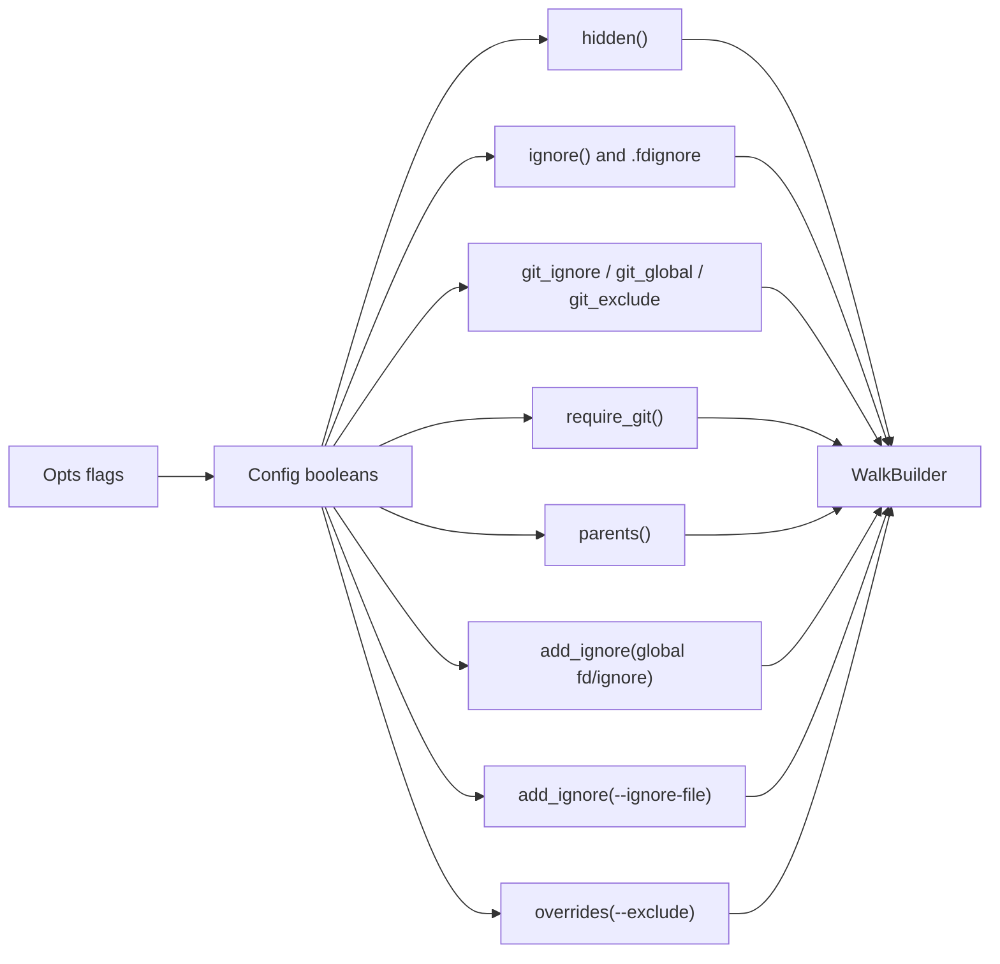

## Overview

By default fd skips hidden entries (names starting with `.`) and anything matched by ignore files: `.gitignore` and git's other exclude sources, `.ignore`, `.fdignore`, and fd's global ignore file. This keeps build output and VCS metadata out of the results. The rules are not implemented by fd itself: `build_walker` maps fd's flags onto the `ignore` crate's `WalkBuilder`, which applies them during traversal so ignored directories are never entered.

Sources: [README.md:124-143](repo://README.md#L124-L143), [src/walk.rs:347-404](repo://src/walk.rs#L347-L404)

When a file seems missing, `-u` (or `-HI`) disables both kinds of filtering at once.

Sources: [README.md:394-401](repo://README.md#L394-L401)

## Sources of ignore rules

| Source | Read when | Turned off by |
| --- | --- | --- |
| Hidden names | always | `-H`, `-u` |
| `.gitignore`, global git excludes, `.git/info/exclude` | inside a git repository | `-I`, `--no-ignore-vcs`, `-u` |
| `.ignore` | always | `-I`, `-u` |
| `.fdignore` | always | `-I`, `-u` |
| Ignore files in parent directories | with any of the above | `--no-ignore-parent` |
| Global `fd/ignore` file | always | `-I`, `--no-global-ignore-file`, `-u` |
| `--ignore-file <path>` | when given | never (low precedence) |
| `--exclude <glob>` | when given | never (overrides everything) |

Sources: [src/main.rs:313-320](repo://src/main.rs#L313-L320), [src/walk.rs:352-396](repo://src/walk.rs#L352-L396)

## How flags become walker settings

`construct_config` combines the flags into booleans: `ignore_hidden` is off with `--hidden` or `-u`; `read_fdignore` is off with `--no-ignore` or `-u`; `read_vcsignore` is also off with `--no-ignore-vcs`; `read_global_ignore` is also off with `--no-global-ignore-file`; `require_git_to_read_vcsignore` is off with `--no-require-git`; `read_parent_ignore` is off with `--no-ignore-parent`.

Sources: [src/main.rs:310-320](repo://src/main.rs#L310-L320)

`build_walker` then sets `hidden(ignore_hidden)`, `ignore(read_fdignore)` for `.ignore` files, `git_ignore`, `git_global` and `git_exclude` from `read_vcsignore`, and `require_git`. Parent directories are searched for ignore files only when `read_parent_ignore` is on and at least one kind of ignore file is read. `.fdignore` is registered with `add_custom_ignore_filename` only when `read_fdignore` is on.

Sources: [src/walk.rs:347-369](repo://src/walk.rs#L347-L369)



Sources: [src/main.rs:310-320](repo://src/main.rs#L310-L320), [src/walk.rs:330-404](repo://src/walk.rs#L330-L404)

## Git rules outside a repository

`.gitignore` rules apply only inside a git repository, because `require_git` is on by default. `--no-require-git` applies them in any directory, which helps when searching an exported tree that still has its `.gitignore` files. `--require-git` turns the default back on.

Sources: [src/cli.rs:81-101](repo://src/cli.rs#L81-L101), [src/walk.rs:360-360](repo://src/walk.rs#L360-L360)

## The global ignore file

fd looks for `fd/ignore` in the user's configuration directory as chosen by `etcetera::choose_base_strategy`: usually `~/.config/fd/ignore` on Linux and macOS, and `%APPDATA%\fd\ignore` on Windows. It is added only if it exists as a file. Malformed patterns in it are reported as "Malformed pattern in global ignore file" and the search continues; partial errors are ignored silently.

Sources: [src/walk.rs:371-385](repo://src/walk.rs#L371-L385), [README.md:274-279](repo://README.md#L274-L279)

> [!TIP]
> Adding `.git/` to the global ignore file keeps `.git` directories out of `--hidden` searches.

Sources: [README.md:278-279](repo://README.md#L278-L279)

## Custom ignore files

`--ignore-file <path>` adds a file in `.gitignore` format with low precedence; it can be given several times. Errors are reported like those of the global file.

Sources: [src/cli.rs:510-518](repo://src/cli.rs#L510-L518), [src/walk.rs:387-396](repo://src/walk.rs#L387-L396)

## Excluding with globs

`-E`/`--exclude <glob>` excludes matching entries regardless of every other rule, including `-u`. Each glob is prefixed with `!` and added to an `OverrideBuilder` rooted at the first search path; in the `ignore` crate's override syntax, `!` marks a pattern as an exclusion. A malformed glob is a fatal "Malformed exclude pattern" error.

Sources: [src/main.rs:380-380](repo://src/main.rs#L380-L380), [src/walk.rs:330-345](repo://src/walk.rs#L330-L345), [src/cli.rs:310-324](repo://src/cli.rs#L310-L324)

```bash
fd -H -E .git
fd -E /mnt/external-drive
fd -E '*.bak'
```

Sources: [README.md:243-261](repo://README.md#L243-L261)

## Skipping directories by content

`--ignore-contain <name>` skips any directory that contains an entry with the given name, for example a `CACHEDIR.TAG` marker. The check runs in the walker callback before anything else: when the entry is a directory and `entry_path.join(name).exists()` holds for any name, the callback returns `WalkState::Skip`, so neither the directory nor anything below it is reported. The file type is checked first so that files cost no extra syscall.

Sources: [src/cli.rs:550-552](repo://src/cli.rs#L550-L552), [src/config.rs:134-135](repo://src/config.rs#L134-L135), [src/walk.rs:464-479](repo://src/walk.rs#L464-L479)
