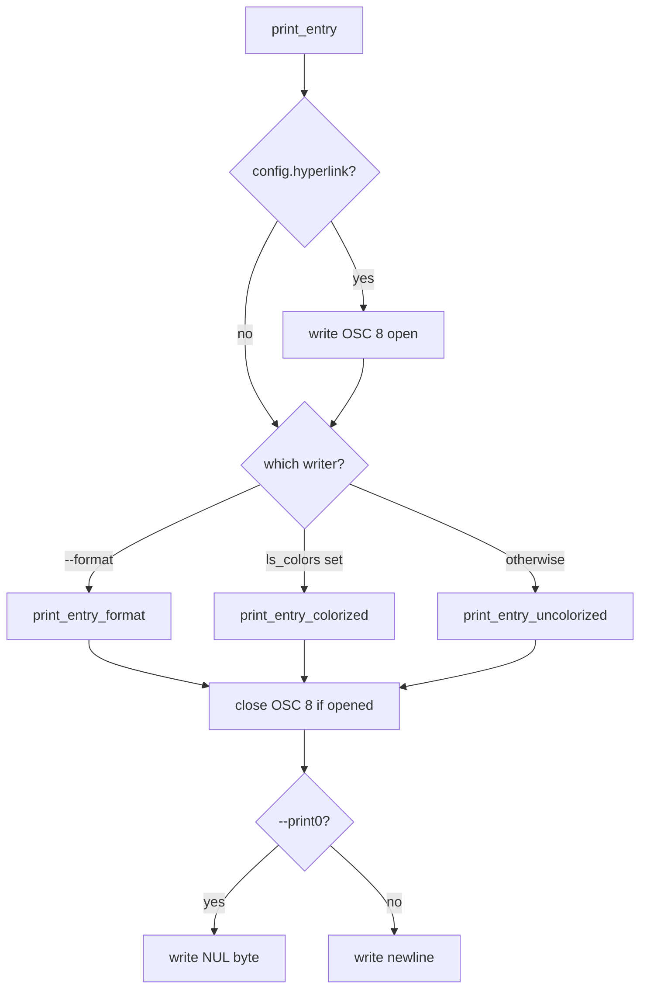

## Overview

When no command is given, every match ends up in `output::print_entry`, called by the receiver thread described in [[Parallel Directory Walk]]. It decides how a path is written: through a `--format` template, colored with `LS_COLORS`, or plain; wrapped in an OSC 8 hyperlink or not; ended by a newline or a NUL byte. Paths written to a terminal are sanitized so that a crafted file name cannot inject escape sequences.

Sources: [src/output.rs:16-43](repo://src/output.rs#L16-L43), [src/walk.rs:251-267](repo://src/walk.rs#L251-L267)

## Printing an entry

`print_entry` opens a hyperlink when `config.hyperlink` is set and the path can be made absolute, then picks one of three writers, closes the hyperlink, and writes `\0` with `--print0` or a newline otherwise.

Sources: [src/output.rs:16-43](repo://src/output.rs#L16-L43)

Sources: [src/output.rs:16-43](repo://src/output.rs#L16-L43)

Every writer starts from `DirEntry::stripped_path`. When `strip_cwd_prefix` is on it drops the leading `./`, unless the result would start with `-`, in which case the `./` stays so the path is not read as an option by a downstream tool.

Sources: [src/dir_entry.rs:56-80](repo://src/dir_entry.rs#L56-L80), [src/dir_entry.rs:112-114](repo://src/dir_entry.rs#L112-L114)

## Writers

### Colorized

`print_entry_colorized` splits the path into its parent (including the trailing separators) and its last component. The parent is painted with the `LS_COLORS` directory style, after `--path-separator` replaces the platform separator in it; the last component is painted with the entry's own style, which the sender thread usually computed already. Directories then get a trailing separator, painted in the directory style.

Sources: [src/output.rs:88-139](repo://src/output.rs#L88-L139), [src/output.rs:45-66](repo://src/output.rs#L45-L66)

### Plain

`print_entry_uncolorized_base` converts the path lossily to a string, replaces the separator if `--path-separator` is set, sanitizes it and writes it, followed by the trailing separator for directories. On Unix, when stdout is not a terminal and no custom separator is set, the path's raw bytes are written instead, so a file name that is not valid UTF-8 reaches `xargs` or another program unchanged.

Sources: [src/output.rs:141-182](repo://src/output.rs#L141-L182)

### Format template

With `--format`, `print_entry_format` renders the template against the stripped path and the custom separator, then sanitizes the result. Directories get no trailing separator here: the template decides the whole line. [[Format Templates and Placeholders]] describes the placeholders.

Sources: [src/output.rs:68-86](repo://src/output.rs#L68-L86)

## Colors

`LS_COLORS` is read only when colors are enabled; without it, fd uses its own `DEFAULT_LS_COLORS`. The style for an entry is computed by `lscolors` from its name, file type and metadata, which `DirEntry` exposes through the `Colorable` trait, and is cached on the entry so it is looked up once. For broken symlinks the file name is taken from the last path component by hand, since `Path::file_name` only works for normal components.

Sources: [src/main.rs:279-292](repo://src/main.rs#L279-L292), [src/dir_entry.rs:105-109](repo://src/dir_entry.rs#L105-L109), [src/dir_entry.rs:139-167](repo://src/dir_entry.rs#L139-L167)

| `--color` | Colors on when |
| --- | --- |
| `auto` (default) | ANSI is supported, `NO_COLOR` is unset or empty, and stdout is a terminal |
| `always` | Always |
| `never` | Never |

Sources: [src/main.rs:271-286](repo://src/main.rs#L271-L286), [src/cli.rs:520-530](repo://src/cli.rs#L520-L530)

## Hyperlinks

`--hyperlink` defaults to `never`; given without a value it means `auto`, which follows the color decision. `PathUrl` makes the path absolute and prints it as `file://` plus the host name (read once with `gethostname` on Unix, `/` elsewhere) plus the path. Every byte outside ASCII letters, digits and `/:-._~` is percent-encoded, since a byte above 127 may not be valid UTF-8 on some systems; on Windows, `\` becomes `/`. Hyperlinks are not added to `--exec` output.

Sources: [src/cli.rs:532-548](repo://src/cli.rs#L532-L548), [src/main.rs:293-297](repo://src/main.rs#L293-L297), [src/hyperlink.rs:1-62](repo://src/hyperlink.rs#L1-L62)

## Terminal sanitization

`sanitize.rs` guards against terminal escape injection through file names. `maybe_sanitize` does nothing for pipes and files, so bytes pass through unchanged; for a terminal it calls `sanitize_for_terminal`. That function borrows the string when nothing needs escaping, and otherwise writes each offending character as `\xHH` (up to U+00FF) or `\u{HHHH}`.

Sources: [src/sanitize.rs:26-55](repo://src/sanitize.rs#L26-L55)

`needs_escape` flags every control character except tab (C0, C1 and DEL, which also covers newlines and carriage returns), plus invisible and reordering characters: the soft hyphen, zero-width characters and LRM/RLM, bidi embeddings and overrides, word joiners and invisible formatting characters, the BOM, interlinear annotations and language tags. Variation selectors and private-use characters are kept, because emoji, CJK text and icon fonts use them.

Sources: [src/sanitize.rs:6-24](repo://src/sanitize.rs#L6-L24), [src/sanitize.rs:142-156](repo://src/sanitize.rs#L142-L156)

Error messages go through the same filter when stderr is a terminal, since they often quote paths.

Sources: [src/error.rs:1-9](repo://src/error.rs#L1-L9)
