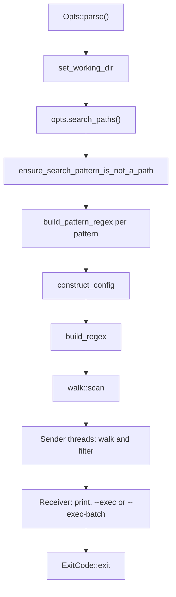

## Overview

`fd` finds entries in the filesystem. It is a simple, fast and user-friendly alternative to `find`: it does not try to cover all of `find`'s functionality, and instead picks opinionated defaults for the common cases. The crate is published as `fd-find` and builds a single binary named `fd`.

Sources: [README.md:1-11](repo://README.md#L1-L11), [Cargo.toml:1-31](repo://Cargo.toml#L1-L31)

Out of the box, `fd PATTERN` treats the pattern as a regular expression, matches it against file names only, searches the current directory recursively, skips hidden files and anything listed in `.gitignore`, and is case-insensitive unless the pattern holds an uppercase character (smart case). Directory traversal runs on several threads, and results are colored the way `ls` colors them. [[Quickstart]] walks through the most common searches.

Sources: [README.md:15-28](repo://README.md#L15-L28), [src/main.rs:248-255](repo://src/main.rs#L248-L255)

## How a search runs

The `main` function calls `run`, which parses the command line into `Opts`, changes into `--base-directory` if one was given, resolves the search paths, turns every pattern into a regex string, builds the `Config`, compiles the regexes and hands everything to `walk::scan`. Any error bubbling out of `run` is printed with the `[fd error]:` prefix and the process exits with a general error code.

Sources: [src/main.rs:62-112](repo://src/main.rs#L62-L112)

Sources: [src/main.rs:62-112](repo://src/main.rs#L62-L112), [src/walk.rs:617-687](repo://src/walk.rs#L617-L687)

`walk::scan` builds a parallel walker from the `ignore` crate. Its sender threads test each entry against the patterns and filters and push matches over a bounded channel; one receiver thread either prints them or, with `--exec`, a pool of job threads runs commands on them. [[Startup and Configuration]] and [[Parallel Directory Walk]] trace both halves in detail.

Sources: [src/walk.rs:406-440](repo://src/walk.rs#L406-L440), [src/walk.rs:617-653](repo://src/walk.rs#L617-L653)

## Module layout

Every module lives directly under `src/` and is declared in `main.rs`.

Sources: [src/main.rs:1-15](repo://src/main.rs#L1-L15)

| Module | Role | Page |
| --- | --- | --- |
| `cli` | clap definition of every command-line option (`Opts`) | [[Command-Line Options]] |
| `config` | The resolved `Config` shared by all threads | [[Startup and Configuration]] |
| `regex_helper` | Smart-case and leading-dot analysis of patterns | [[Patterns and Matching]] |
| `walk` | Parallel traversal, filtering, buffering and printing loop | [[Parallel Directory Walk]] |
| `dir_entry`, `output`, `hyperlink`, `sanitize` | Entry wrapper, printing, colors, OSC 8 links, escaping | [[Output and Colors]] |
| `filetypes`, `filter` | `--type`, `--size`, `--changed-*` and `--owner` filters | [[File Type, Size, Time and Owner Filters]] |
| `exec` | `--exec` and `--exec-batch` | [[Command Execution]] |
| `fmt` | Placeholder templates for `--format` and `--exec` | [[Format Templates and Placeholders]] |
| `exit_codes`, `error` | Process exit codes and error printing | [[Exit Codes and Errors]] |
| `filesystem` | Platform helpers: path separators, file kinds, emptiness | [[Output and Colors]] |

Sources: [src/main.rs:1-36](repo://src/main.rs#L1-L36)

## Dependencies

The search itself rests on a few crates: `ignore` provides the parallel walker and gitignore handling, `regex` and `globset` compile the patterns, `lscolors` and `nu-ansi-term` color the output, `crossbeam-channel` carries results between threads, `clap` parses the command line and `jiff` parses dates for the time filters. On most Linux targets the `use-jemalloc` feature swaps in jemalloc as the global allocator for speed.

Sources: [Cargo.toml:33-71](repo://Cargo.toml#L33-L71), [src/main.rs:38-54](repo://src/main.rs#L38-L54)
