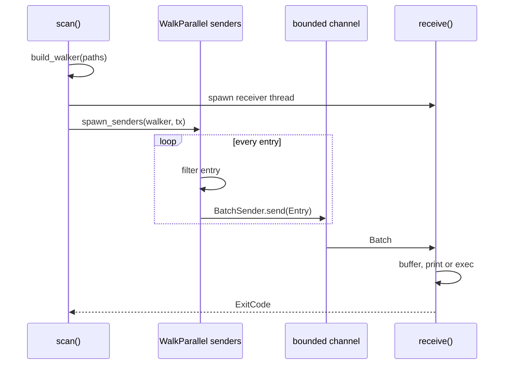
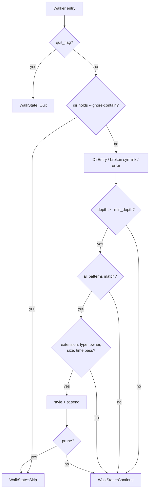
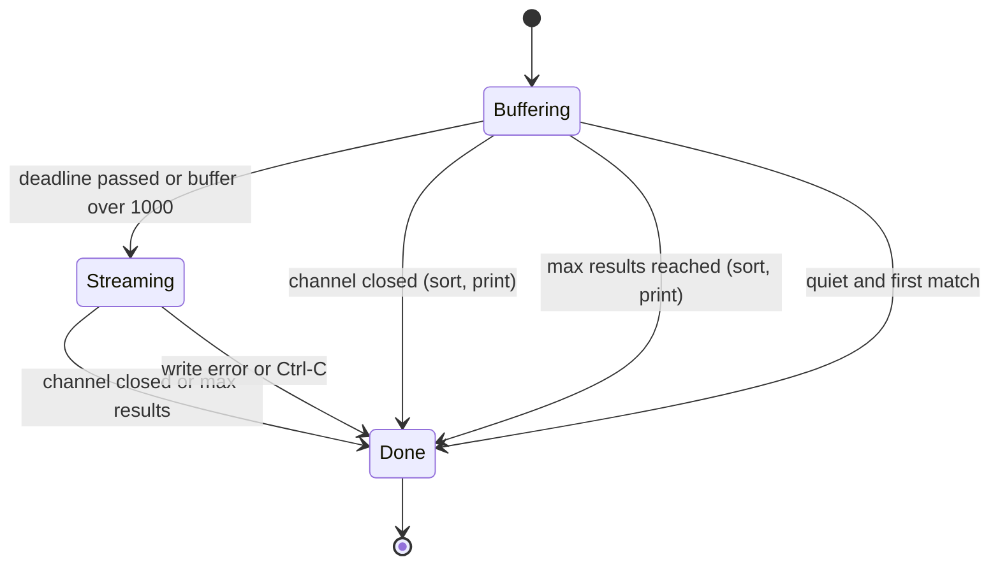

## Overview

`src/walk.rs` is where the search happens. It builds a parallel walker from the `ignore` crate, runs a filter closure on every entry in the walker's threads (the senders), and sends the matches over a bounded channel to a receiver that prints them or runs commands on them. Splitting the work this way keeps the expensive part (reading directories, stat calls, regex matching, color lookup) parallel while output stays on one thread and never interleaves.

Sources: [src/walk.rs:680-687](repo://src/walk.rs#L680-L687), [src/walk.rs:616-653](repo://src/walk.rs#L616-L653)

The shared state is a `WorkerState`: the compiled patterns, the `Config` from [[Startup and Configuration]], a `quit_flag` that tells senders to stop, and an `interrupt_flag` set by Ctrl-C.

Sources: [src/walk.rs:305-328](repo://src/walk.rs#L305-L328)

## Scan lifecycle

`WorkerState::scan` builds the walker, installs a Ctrl-C handler when results are printed with colors, creates a channel bounded at `2 * threads` batches, then in a thread scope spawns the receiver and runs the senders on the current thread. When the receiver returns, an interrupt overrides its exit code with `KilledBySigint`.

Sources: [src/walk.rs:616-653](repo://src/walk.rs#L616-L653)

Sources: [src/walk.rs:406-453](repo://src/walk.rs#L406-L453), [src/walk.rs:616-653](repo://src/walk.rs#L616-L653)

The handler is installed only when results are printed with colors. On the first Ctrl-C it sets both flags, so the receiver flushes what it has printed and returns `KilledBySigint` (exit code 130) after the entry in progress; a second Ctrl-C calls `ExitCode::KilledBySigint.exit()` at once. [[Exit Codes and Errors]] describes how the signal is re-raised.

Sources: [src/walk.rs:621-634](repo://src/walk.rs#L621-L634), [src/walk.rs:259-264](repo://src/walk.rs#L259-L264)

## Building the walker

`build_walker` roots a `WalkBuilder` at the first search path and adds the others with `builder.add`. It maps the config onto the builder: `hidden`, `ignore` (`.ignore` files), `parents`, `git_ignore`, `git_global`, `git_exclude`, `require_git`, `follow_links`, `same_file_system` and `max_depth`. It then registers `.fdignore` as a custom ignore filename, the global `fd/ignore` file in the config directory, and every `--ignore-file`, and sets the thread count. `--exclude` globs go in as `Override`s rooted at the first path, each prefixed with `!`. [[Hidden and Ignored Files]] explains what each switch means for the user.

Sources: [src/walk.rs:330-404](repo://src/walk.rs#L330-L404), [src/main.rs:380-381](repo://src/main.rs#L380-L381)

## Per-entry filtering

### The filter chain

`spawn_senders` gives each walker thread a closure that runs once per entry and returns a `WalkState`. Checks run cheapest first, so that most entries are rejected before any metadata is read.

Sources: [src/walk.rs:442-458](repo://src/walk.rs#L442-L458)

1. Quit if `quit_flag` is set.
2. Skip (do not descend into) a directory containing any `--ignore-contain` name.
3. Continue past the root entry at depth 0.
4. Wrap the entry as a `DirEntry`; a `NotFound` error on a path that is a symlink becomes `DirEntry::broken_symlink`, and other errors are sent as `WorkerResult::Error`.
5. Reject entries above `min_depth`.
6. Match every pattern against the file name, or the absolute path with `--full-path`.
7. Check the extension `RegexSet` against the file name.
8. Check the `FileTypes` filter.
9. On Unix, check the owner filter against metadata.
10. Check size constraints, which only files can pass.
11. Check that the modification time passes every time constraint.
12. Precompute the `LS_COLORS` style when printing with colors, so color lookups run in parallel.
13. Send the entry, then return `Skip` with `--prune` (so a matching directory is not entered) or `Continue`.

Sources: [src/walk.rs:459-535](repo://src/walk.rs#L459-L535), [src/walk.rs:536-613](repo://src/walk.rs#L536-L613)

Sources: [src/walk.rs:459-524](repo://src/walk.rs#L459-L524), [src/walk.rs:526-612](repo://src/walk.rs#L526-L612)

### What a pattern is matched against

`search_str_for_entry` returns the file name by default. With `--full-path` it returns the entry's absolute path: absolute entries as they are, relative ones joined to the cached `full_path_base` after stripping a leading `./`. A missing file name panics as unreachable, since a traversal never yields paths like `foo/..` or `/`.

Sources: [src/walk.rs:656-678](repo://src/walk.rs#L656-L678)

### DirEntry

`DirEntry` wraps either an `ignore::DirEntry` or the path of a broken symlink, and caches `metadata` and the color `style` in `OnceCell`s so each is computed at most once even when several filters ask. A broken symlink has no depth and reads its metadata with `symlink_metadata`. Entries compare and sort by path.

Sources: [src/dir_entry.rs:11-110](repo://src/dir_entry.rs#L11-L110), [src/dir_entry.rs:116-137](repo://src/dir_entry.rs#L116-L137)

## Batching

Results travel as `Batch`es: an `Arc<Mutex<Option<Vec<WorkerResult>>>>` shared between a sender and the receiver. `BatchSender::send` pushes into the current batch and sends the batch over the channel only when it receives its first item; later items are appended to a batch the receiver may already hold. When the receiver has taken the vector (`None`) or the batch reached its limit, the sender starts a new one. This cuts channel traffic to one message per batch while the bounded channel still pushes back on fast walkers.

Sources: [src/walk.rs:47-122](repo://src/walk.rs#L47-L122)

The limit is 256 items, except with `--exec` on more than one thread, where it is 1 so each command job gets work as soon as it is free.

Sources: [src/walk.rs:449-457](repo://src/walk.rs#L449-L457)

## The receiver

### Choosing a receiver

`receive` picks one of three consumers. With a batch command it calls `exec::batch` on the flattened channel. With a per-entry command it spawns `threads` job threads, each running `exec::job` on a clone of the receiver, and merges their exit codes. Otherwise it wraps a locked, buffered stdout in a `ReceiverBuffer`. [[Command Execution]] covers the first two.

Sources: [src/walk.rs:406-440](repo://src/walk.rs#L406-L440)

### Buffering, then streaming

`ReceiverBuffer` starts in `Buffering` mode with a deadline of `--max-buffer-time` (default 100 ms). While buffering it collects entries; if the walk finishes before the deadline, `stop` sorts the buffer before printing, which makes small searches deterministic. When the deadline passes, or more than 1000 entries are buffered, it switches to `Streaming`, prints the buffer unsorted and from then on prints each entry as it arrives, flushing whenever the channel is momentarily empty.

Sources: [src/walk.rs:124-171](repo://src/walk.rs#L124-L171), [src/walk.rs:183-249](repo://src/walk.rs#L183-L249), [src/walk.rs:269-293](repo://src/walk.rs#L269-L293)

Sources: [src/walk.rs:173-249](repo://src/walk.rs#L173-L249), [src/walk.rs:269-302](repo://src/walk.rs#L269-L302)

### Stopping early

Any error from `poll` ends `process`, which sets `quit_flag` so the senders return `WalkState::Quit`. In `--quiet` mode the first entry returns `HasResults(true)` without printing. `--max-results` stops once the count is reached. Walk errors are printed only with `--show-errors`. A write error other than a broken pipe is reported as "Could not write to output" and ends with a general error; a failed flush (usually a closed pipe) also exits quietly with a general error.

Sources: [src/walk.rs:173-181](repo://src/walk.rs#L173-L181), [src/walk.rs:198-267](repo://src/walk.rs#L198-L267), [src/walk.rs:295-302](repo://src/walk.rs#L295-L302)
