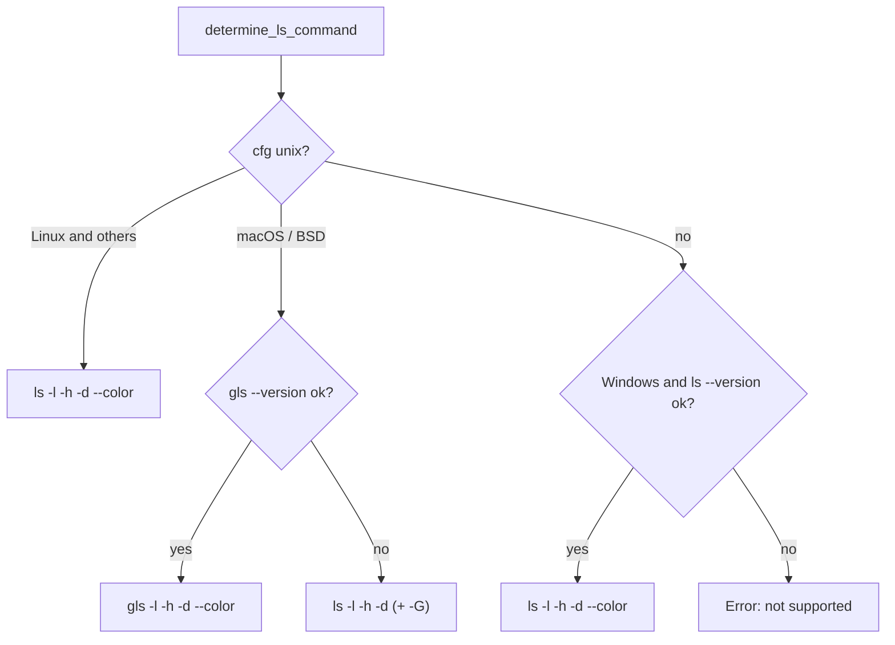

## Overview

Before any directory is read, `run` in `src/main.rs` turns the parsed command line (`Opts`) into two things the walker needs: a list of compiled regexes and one immutable `Config`. Every decision that depends only on the arguments and the environment (case sensitivity, colors, hyperlinks, which ignore files to read, the command to run) is made here once, so the worker threads only read flags.

Sources: [src/main.rs:75-112](repo://src/main.rs#L75-L112)

The `Config` struct is moved into the walker's shared `WorkerState` and borrowed by every sender and receiver thread; nothing changes it after startup. [[Parallel Directory Walk]] picks up from `walk::scan`.

Sources: [src/config.rs:13-40](repo://src/config.rs#L13-L40), [src/walk.rs:305-328](repo://src/walk.rs#L305-L328)

## Startup sequence

### From arguments to a scan

`run` performs its steps in a fixed order, and each step can abort the program with an error message.

Sources: [src/main.rs:75-112](repo://src/main.rs#L75-L112)

1. `Opts::parse()` parses the arguments with clap. With `--gen-completions`, completions are printed and `run` returns.
2. `set_working_dir` changes into `--base-directory`; a path that is not a directory is an error.
3. `opts.search_paths()` resolves the roots. An empty list (every given path was missing) fails with "No valid search paths given."
4. `ensure_search_pattern_is_not_a_path` rejects patterns holding a path separator unless `--full-path` is set.
5. `build_pattern_regex` turns the `--and` patterns and the positional pattern into regex strings.
6. `construct_config` builds the `Config`.
7. `ensure_use_hidden_option_for_leading_dot_pattern` rejects a `^\.` pattern while hidden files are skipped.
8. `build_regex` compiles each string to a `regex::bytes::Regex`, and `walk::scan` starts the search.

Sources: [src/main.rs:75-112](repo://src/main.rs#L75-L112)

### Search paths

`search_paths` prefers the positional `path` arguments, then `--search-path`, and falls back to `./` after checking that the current directory still exists. A given path that is not an existing directory is reported with `print_error` and dropped rather than aborting the search. `normalize_path` makes paths absolute with `--absolute-path`, rewrites `.` to `./` (a workaround for ripgrep issue 2711), and rewrites `-` to `./-` so the walker treats it as a path.

Sources: [src/cli.rs:696-740](repo://src/cli.rs#L696-L740), [src/cli.rs:963-971](repo://src/cli.rs#L963-L971)

`is_existing_directory` deliberately avoids `Path::exists`: `.` always exists even when the working directory was deleted, so it also requires a file name or a successful `normalize`.

Sources: [src/filesystem.rs:38-42](repo://src/filesystem.rs#L38-L42)

## Building the Config

### Case sensitivity, separators and filters

`construct_config` makes the search case-sensitive when `--ignore-case` is absent and either `--case-sensitive` is set or any pattern holds an uppercase literal (see [[Patterns and Matching]]). The path separator is `--path-separator`, else the MSYS default from `filesystem::default_path_separator` (`/` when `MSYSTEM` is set on Windows), else the platform's `MAIN_SEPARATOR`. On Windows a separator longer than one byte is refused, with a hint that some shells expand `/` and `//` should be used.

Sources: [src/main.rs:234-264](repo://src/main.rs#L234-L264), [src/filesystem.rs:123-136](repo://src/filesystem.rs#L123-L136)

Size filters are moved out of `Opts`, `--changed-within` and `--changed-before` become `TimeFilter`s through `extract_time_constraints` (an unparsable value fails with "is not a valid date or duration"), and on Unix `--owner` becomes an `OwnerFilter` unless it constrains nothing. `--type` values are folded into a `FileTypes` set: `executable` also enables files, and `empty` alone enables both files and directories. Extensions compile into one case-insensitive `RegexSet` of `.\.ext$` patterns, with leading dots trimmed. [[File Type, Size, Time and Owner Filters]] covers how each is applied.

Sources: [src/main.rs:266-269](repo://src/main.rs#L266-L269), [src/main.rs:333-373](repo://src/main.rs#L333-L373), [src/main.rs:496-519](repo://src/main.rs#L496-L519)

### Colors and hyperlinks

`--color auto` enables colors only when ANSI support is available (on Windows, `enable_ansi_support` succeeds or `TERM` is set), `NO_COLOR` is unset or empty, and stdout is a terminal. With colors on, styles come from `LS_COLORS`, or from the built-in `DEFAULT_LS_COLORS` string generated with `vivid` (molokai theme). `--hyperlink auto` follows the color decision.

Sources: [src/main.rs:271-297](repo://src/main.rs#L271-L297), [src/main.rs:56-60](repo://src/main.rs#L56-L60)

### Commands and list-details

`extract_command` takes the `CommandSet` parsed from `--exec`/`--exec-batch`. Without one, `--list-details` builds a batch command from `determine_ls_command`: GNU `ls -l -h -d --color=…` on most Unix systems; on macOS and the BSDs, `gls` when it answers `--version`, else BSD `ls -l -h -d` plus `-G` for colors (not on NetBSD or OpenBSD); on Windows only when a GNU `ls` is on the path. Short options are used so BusyBox `ls` also works.

Sources: [src/main.rs:395-494](repo://src/main.rs#L395-L494)

Sources: [src/main.rs:412-494](repo://src/main.rs#L412-L494)

### Derived values

`--full-path` caches the current directory in `full_path_base` so matching can build absolute paths without a syscall per entry. `max_depth` and `min_depth` fall back to `--exact-depth`. `threads` defaults to the available parallelism capped at 64, and falls back to 1 when it cannot be read. `max_results` ignores 0 and turns `-1` into 1. `strip_cwd_prefix` applies only when no search path was given; in `auto` mode the `./` prefix is stripped unless `--print0` or a command is in use, which keeps a path starting with `-` from being read as an option.

Sources: [src/main.rs:299-308](repo://src/main.rs#L299-L308), [src/cli.rs:742-800](repo://src/cli.rs#L742-L800), [src/main.rs:389-391](repo://src/main.rs#L389-L391)

## Config fields

| Field | Set from | Used for |
| --- | --- | --- |
| `case_sensitive` | `-s`, `-i`, smart case | Regex compilation |
| `full_path_base` | `--full-path` | Matching against absolute paths |
| `ignore_hidden` | `-H`, `-u` | Walker `hidden()` |
| `read_fdignore`, `read_vcsignore`, `read_parent_ignore`, `read_global_ignore`, `require_git_to_read_vcsignore` | `-I`, `--no-ignore-*`, `-u`, `--no-require-git` | Ignore-file handling |
| `follow_links`, `one_file_system` | `-L`, `--one-file-system` | Walker options |
| `max_depth`, `min_depth`, `prune` | `-d`, `--min-depth`, `--exact-depth`, `--prune` | Depth limits, pruning |
| `threads` | `-j` | Walker threads and `--exec` jobs |
| `quiet`, `max_results` | `-q`, `--max-results`, `-1` | Early stop and exit code |
| `max_buffer_time` | `--max-buffer-time` | Receiver buffering deadline |
| `ls_colors`, `hyperlink`, `interactive_terminal` | `--color`, `--hyperlink`, stdout | Output styling |
| `file_types`, `extensions`, `size_constraints`, `time_constraints`, `owner_constraint` | `-t`, `-e`, `-S`, `--changed-*`, `-o` | Entry filters |
| `format`, `command`, `batch_size` | `--format`, `-x`, `-X`, `-l`, `--batch-size` | Output templates and commands |
| `exclude_patterns`, `ignore_files`, `ignore_contain` | `-E`, `--ignore-file`, `--ignore-contain` | Overrides and skipped directories |
| `null_separator`, `path_separator`, `actual_path_separator`, `strip_cwd_prefix` | `-0`, `--path-separator`, `--strip-cwd-prefix` | Path printing |
| `show_filesystem_errors` | `--show-errors` | Printing walk errors |

Sources: [src/config.rs:14-75](repo://src/config.rs#L14-L75), [src/config.rs:76-135](repo://src/config.rs#L76-L135), [src/main.rs:310-392](repo://src/main.rs#L310-L392)

`Config::is_printing` is true when there is no command; the walker uses it to decide whether to precompute colors and install the Ctrl-C handler.

Sources: [src/config.rs:138-143](repo://src/config.rs#L138-L143), [src/walk.rs:593-598](repo://src/walk.rs#L593-L598)
