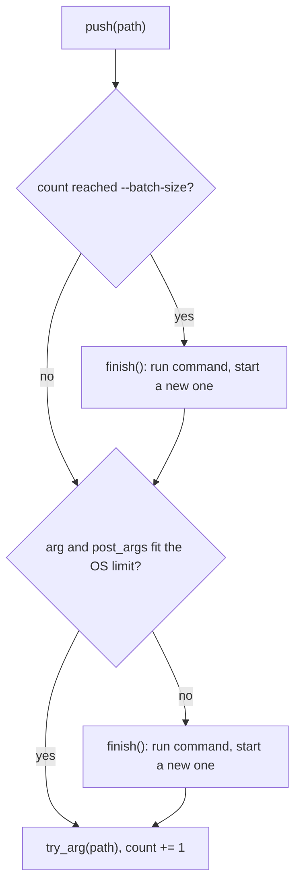

## Overview

Instead of printing results, fd can run commands on them. `-x`/`--exec` runs a command once per result, in parallel across the job threads. `-X`/`--exec-batch` runs a command with many results as arguments. `-l`/`--list-details` is a built-in `--exec-batch` that calls `ls -l`. All three become a `CommandSet` in `Config.command`; when one is present the receiver thread hands the stream of results to the `exec` module instead of `ReceiverBuffer`.

Sources: [src/exec/mod.rs:20-74](repo://src/exec/mod.rs#L20-L74), [src/walk.rs:406-434](repo://src/walk.rs#L406-L434)

Each argument of a command is a template; the placeholders it may hold are on [[Format Templates and Placeholders]]. The flags and conflicts are parsed as described on [[Command-Line Options and Configuration]].

Sources: [src/cli.rs:882-952](repo://src/cli.rs#L882-L952)

## Building a CommandSet

### From the command line

The hand-written `Exec` parser reads every occurrence of `--exec` (or, if there is none, `--exec-batch`) as one command. Values continue up to a `;` or the end of the arguments, so `-x` should come last or be closed with `\;`. A repeated `-x` gives several commands, which run one after another for each result. The `execs` group makes these flags conflict with `--max-results`, `-1` and `--quiet`, and `--exec-batch` conflicts with `--exec`.

Sources: [src/cli.rs:855-880](repo://src/cli.rs#L855-L880), [src/cli.rs:882-931](repo://src/cli.rs#L882-L931), [src/cli.rs:21-31](repo://src/cli.rs#L21-L31)

### CommandTemplate rules

`CommandTemplate::new` parses each argument with `FormatTemplate::parse` and applies these rules:

Sources: [src/exec/mod.rs:219-256](repo://src/exec/mod.rs#L219-L256)

1. A command with no arguments is an error ("No executable provided for --exec or --exec-batch"); the comment notes clap cannot check this.
2. In batch mode the first argument may not contain a placeholder; with `--exec` a placeholder as the program is allowed.
3. If no argument holds a placeholder, a `{}` argument is appended, so `fd -e zip -x unzip` runs `unzip <path>`.
4. In batch mode, `CommandSet::new_batch` also refuses more than one argument with placeholders ("Only one placeholder allowed for batch commands").

Sources: [src/exec/mod.rs:51-70](repo://src/exec/mod.rs#L51-L70), [src/exec/mod.rs:236-256](repo://src/exec/mod.rs#L236-L256), [src/exec/mod.rs:438-443](repo://src/exec/mod.rs#L438-L443)

## One command per result

### Job threads

With `--exec`, `WorkerState::receive` starts `threads` job threads in a `thread::scope`. Each owns a clone of the channel receiver and runs `exec::job` over it, so the threads share the results between them. The walker sends batches of a single entry in this mode, so the work spreads evenly (see [[Parallel Directory Walk]]). The receiver merges the jobs' exit codes when all have finished.

Sources: [src/walk.rs:412-433](repo://src/walk.rs#L412-L433), [src/walk.rs:449-457](repo://src/walk.rs#L449-L457)

### exec::job

`job` handles each `WorkerResult`. Errors are printed only with `--show-errors`. For an entry it calls `CommandSet::execute` with the stripped path, the custom path separator and the `--print0` flag, and merges the returned code into its own. Commands run in parallel, and the CLI help warns that their order is not guaranteed; `--threads=1` runs them one after another.

Sources: [src/exec/job.rs:8-44](repo://src/exec/job.rs#L8-L44), [src/cli.rs:894-899](repo://src/cli.rs#L894-L899)

### Output buffering

When more than one thread runs, each command's output is captured with `output()` and stored in an `OutputBuffer`. When the entry's commands finish, `OutputBuffer::write` locks stdout and stderr together and writes everything at once, so the output of parallel commands is never interleaved. With `--print0` a NUL byte follows each entry's output. With a single thread nothing is captured: the command is spawned and waited for, so its output appears as it is produced and the user can interact with it.

Sources: [src/exec/command.rs:9-57](repo://src/exec/command.rs#L9-L57), [src/exec/command.rs:59-99](repo://src/exec/command.rs#L59-L99), [src/exec/job.rs:16-17](repo://src/exec/job.rs#L16-L17)

### Failures

`execute_commands` runs an entry's commands in order and stops at the first one that exits with a non-zero status, which yields `GeneralError`. A spawn failure is reported by `handle_cmd_error`: "Command not found: <program>" when the program does not exist, otherwise "Problem while executing command". In every case the buffered output is still written.

Sources: [src/exec/command.rs:59-115](repo://src/exec/command.rs#L59-L115)

## Batch execution

### exec::batch

With `--exec-batch`, the receiver thread itself calls `exec::batch`. It turns the stream into the results' stripped paths, printing errors only with `--show-errors`, and passes them to `CommandSet::execute_batch` along with `--batch-size`. That flag requires `--exec-batch` and defaults to 0, meaning no limit.

Sources: [src/exec/job.rs:46-64](repo://src/exec/job.rs#L46-L64), [src/cli.rs:492-508](repo://src/cli.rs#L492-L508)

### CommandBuilder

`execute_batch` creates a `CommandBuilder` per command. The builder splits the template into fixed arguments before the placeholder (`pre_args`), the placeholder argument (`path_arg`) and fixed arguments after it (`post_args`). Each path is pushed to every builder. `push` runs the pending command first when `--batch-size` is reached, or when the `argmax` crate reports that the expanded path plus `post_args` would no longer fit the operating system's command-line limit, and then adds the argument. When the paths run out, `finish` runs whatever is pending. A run appends `post_args`, inherits stdin, stdout and stderr, and records `GeneralError` if the command fails.

Sources: [src/exec/mod.rs:90-208](repo://src/exec/mod.rs#L90-L208)

Sources: [src/exec/mod.rs:173-203](repo://src/exec/mod.rs#L173-L203)

The order of the arguments follows the order in which the walker found the results, which the CLI help calls non-deterministic. An error while adding an argument or running the command stops the batch through `handle_cmd_error`.

Sources: [src/cli.rs:932-934](repo://src/cli.rs#L932-L934), [src/exec/mod.rs:100-120](repo://src/exec/mod.rs#L100-L120)

## --list-details

`-l` builds a batch `CommandSet` from `determine_ls_command`, so it behaves like `--exec-batch ls ...` with an implicit `{}` at the end. The `ls` options use short flags so that BusyBox works too.

Sources: [src/main.rs:395-429](repo://src/main.rs#L395-L429)

| Platform | Command |
| --- | --- |
| Unix other than macOS and the BSDs | `ls -l -h -d --color=always` or `--color=never` |
| macOS, DragonFly, FreeBSD, NetBSD, OpenBSD with `gls` | `gls -l -h -d --color=...` |
| the same BSDs without `gls` | `ls -l -h -d`, plus `-G` when colored, except on NetBSD and OpenBSD |
| Windows with GNU `ls` on the path | `ls -l -h -d --color=...` |
| Windows without it, other platforms | error |

Sources: [src/main.rs:430-494](repo://src/main.rs#L430-L494)

The color argument follows fd's own color decision, so `ls` colors its output whenever fd would have. `-l` conflicts with `--absolute-path`, `--print0` and `--format`.

Sources: [src/main.rs:288-298](repo://src/main.rs#L288-L298), [src/cli.rs:227-238](repo://src/cli.rs#L227-L238), [src/cli.rs:266-276](repo://src/cli.rs#L266-L276), [src/cli.rs:481-487](repo://src/cli.rs#L481-L487)

## Paths handed to commands

Commands receive `DirEntry::stripped_path`. With the default `--strip-cwd-prefix=auto`, a command keeps the leading `./` when fd searches the current directory, so a file named `-rf` reaches the command as `./-rf`, not as an option. The exit status of the whole run merges every command's status: `GeneralError` if any failed (see [[Exit Codes and Error Reporting]]).

Sources: [src/main.rs:390](repo://src/main.rs#L390-L390), [src/dir_entry.rs:56-80](repo://src/dir_entry.rs#L56-L80), [src/exit_codes.rs:46-51](repo://src/exit_codes.rs#L46-L51)
