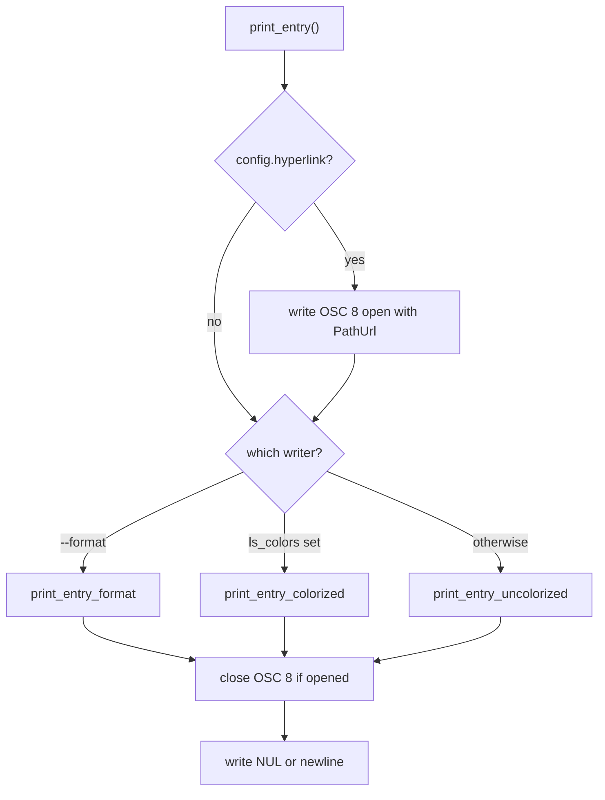

## Overview

`output::print_entry` writes one search result to stdout. The receiver calls it for each entry it prints (see [[Result Buffering and Ordering]]). It decides how the path is shown: relative or with `./`, with a custom separator, colored by `LS_COLORS`, wrapped in a terminal hyperlink, rendered through a `--format` template, or written as raw bytes for a pipe. Whatever reaches an interactive terminal is first sanitized, so a file name cannot send escape sequences to it.

Sources: [src/output.rs:16-43](repo://src/output.rs#L16-L43)

## print_entry

`print_entry` picks exactly one body writer: the `--format` template if one was given, else the colorized writer if `Config.ls_colors` is set, else the plain writer. Around the body it adds an optional hyperlink, and after it the terminator: a NUL byte with `-0`/`--print0`, otherwise a newline.

Sources: [src/output.rs:16-43](repo://src/output.rs#L16-L43)

Sources: [src/output.rs:16-43](repo://src/output.rs#L16-L43)

## The displayed path

### Stripping ./

When fd searches the current directory without explicit roots, the walker's root is `./` and every path starts with it. `DirEntry::stripped_path` removes that prefix when `Config.strip_cwd_prefix` is true. If the stripped path would start with `-`, it keeps `./` so a downstream tool does not read the path as an option.

Sources: [src/dir_entry.rs:56-71](repo://src/dir_entry.rs#L56-L71), [src/dir_entry.rs:112-114](repo://src/dir_entry.rs#L112-L114), [src/filesystem.rs:118-121](repo://src/filesystem.rs#L118-L121)

`strip_cwd_prefix` is false whenever search paths are given. Otherwise `--strip-cwd-prefix=always` or `never` decides, and the default `auto` strips unless `--print0`, `--exec` or `--exec-batch` is in use. The CLI help gives the reason: with those options the `./` lowers the risk of a path starting with `-` being taken as a command-line option.

Sources: [src/cli.rs:674-680](repo://src/cli.rs#L674-L680), [src/cli.rs:765-773](repo://src/cli.rs#L765-L773), [src/main.rs:390](repo://src/main.rs#L390-L390)

### Separators and trailing slash

With `--path-separator`, every native separator in the printed path is replaced by the given string. The plain and colorized writers end a directory with `actual_path_separator`, which is the custom separator or the platform's own, so directories print as `include/`. In colored output that trailing separator takes the directory style.

Sources: [src/output.rs:12-14](repo://src/output.rs#L12-L14), [src/output.rs:45-66](repo://src/output.rs#L45-L66), [src/main.rs:257-264](repo://src/main.rs#L257-L264)

## Writers

### Plain output

`print_entry_uncolorized_base` converts the stripped path with `to_string_lossy`, replaces separators if asked, sanitizes, writes, and adds the trailing separator. On Unix, when stdout is not a terminal and no custom separator is set, the plain writer skips all of that and writes the path's raw bytes, so file names that are not valid UTF-8 reach `xargs` or other tools unchanged.

Sources: [src/output.rs:141-182](repo://src/output.rs#L141-L182)

### Colored output

`print_entry_colorized` splits the path into the parent part, including the separators after it, and the final component. The parent part is painted with the `LS_COLORS` directory style, after separator replacement; the final component is painted with the entry's own style, which the walker threads usually computed already and cached in the `DirEntry` (see [[Parallel Directory Walk]]). Both parts are sanitized before they are painted.

Sources: [src/output.rs:88-139](repo://src/output.rs#L88-L139)

Colors are on when `--color=always`, or with `auto` when stdout is a terminal, ANSI is supported and `NO_COLOR` is empty or unset. The styles come from the `LS_COLORS` environment variable, or a built-in theme when it is unset (see [[Command-Line Options and Configuration]]).

Sources: [src/main.rs:277-292](repo://src/main.rs#L277-L292)

### Format templates

With `--format`, the template is expanded with the stripped path and the custom separator, converted lossily to a string and sanitized. No color or trailing separator is added. The placeholders and their expansion are on [[Format Templates and Placeholders]].

Sources: [src/output.rs:68-86](repo://src/output.rs#L68-L86), [src/main.rs:374-377](repo://src/main.rs#L374-L377)

## Hyperlinks

### OSC 8

With `--hyperlink`, `print_entry` writes `ESC ] 8 ; ; <url> ESC \` before the body and `ESC ] 8 ; ; ESC \` after it, the OSC 8 sequence terminals use for clickable links. `--hyperlink` alone means `auto`, which follows the color decision; the default is `never`, and it has no effect for `--exec` and `--exec-batch`.

Sources: [src/output.rs:18-36](repo://src/output.rs#L18-L36), [src/main.rs:293-297](repo://src/main.rs#L293-L297), [src/cli.rs:532-548](repo://src/cli.rs#L532-L548)

### Building the URL

`PathUrl::new` makes the path absolute by joining it onto the working directory, and on Windows strips the `\\?\` prefix. If that fails, no link is written. The URL is `file://`, then the host name, then the path with each byte percent-encoded unless it is an ASCII letter, a digit or one of `/ : - . _ ~`. On Unix the host is the machine's host name, read once with `gethostname` and cached; elsewhere it is `/`, and backslashes become `/`. Non-ASCII bytes are always encoded because, the comment explains, on Windows they may not be valid UTF-8.

Sources: [src/hyperlink.rs:1-62](repo://src/hyperlink.rs#L1-L62), [src/filesystem.rs:14-36](repo://src/filesystem.rs#L14-L36)

## Terminal sanitization

### What is escaped

File names may contain any byte except `/` and NUL, including escape sequences that a terminal would act on. `sanitize.rs` exists to stop that kind of injection. `needs_escape` is true for every control character except tab, and for invisible or reordering characters: the soft hyphen, the Mongolian vowel separator, zero-width characters and the LRM/RLM marks, bidi embeddings and overrides, the word joiner and invisible operators, the BOM, interlinear annotation characters, and language tags.

Sources: [src/sanitize.rs:1-24](repo://src/sanitize.rs#L1-L24)

`sanitize_for_terminal` returns the string borrowed when nothing needs escaping. Otherwise it writes each such character as `\xHH` (code points up to U+00FF) or `\u{HHHH}`. The escape is reversible: the original code point can be read back from the output. Variation selectors and private-use characters are kept, because the tests treat them as legitimate in file names.

Sources: [src/sanitize.rs:26-46](repo://src/sanitize.rs#L26-L46), [src/sanitize.rs:142-156](repo://src/sanitize.rs#L142-L156)

### When it applies

`maybe_sanitize` escapes only when the output is a terminal; to a pipe or file the text passes through unchanged. `Config.interactive_terminal` records whether stdout is a terminal, and `print_error` makes the same check for stderr, so error messages that quote file names are protected too. The tests cover OSC 52 clipboard writes, OSC 8 link spoofing, carriage-return overwrites and Trojan Source bidi overrides.

Sources: [src/sanitize.rs:48-55](repo://src/sanitize.rs#L48-L55), [src/error.rs:1-9](repo://src/error.rs#L1-L9), [src/sanitize.rs:79-140](repo://src/sanitize.rs#L79-L140)
