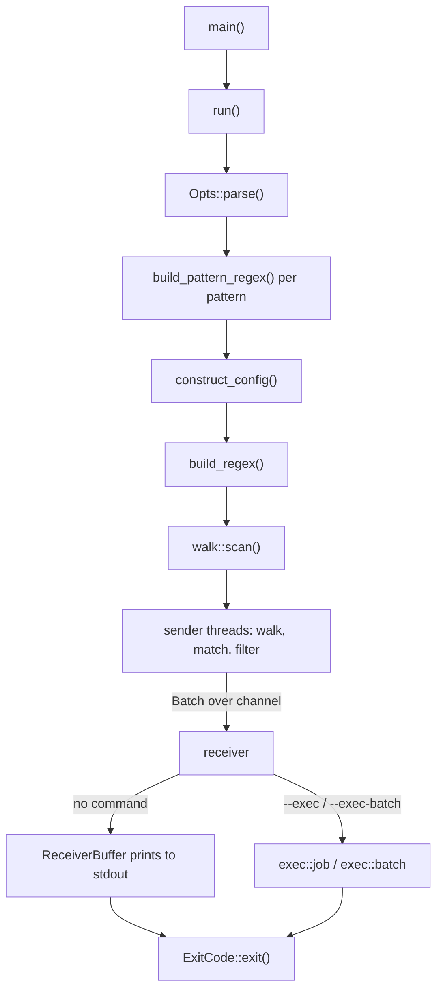

## Overview

`fd` is a command-line program that finds entries in a filesystem. It is a simpler, faster alternative to `find`: `fd PATTERN` replaces `find -iname '*PATTERN*'`, patterns are regular expressions by default, the search is case-insensitive unless the pattern has an uppercase letter, and hidden files and `.gitignore`d paths are skipped by default. The crate is published as `fd-find` and builds a single binary named `fd` from `src/main.rs`.

Sources: [Cargo.toml:1-31](repo://Cargo.toml#L1-L31), [README.md:8-28](repo://README.md#L8-L28)

The program is one pass through a pipeline. `run` parses the command line, turns the patterns into regular expressions, folds every option into one read-only `Config`, and hands the search paths, the regexes and the `Config` to `walk::scan`. Everything after that point happens inside the walker: sender threads visit the filesystem and filter entries, and a receiver prints them or runs commands on them.

Sources: [src/main.rs:62-112](repo://src/main.rs#L62-L112)

## Parts of fd

| Area | What it does | Page |
| --- | --- | --- |
| Command line and `Config` | Parses flags with clap and builds the `Config` every thread reads | [[Command-Line Options and Configuration]] |
| Pattern matching | Turns the pattern and `--and` patterns into byte regexes, applies smart case, matches file names or full paths | [[Pattern Matching]] |
| Ignore rules | Hidden files, `.gitignore`, `.ignore`, `.fdignore`, the global ignore file, `--exclude` | [[Ignore Rules and Exclusions]] |
| Parallel walk | Runs the `ignore` crate's parallel walker and sends matches over a channel in batches | [[Parallel Directory Walk]] |
| Entry filters | Extension, type, owner, size and modification-time filters | [[Entry Filters]] |
| Result buffering | Buffers and sorts fast searches, streams slow ones, stops at `--max-results` or `--quiet` | [[Result Buffering and Ordering]] |
| Output | Writes one entry with colors, hyperlinks, separators and terminal sanitization | [[Output Formatting]] |
| Format templates | Parses and expands `{}`, `{/}`, `{//}`, `{.}`, `{/.}` for `--format` and `--exec` | [[Format Templates and Placeholders]] |
| Command execution | `--exec`, `--exec-batch` and `--list-details` | [[Command Execution]] |
| Exit codes and errors | Process exit status, error messages, Ctrl-C | [[Exit Codes and Error Reporting]] |
| Tests and CI | Integration test harness, CI workflow, release steps | [[Testing and Release]] |

Sources: [src/main.rs:1-15](repo://src/main.rs#L1-L15)

## Main flow

Sources: [src/main.rs:62-112](repo://src/main.rs#L62-L112), [src/walk.rs:406-440](repo://src/walk.rs#L406-L440)

1. `Opts::parse` reads the arguments; `set_working_dir` applies `--base-directory` and `search_paths` resolves the roots. See [[Command-Line Options and Configuration]].
2. `build_pattern_regex` converts each glob, exact or fixed-string pattern to regex syntax, and `build_regex` compiles it with the case sensitivity chosen by smart case. See [[Pattern Matching]].
3. `construct_config` resolves colors, ignore settings, filters and the optional command into `Config`. See [[Command-Line Options and Configuration]].
4. `walk::scan` builds a `WalkParallel` from the ignore settings ([[Ignore Rules and Exclusions]]) and starts the sender threads ([[Parallel Directory Walk]]), which test each entry against the patterns and the filters ([[Entry Filters]]).
5. The receiver either prints entries through `ReceiverBuffer` ([[Result Buffering and Ordering]], [[Output Formatting]]) or runs commands ([[Command Execution]], [[Format Templates and Placeholders]]).
6. `main` turns the returned `ExitCode`, or an error, into the process exit status. See [[Exit Codes and Error Reporting]].

Sources: [src/main.rs:62-112](repo://src/main.rs#L62-L112), [src/walk.rs:616-653](repo://src/walk.rs#L616-L653)

## Design decisions

### Parallel traversal

The directory walk uses the `ignore` crate's `WalkBuilder::build_parallel`, the same walker that applies gitignore rules, so ignore handling and parallelism come from one library. The number of threads is `--threads`, by default the available parallelism capped at 64 "to limit startup overhead on massively parallel machines".

Sources: [src/walk.rs:347-404](repo://src/walk.rs#L347-L404), [src/cli.rs:788-800](repo://src/cli.rs#L788-L800)

### Smart case and byte regexes

The search is case-sensitive only when `--case-sensitive` is given or a pattern contains an uppercase character, and `--ignore-case` always wins. Patterns compile to `regex::bytes::Regex` and are matched against the raw bytes of the `OsStr` file name, so file names that are not valid UTF-8 can still match on Unix.

Sources: [src/main.rs:248-255](repo://src/main.rs#L248-L255), [src/main.rs:541-555](repo://src/main.rs#L541-L555), [src/filesystem.rs:102-116](repo://src/filesystem.rs#L102-L116)

### Sorted output when the search is fast

Results arriving within the first 100 ms (and fewer than 1000) are buffered and sorted before printing; after that the receiver streams them in arrival order. Short searches therefore print deterministic output while long searches start printing early.

Sources: [src/walk.rs:124-127](repo://src/walk.rs#L124-L127), [src/walk.rs:269-293](repo://src/walk.rs#L269-L293)

### jemalloc

On most Linux targets the binary uses jemalloc as its global allocator "for performance reasons". It is disabled on Windows, Android, macOS, the BSDs, illumos, 32-bit musl and riscv64; the comments note a jemalloc bug on macOS Catalina, and the platform list must stay in sync with `Cargo.toml`.

Sources: [src/main.rs:38-54](repo://src/main.rs#L38-L54), [Cargo.toml:65-71](repo://Cargo.toml#L65-L71)

### Safe terminal output

File names are written to a terminal through `maybe_sanitize`, which escapes control characters, bidi overrides and invisible format characters so a file name cannot inject escape sequences. When output goes to a pipe, the bytes pass through unchanged.

Sources: [src/sanitize.rs:1-55](repo://src/sanitize.rs#L1-L55)
