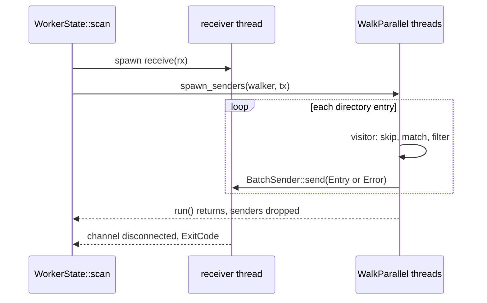
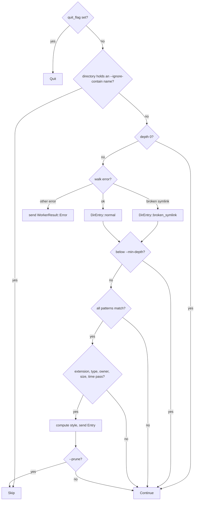

## Overview

`walk::scan` is where the search runs. It wraps the regexes and the `Config` in a `WorkerState` and calls `WorkerState::scan`, which runs two sides at once: the sender threads of the `ignore` crate's `WalkParallel`, which visit directory entries and decide which are results, and a receiver, which prints the results or runs commands on them. The two sides talk over a bounded crossbeam channel that carries batches of `WorkerResult`s.

Sources: [src/walk.rs:680-687](repo://src/walk.rs#L680-L687), [src/walk.rs:305-328](repo://src/walk.rs#L305-L328)

This page follows the sender side and the hand-off. Which entries the walker never yields is on [[Ignore Rules and Exclusions]]; what each filter tests is on [[Entry Filters]]; what the receiver does with a batch is on [[Result Buffering and Ordering]] and [[Command Execution]].

Sources: [src/walk.rs:406-440](repo://src/walk.rs#L406-L440)

## Startup and shutdown

`WorkerState::scan` builds the walker, installs a Ctrl-C handler when output is colored and printed, and creates a channel of capacity `2 * threads`. Inside `thread::scope` it spawns the receiver on its own thread, then calls `spawn_senders` on the current thread. `WalkParallel::run` blocks until the traversal is done; when it returns, every `Sender` clone has been dropped, the receiver sees the channel disconnect and returns an `ExitCode`. If a Ctrl-C arrived meanwhile, `scan` reports `KilledBySigint` instead.

Sources: [src/walk.rs:616-653](repo://src/walk.rs#L616-L653)

Sources: [src/walk.rs:443-457](repo://src/walk.rs#L443-L457), [src/walk.rs:636-646](repo://src/walk.rs#L636-L646)

The handler sets `quit_flag` and `interrupt_flag`. Senders see `quit_flag` on their next entry and return `WalkState::Quit`, and the receiver checks `interrupt_flag` after each printed entry. A second Ctrl-C finds `interrupt_flag` already set and exits the process at once with `KilledBySigint`.

Sources: [src/walk.rs:621-634](repo://src/walk.rs#L621-L634), [src/walk.rs:459-462](repo://src/walk.rs#L459-L462), [src/walk.rs:260-264](repo://src/walk.rs#L260-L264)

## The visitor

### Order of checks

`spawn_senders` gives `WalkParallel::run` a factory; each walker thread gets its own boxed closure with its own `BatchSender`. The closure runs once per entry and answers with a `WalkState`: `Continue` drops the entry but descends into it, `Skip` drops a directory and its subtree, `Quit` stops the walk. The checks run cheapest first, so metadata is read only for entries that already passed the name match.

Sources: [src/walk.rs:443-459](repo://src/walk.rs#L443-L459)

Sources: [src/walk.rs:459-524](repo://src/walk.rs#L459-L524), [src/walk.rs:526-612](repo://src/walk.rs#L526-L612)

### Errors and broken symlinks

The root of each search path arrives at depth 0 and is never a result. A walk error is normally forwarded as `WorkerResult::Error`, which the receiver prints only with `--show-errors`. One error is turned back into a result: a `NotFound` I/O error whose path is itself a symlink means the link's target is missing, and the entry becomes `DirEntry::broken_symlink(path)` so `fd` still lists dangling links. A broken symlink has no depth, and `--min-depth` drops it.

Sources: [src/walk.rs:480-512](repo://src/walk.rs#L480-L512)

### After the filters

The name match is on [[Pattern Matching]] and the filters that follow it, in order, are on [[Entry Filters]]. When results are being printed in color, the visitor calls `entry.style(ls_colors)` before sending: the `LS_COLORS` lookup, which may need metadata, then runs on the walker threads instead of the single receiver. With `--prune`, a matching directory is sent and then skipped, so nothing below a match is reported.

Sources: [src/walk.rs:593-611](repo://src/walk.rs#L593-L611), [src/cli.rs:326-331](repo://src/cli.rs#L326-L331)

A failed send means the receiver has gone (after `--max-results`, `--quiet` or an output error), and the visitor answers `Quit`.

Sources: [src/walk.rs:600-604](repo://src/walk.rs#L600-L604)

## Batching

### Batch and BatchSender

A `Batch` is an `Arc<Mutex<Option<Vec<WorkerResult>>>>`. `BatchSender::send` pushes into its current batch and sends the batch over the channel when the push makes it one item long, so the batch enters the channel at once and keeps filling while it waits there. The receiver iterates a batch by taking the vector out of the `Option`. A sender that then finds `None`, or finds its batch at the size limit, starts a new one.

Sources: [src/walk.rs:47-122](repo://src/walk.rs#L47-L122)

This keeps latency low (a result is in the channel as soon as it is found) without a channel message per entry. The size limit and the bounded channel provide backpressure: when the receiver falls behind, senders block on `send` once `2 * threads` batches are queued.

Sources: [src/walk.rs:90-98](repo://src/walk.rs#L90-L98), [src/walk.rs:636](repo://src/walk.rs#L636-L636)

### Batch size

The limit is `0x100` entries. With `--exec` (not `--exec-batch`) and more than one thread it is 1, so each command job takes a single path and work spreads evenly across the job threads.

Sources: [src/walk.rs:449-457](repo://src/walk.rs#L449-L457)

## DirEntry

### Two kinds of entry

`DirEntry` wraps either an `ignore::DirEntry` or the `PathBuf` of a broken symlink. `path`, `file_type`, `metadata` and `depth` hide the difference: for a broken symlink the file type comes from `symlink_metadata`, and the depth is `None`.

Sources: [src/dir_entry.rs:11-47](repo://src/dir_entry.rs#L11-L47), [src/dir_entry.rs:82-103](repo://src/dir_entry.rs#L82-L103)

### Lazy caches

Metadata and the `LS_COLORS` style are each stored in a `OnceCell` and computed on first use, so the owner, size and time filters and the color lookup share one `stat` call per entry, and entries rejected by name are never stat'ed.

Sources: [src/dir_entry.rs:17-22](repo://src/dir_entry.rs#L17-L22), [src/dir_entry.rs:89-109](repo://src/dir_entry.rs#L89-L109)

### Ordering and coloring

Entries compare and sort by path, which is what the receiver uses to sort buffered results. `DirEntry` implements `lscolors::Colorable` so the style lookup can reuse the cached file type and metadata; for a broken symlink it computes the file name from the last path component.

Sources: [src/dir_entry.rs:116-167](repo://src/dir_entry.rs#L116-L167)

`stripped_path` and `into_stripped_path` give the path as the user sees it, without a leading `./` when `strip_cwd_prefix` is on; [[Output Formatting]] and [[Command Execution]] call them for every result.

Sources: [src/dir_entry.rs:56-80](repo://src/dir_entry.rs#L56-L80)
