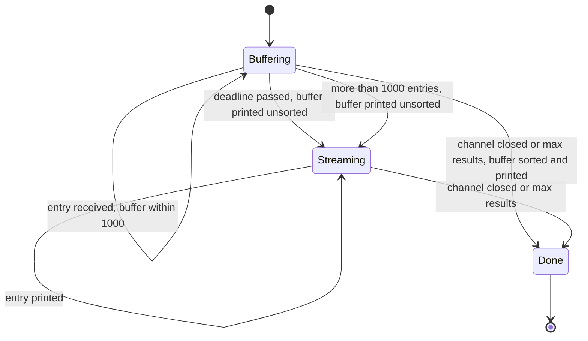

## Overview

The sender threads find results in whatever order the parallel walk produces them, so the same search can list files in a different order on each run. fd handles this on the receiving side. For a short time after start, `ReceiverBuffer` collects results instead of printing them; if the search ends within that window, it sorts them by path and prints a stable listing. If the search takes longer, or produces many results, the receiver switches to streaming and prints each result as it arrives, so long searches show output right away.

Sources: [src/walk.rs:26-35](repo://src/walk.rs#L26-L35), [src/walk.rs:124-127](repo://src/walk.rs#L124-L127), [src/config.rs:68-71](repo://src/config.rs#L68-L71)

This page covers the printing receiver. The channel and batches it reads are on [[Parallel Directory Walk]], the formatting of one line is on [[Output Formatting]], and the receivers used for commands are on [[Command Execution]].

Sources: [src/walk.rs:406-440](repo://src/walk.rs#L406-L440)

## Choosing a receiver

`WorkerState::receive` runs on the receiver thread. With a command in batch mode it calls `exec::batch` on the flattened stream of results; with a one-by-one command it starts `threads` job threads that share the channel and merges their exit codes. Without a command it locks stdout, wraps it in a `BufWriter`, and runs `ReceiverBuffer::process`.

Sources: [src/walk.rs:406-440](repo://src/walk.rs#L406-L440)

## Buffering and streaming

### The two modes

`ReceiverBuffer` starts in `Buffering` mode with a deadline of `--max-buffer-time` (a hidden option, in milliseconds) or 100 ms from creation. In `Buffering` mode it waits for a batch only until the deadline; in `Streaming` mode it waits as long as it takes.

Sources: [src/walk.rs:151-195](repo://src/walk.rs#L151-L195), [src/cli.rs:559-564](repo://src/cli.rs#L559-L564)

Sources: [src/walk.rs:197-293](repo://src/walk.rs#L197-L293)

### Polling

`poll` takes one batch and handles each result in it. An entry is pushed onto the buffer in `Buffering` mode, or printed in `Streaming` mode. When the buffer grows past `MAX_BUFFER_LENGTH` (1000), `stream` prints it as it is and switches modes. A `Timeout` from the channel also calls `stream`. A `Disconnected` channel, which means every sender has finished, calls `stop`.

Sources: [src/walk.rs:197-249](repo://src/walk.rs#L197-L249)

### Sorting

Only `stop` sorts, and only while still buffering: the buffer is sorted with `DirEntry`'s `Ord`, which compares paths, and then printed. Output is therefore sorted when the search finishes within the deadline with at most 1000 results, or reaches `--max-results` before either limit. Output that started streaming is in arrival order. The CLI help suggests `--list-details` when a deterministic order is needed.

Sources: [src/walk.rs:269-293](repo://src/walk.rs#L269-L293), [src/dir_entry.rs:116-137](repo://src/dir_entry.rs#L116-L137), [src/cli.rs:227-238](repo://src/cli.rs#L227-L238)

### Flushing

Results go through the `BufWriter`. `stream` flushes after printing the buffer, and in `Streaming` mode `poll` flushes after a batch only when no other batch is waiting in the channel, so a fast search writes in large chunks while a slow one still shows each result promptly.

Sources: [src/walk.rs:235-238](repo://src/walk.rs#L235-L238), [src/walk.rs:269-279](repo://src/walk.rs#L269-L279)

## Stopping early

### Ending the loop

`process` loops on `poll` until it returns an `Err(ExitCode)`; every way of finishing, including success, goes through that error. Before returning the code, `process` sets `quit_flag`, and the walker threads answer `WalkState::Quit` on their next entry.

Sources: [src/walk.rs:173-181](repo://src/walk.rs#L173-L181)

### Result limits and quiet mode

After each entry, `num_results` is incremented, and reaching `--max-results` (or `-1`) calls `stop`, which prints what was buffered. With `--quiet` the first entry ends the loop at once with `HasResults(true)`; if the channel closes with no results, `stop` returns `HasResults(false)`. `HasResults(true)` exits with status 0 and `HasResults(false)` with 1 (see [[Exit Codes and Error Reporting]]).

Sources: [src/walk.rs:203-226](repo://src/walk.rs#L203-L226), [src/walk.rs:281-293](repo://src/walk.rs#L281-L293), [src/exit_codes.rs:14-23](repo://src/exit_codes.rs#L14-L23)

## Errors and interrupts

### Walk errors

A `WorkerResult::Error` from the walker, such as a permission error, is printed with `print_error` only when `--show-errors` is set, and is otherwise dropped. It never counts as a result.

Sources: [src/walk.rs:227-231](repo://src/walk.rs#L227-L231), [src/cli.rs:603-611](repo://src/cli.rs#L603-L611)

### Output errors

`print` writes one entry with `output::print_entry`. A write error other than `BrokenPipe` is reported as "Could not write to output" and ends the search with `GeneralError`. A broken pipe is not reported there; the next `flush` fails and ends the loop with `GeneralError`, the comment calling it a graceful exit for a closed pipe.

Sources: [src/walk.rs:251-258](repo://src/walk.rs#L251-L258), [src/walk.rs:295-302](repo://src/walk.rs#L295-L302)

### Ctrl-C

After each printed entry, `print` checks `interrupt_flag`, which the Ctrl-C handler sets. If it is set, the receiver flushes what it has and returns `KilledBySigint`. The handler itself is described on [[Parallel Directory Walk]].

Sources: [src/walk.rs:260-266](repo://src/walk.rs#L260-L266)
