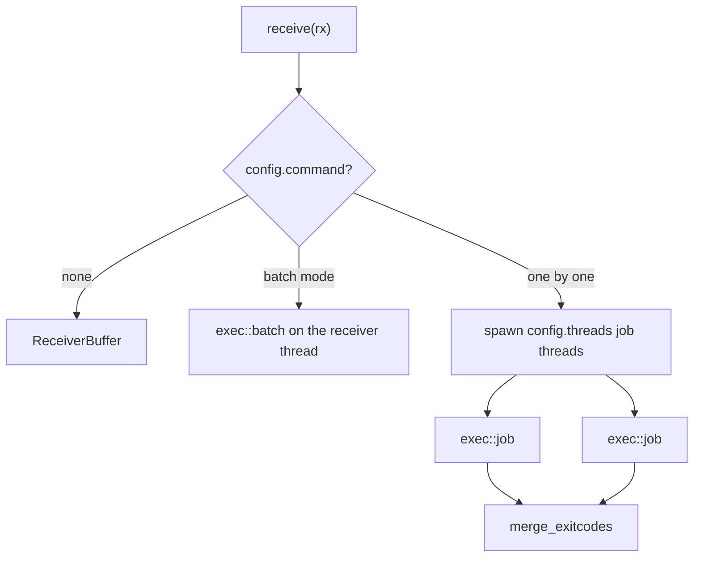

## Overview

Instead of printing results, fd can run a command on them. `--exec`/`-x` runs a command once per result, in parallel across the thread pool; `--exec-batch`/`-X` runs it once (or a few times) with all results as arguments; `--list-details`/`-l` is a built-in batch command that calls `ls -l` on the results. All three are turned into a `CommandSet` while the arguments are parsed, and `receive` hands the result stream to them in place of the printer described on [[Printing Results]]. The words of the command are templates in the syntax of [[Placeholder Templates]].

Sources: [src/exec/mod.rs:20-74](repo://src/exec/mod.rs#L20-L74), [src/walk.rs:406-440](repo://src/walk.rs#L406-L440)

```bash
fd -e zip -x unzip                  # one unzip per archive, in parallel
fd -e jpg -x convert {} {.}.png     # placeholders in the command
fd -g 'test_*.py' -X vim            # one vim with every match
fd -e rs -X wc -l                   # batch, path appended at the end
```

Sources: [src/cli.rs:894-918](repo://src/cli.rs#L894-L918), [src/cli.rs:932-950](repo://src/cli.rs#L932-L950)

## Parsing commands

### Reading the arguments

Each `-x` or `-X` takes every following argument up to a `;` (written `\;` in a shell) or the end of the command line, including arguments that start with `-`. That is why `-x` should come last on the command line. The flag may be repeated: `Exec::from_arg_matches` reads all occurrences with `get_occurrences` and builds one `CommandSet` holding several commands, with `CommandSet::new` for `--exec` or `CommandSet::new_batch` for `--exec-batch`. The two flags conflict with each other and with `--list-details`.

Sources: [src/cli.rs:861-892](repo://src/cli.rs#L861-L892), [src/cli.rs:921-931](repo://src/cli.rs#L921-L931)

### Validation

`CommandTemplate::new` parses every argument with `FormatTemplate::parse` and enforces three rules, reported as clap errors before the search starts:

Sources: [src/exec/mod.rs:219-234](repo://src/exec/mod.rs#L219-L234)

- The command must not be empty ("No executable provided for --exec or --exec-batch"), since an empty template would try to execute every result.
- In batch mode the first argument must be a fixed executable, not a placeholder; `--exec {}` is allowed and runs each result as a program.
- If no argument holds a placeholder, `{}` is appended as a last argument, so `fd -x echo` behaves like `fd -x echo {}`.

Sources: [src/exec/mod.rs:236-256](repo://src/exec/mod.rs#L236-L256), [src/exec/mod.rs:438-443](repo://src/exec/mod.rs#L438-L443)

`new_batch` adds a fourth rule: only one argument may contain placeholders, because that argument is repeated once per result. An argument may still hold several placeholders, such as `{/}:{//}`.

Sources: [src/exec/mod.rs:51-70](repo://src/exec/mod.rs#L51-L70), [src/exec/mod.rs:421-424](repo://src/exec/mod.rs#L421-L424)

### List details

`--list-details` is not a separate code path. `extract_command` builds a batch `CommandSet` from `determine_ls_command`, which picks GNU `ls -l -h -d` (`gls` on macOS and the BSDs if installed) or BSD `ls -l -h -d`, passing colour flags that follow fd's own colour decision; [[Command-Line Options and Configuration]] lists the platform rules. Since a command is set, `./` is not stripped by default, protecting names that begin with `-`.

Sources: [src/main.rs:395-410](repo://src/main.rs#L395-L410), [src/main.rs:412-494](repo://src/main.rs#L412-L494), [src/main.rs:388-390](repo://src/main.rs#L388-L390)

## Dispatch in receive



Sources: [src/walk.rs:406-440](repo://src/walk.rs#L406-L440)

For `--exec`, `receive` spawns `config.threads` scoped threads, each with a clone of the channel receiver, and each runs `exec::job` over its own stream of batches. Because walker threads send batches of one entry when `--exec` runs on several threads, the jobs pull results one at a time and share the work evenly ([[Parallel Directory Traversal]] covers the batching). The exit codes of all jobs are merged when they finish. For `--exec-batch` and `--list-details`, `exec::batch` runs on the receiver thread itself.

Sources: [src/walk.rs:411-433](repo://src/walk.rs#L411-L433), [src/walk.rs:449-457](repo://src/walk.rs#L449-L457)

## One command per result

### The job loop

`job` loops over the results it receives. Errors are printed only with `--show-errors`; for each entry, `CommandSet::execute` generates every command of the set from the entry's stripped path and the custom path separator, and `execute_commands` runs them in order. The job keeps going after a failed command and merges its exit code into the job's result.

Sources: [src/exec/job.rs:8-44](repo://src/exec/job.rs#L8-L44), [src/exec/mod.rs:76-88](repo://src/exec/mod.rs#L76-L88)

### Output buffering

Parallel commands writing straight to the terminal would interleave their lines. When fd runs more than one thread, `execute_commands` therefore runs each command with `output()`, capturing its stdout and stderr, and pushes them into an `OutputBuffer`. When all commands for the entry are done, `OutputBuffer::write` locks stdout and stderr together and writes everything at once, so the output of one result is never split by another's.

Sources: [src/exec/command.rs:9-57](repo://src/exec/command.rs#L9-L57), [src/exec/command.rs:59-99](repo://src/exec/command.rs#L59-L99)

With `--threads=1`, output is not buffered: the command is spawned with inherited stdio and fd waits for it, so interactive commands and progress output work. With `--print0`, a `\0` is written after each result's output, even when that output was not buffered, so the per-result blocks can be told apart downstream.

Sources: [src/exec/job.rs:16-17](repo://src/exec/job.rs#L16-L17), [src/exec/command.rs:30-56](repo://src/exec/command.rs#L30-L56)

### Failures

If a command exits with anything but 0, or was killed by a signal, the remaining commands of the set are skipped for that entry and it counts as `GeneralError`. If a command cannot be started, `handle_cmd_error` prints "Command not found: …" for a missing program or "Problem while executing command: …" otherwise. Shell aliases and functions are not visible to fd, so they fail with "Command not found".

Sources: [src/exec/command.rs:80-115](repo://src/exec/command.rs#L80-L115), [README.md:439-446](repo://README.md#L439-L446)

## Batches of results

### CommandBuilder

`batch` turns the results into a lazy iterator of stripped paths (printing errors with `--show-errors`) and passes it to `CommandSet::execute_batch` with `--batch-size`. For each command of the set, `CommandBuilder::new` splits the template into the arguments before the placeholder argument (`pre_args`), the placeholder argument itself (`path_arg`) and the arguments after it (`post_args`), and starts an `argmax::Command` from `pre_args` with inherited stdio.

Sources: [src/exec/job.rs:46-64](repo://src/exec/job.rs#L46-L64), [src/exec/mod.rs:90-171](repo://src/exec/mod.rs#L90-L171)

Every path is pushed to every builder. `push` expands `path_arg` for the path and appends it. Before that, it runs the pending command and starts a fresh one when the batch already holds `--batch-size` paths (0 means no limit), or when `args_would_fit` reports that the new argument plus `post_args` would exceed the operating system's command-line length limit. `finish` appends `post_args`, runs the command and waits for it; after the last path every builder is finished.

Sources: [src/exec/mod.rs:173-203](repo://src/exec/mod.rs#L173-L203), [src/cli.rs:491-508](repo://src/cli.rs#L491-L508)

So `fd -X` may run its command more than once on large result sets, and because paths are consumed as they arrive, a batch can start before the walk has finished. The order of arguments follows the parallel walk and is not sorted.

Sources: [src/exec/mod.rs:100-117](repo://src/exec/mod.rs#L100-L117), [src/cli.rs:932-935](repo://src/cli.rs#L932-L935)

### Batch failures

A batch that exits unsuccessfully sets that builder's exit code to `GeneralError`, and the remaining batches still run. A command that cannot be started, or an argument that cannot be added at all, ends `execute_batch` at once through `handle_cmd_error`. The final code merges all builders: any error gives `GeneralError`, as described on [[Errors and Exit Codes]].

Sources: [src/exec/mod.rs:100-120](repo://src/exec/mod.rs#L100-L120), [src/exec/mod.rs:191-207](repo://src/exec/mod.rs#L191-L207)
