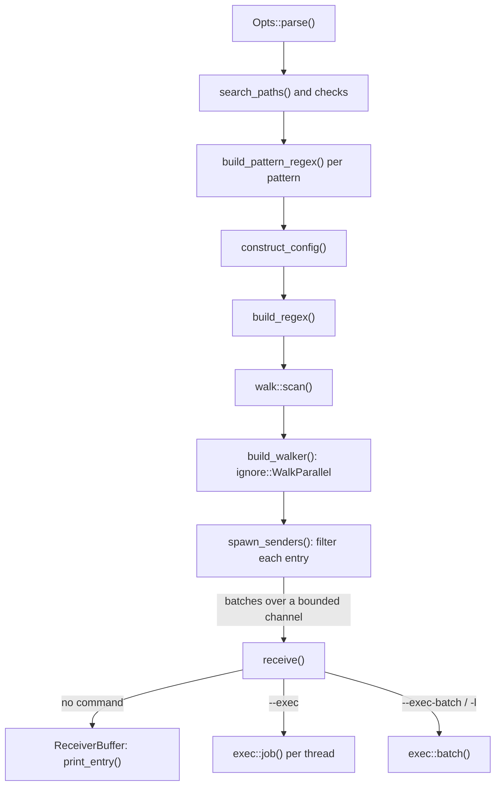

## Overview

`fd` finds entries in a filesystem. It is a fast, user-friendly alternative to `find`: `fd PATTERN` searches the current directory recursively for names that match a regular expression, skips hidden files and anything listed in `.gitignore`, and colours its output like `ls`. It does not try to cover every `find` feature; it picks defaults that suit most searches and offers flags to turn them off.

Sources: [README.md:1-28](repo://README.md#L1-L28)

The crate is published as `fd-find` and builds a single binary, `fd`, from `src/main.rs`. Every module of the program is declared at the top of that file, and each run is one pass through `run`: parse the arguments, build a configuration and the search regexes, then hand them to the directory walker.

Sources: [Cargo.toml:1-33](repo://Cargo.toml#L1-L33), [src/main.rs:1-15](repo://src/main.rs#L1-L15), [src/main.rs:62-112](repo://src/main.rs#L62-L112)

## Parts of fd

| Area | What it does | Page |
| --- | --- | --- |
| Command line and `Config` | Parses the flags with clap and freezes them into one `Config` shared by all threads | [[Command-Line Options and Configuration]] |
| Patterns | Turns regex, glob, exact or literal patterns into byte regexes, applies smart case | [[Pattern Matching]] |
| Walker | Runs the parallel traversal through the `ignore` crate and filters each entry | [[Parallel Directory Traversal]] |
| Metadata filters | `--type`, `--size`, `--changed-within`/`--changed-before`, `--owner` | [[Entry Filters]] |
| Output | Buffers, sorts, colours, sanitizes and prints each result | [[Printing Results]] |
| Templates | The `{}`, `{/}`, `{//}`, `{.}`, `{/.}` placeholders of `--format` and `--exec` | [[Placeholder Templates]] |
| Commands | `--exec`, `--exec-batch` and `--list-details` | [[Command Execution]] |
| Exit status | Exit codes, error messages and Ctrl-C | [[Errors and Exit Codes]] |
| Build and tests | Building, installing, the test harness, CI and releases | [[Quickstart]], [[Testing and Releases]] |

Sources: [src/main.rs:1-15](repo://src/main.rs#L1-L15), [src/walk.rs:406-440](repo://src/walk.rs#L406-L440)

## How a search runs

Sources: [src/main.rs:75-112](repo://src/main.rs#L75-L112), [src/walk.rs:406-440](repo://src/walk.rs#L406-L440), [src/walk.rs:617-653](repo://src/walk.rs#L617-L653)

1. `Opts::parse` reads the command line into the clap struct `Opts`, and `run` resolves the search paths, honouring `--base-directory`; see [[Command-Line Options and Configuration]].
2. Each positional and `--and` pattern goes through `build_pattern_regex`, which translates a glob or escapes a literal; see [[Pattern Matching]].
3. `construct_config` consumes `Opts` and produces the `Config`: case sensitivity, ignore rules, colours, filters, the command to run; see [[Command-Line Options and Configuration]].
4. `build_regex` compiles each pattern into a `regex::bytes::Regex` with the chosen case sensitivity; see [[Pattern Matching]].
5. `walk::scan` builds an `ignore::WalkParallel` and starts one closure per walker thread that matches names and applies the filters of [[Entry Filters]]; see [[Parallel Directory Traversal]].
6. Matching entries travel in batches over a bounded channel to `receive`, which prints them ([[Printing Results]]) or runs commands on them ([[Command Execution]]).
7. `main` turns the returned `ExitCode`, or any error, into the process exit status; see [[Errors and Exit Codes]].

Sources: [src/main.rs:62-112](repo://src/main.rs#L62-L112), [src/main.rs:248-310](repo://src/main.rs#L248-L310)

## Design decisions

### Parallel walk, single receiver

The traversal is delegated to the `ignore` crate's `WalkParallel`, the walker behind ripgrep, which already knows how to read `.gitignore` files and skip hidden entries. Every walker thread runs the matching and filtering itself, so the cost of regexes and `stat` calls is spread across cores; only accepted entries cross a `crossbeam_channel::bounded` channel sized at twice the thread count. One receiver owns stdout, so lines from different threads never interleave. Even colours are computed on the walker threads ("Compute colors in parallel") to keep the receiver light.

Sources: [src/walk.rs:347-404](repo://src/walk.rs#L347-L404), [src/walk.rs:593-598](repo://src/walk.rs#L593-L598), [src/walk.rs:636-646](repo://src/walk.rs#L636-L646)

### Sorted output when the search is fast

A parallel walk returns entries in no fixed order. The receiver therefore starts in `Buffering` mode and keeps results in memory for up to 100 ms (`DEFAULT_MAX_BUFFER_TIME`) or 1000 entries (`MAX_BUFFER_LENGTH`). If the walk ends first, the buffer is sorted before printing, so small searches give stable, sorted output; large ones switch to streaming so the first results appear quickly. [[Printing Results]] traces both modes.

Sources: [src/walk.rs:124-127](repo://src/walk.rs#L124-L127), [src/walk.rs:269-293](repo://src/walk.rs#L269-L293)

### Opinionated defaults with escape hatches

Searches are case-insensitive unless a pattern contains an uppercase character (smart case). Hidden entries and paths matched by `.gitignore`, `.fdignore` and the global ignore file are skipped. Each default maps to one `Config` field with a flag that turns it off: `-s`/`-i` for case, `-H` for hidden files, `-I` or `-u` for ignore files.

Sources: [src/main.rs:248-256](repo://src/main.rs#L248-L256), [src/main.rs:310-321](repo://src/main.rs#L310-L321)

### Safe output

File names can hold terminal escape sequences. When stdout or stderr is a terminal, `maybe_sanitize` escapes control, bidi and zero-width characters in every printed path and error message; when output is piped, the raw bytes are written so tools downstream see the real names. A path that would start with `-` after stripping `./` keeps its prefix, so it cannot be read as an option by a command.

Sources: [src/sanitize.rs:1-55](repo://src/sanitize.rs#L1-L55), [src/output.rs:167-182](repo://src/output.rs#L167-L182), [src/dir_entry.rs:56-71](repo://src/dir_entry.rs#L56-L71)

### Allocator choice

On most Unix targets the `use-jemalloc` feature replaces the system allocator with jemalloc "for performance reasons". It stays off on macOS, Windows, Android, the BSDs, illumos, 32-bit musl and riscv64; the list in `src/main.rs` must match the dependency condition in `Cargo.toml`.

Sources: [src/main.rs:38-54](repo://src/main.rs#L38-L54), [Cargo.toml:63-69](repo://Cargo.toml#L63-L69)
