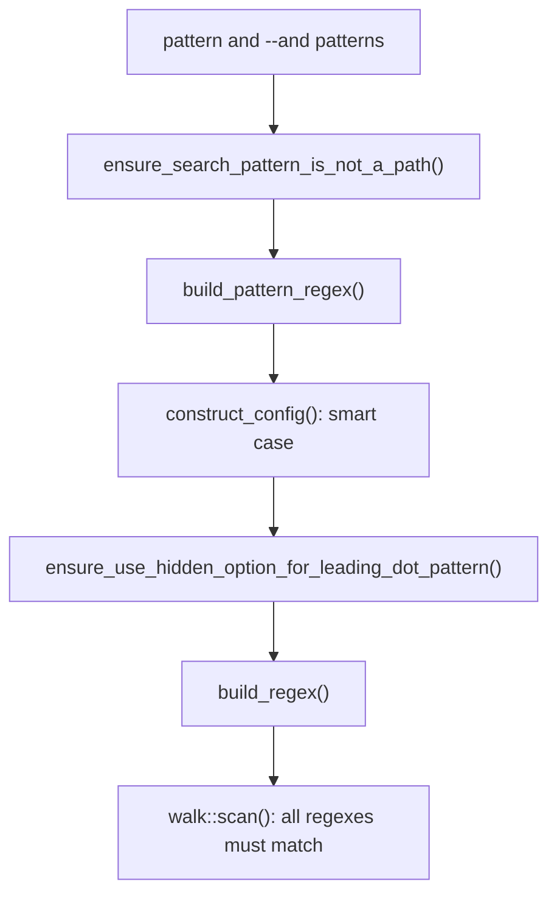

## Overview

Every search pattern fd receives, the positional one and each `--and`, ends up as one `regex::bytes::Regex`. Glob, exact and literal modes do not have matchers of their own: they are translated into regex source first, so the walker only ever runs regexes against bytes. This page follows a pattern from the command line to the match against an entry, and the checks fd runs on the way to catch patterns that can never match. Where the match sits among the other checks of an entry is on [[Parallel Directory Traversal]].

Sources: [src/main.rs:84-111](repo://src/main.rs#L84-L111)

## From pattern to regex

Sources: [src/main.rs:75-112](repo://src/main.rs#L75-L112)

`run` chains the `--and` patterns (`opts.exprs`) with the positional pattern, so the positional one comes last, and passes each through `build_pattern_regex`. The pattern defaults to the empty string, which as a regex matches everything: plain `fd` lists every entry.

Sources: [src/main.rs:84-98](repo://src/main.rs#L84-L98), [src/cli.rs:628-639](repo://src/cli.rs#L628-L639)

## Pattern modes

`build_pattern_regex` picks the translation from the flags, checked in the order of the table: `--glob` first, then `--exact`, then `--fixed-strings`.

Sources: [src/main.rs:218-232](repo://src/main.rs#L218-L232)

| Flag | Translation | Effect |
| --- | --- | --- |
| `--glob`/`-g` | `GlobBuilder` with `literal_separator(true)`, then `glob.regex()` | `*` does not cross `/`; the regex is anchored to the whole name |
| `--exact` | `^` + `regex::escape(pattern)` + `$` | literal, must equal the whole name or path |
| `--fixed-strings`/`-F` | `regex::escape(pattern)` | literal substring |
| none (or `--regex`) | the pattern unchanged | regex substring search |

Sources: [src/main.rs:218-232](repo://src/main.rs#L218-L232), [src/cli.rs:152-198](repo://src/cli.rs#L152-L198)

An empty pattern skips the glob translation even with `--glob`, so `fd -g` with no pattern still lists everything. Because `literal_separator` is on, `--glob` with `--full-path` needs `**` to cross directories, as in `fd -p -g '**/.git/config'`.

Sources: [src/main.rs:218-221](repo://src/main.rs#L218-L221), [README.md:145-152](repo://README.md#L145-L152)

## Smart case

`construct_config` makes the search case-sensitive when `--case-sensitive` is set, or when any translated pattern contains an uppercase character, unless `--ignore-case` is set. The check runs on the regex source after translation, through `pattern_has_uppercase_char`.

Sources: [src/main.rs:248-256](repo://src/main.rs#L248-L256)

`pattern_has_uppercase_char` does not scan the raw text. It parses the pattern with `regex_syntax` into its high-level IR (`Hir`) and walks it: literals count when a character is uppercase, character classes when a range starts or ends on an uppercase character, and captures, repetitions, concatenations and alternations are searched recursively. Escape sequences such as `\A` or `\x6F` are therefore not mistaken for uppercase letters. A pattern that fails to parse counts as lowercase; `build_regex` reports the parse error later.

Sources: [src/regex_helper.rs:4-37](repo://src/regex_helper.rs#L4-L37), [src/regex_helper.rs:90-96](repo://src/regex_helper.rs#L90-L96)

## Early diagnostics

### Patterns that hold a path

Without `--full-path`, patterns are matched against the file name only, so a pattern containing a path separator never matches. `ensure_search_pattern_is_not_a_path` checks the positional pattern and every `--and` pattern and fails with a message suggesting `fd . 'dir'` or `fd --full-path 'dir'`. A `/` always triggers it, since it is a separator on every platform and has no regex meaning. On Windows a `\` triggers it only if the pattern also names an existing directory, because `\` is the regex escape character and patterns like `\d+` must still run.

Sources: [src/main.rs:149-216](repo://src/main.rs#L149-L216)

### Patterns for hidden files

On Unix, when hidden files are skipped, `ensure_use_hidden_option_for_leading_dot_pattern` fails if a pattern can only match names starting with a dot, and suggests `-H`. `pattern_matches_strings_with_leading_dot` detects only the simplest form: a concatenation that starts with the start-of-text anchor followed by a literal beginning with `.`, such as `^\.gitignore`. `^.gitignore` (any character) and `\.gitignore` (unanchored) pass.

Sources: [src/main.rs:521-539](repo://src/main.rs#L521-L539), [src/regex_helper.rs:39-79](repo://src/regex_helper.rs#L39-L79), [src/regex_helper.rs:98-105](repo://src/regex_helper.rs#L98-L105)

## Compiling

`build_regex` compiles each pattern with `RegexBuilder`, setting `case_insensitive` from the smart-case decision and `dot_matches_new_line(true)` so `.` also matches newlines inside file names. A compile error is returned with a note pointing to `--fixed-strings`, `--exact` and `--glob`, since the usual cause is a literal name holding regex metacharacters.

Sources: [src/main.rs:541-555](repo://src/main.rs#L541-L555)

The regexes are byte regexes. On Unix, `osstr_to_bytes` hands the walker the raw bytes of the name without conversion, so names that are not valid UTF-8 can still match; on Windows the name is converted with `to_string_lossy` first.

Sources: [src/filesystem.rs:102-116](repo://src/filesystem.rs#L102-L116)

## What a pattern is matched against

`search_str_for_entry` picks the string for each entry. Without `--full-path` it is the entry's file name. With `--full-path`, `construct_config` stores the current directory once in `full_path_base`, and the string is the absolute path: absolute entries are used as they are, relative ones have their leading `./` removed and are joined to that base. Caching the directory saves a `getcwd` call per entry.

Sources: [src/walk.rs:656-678](repo://src/walk.rs#L656-L678), [src/main.rs:299-307](repo://src/main.rs#L299-L307)

The entry is kept only if every regex matches (`patterns.iter().all(...)`), which is what makes `--and` an intersection. The name is checked before any filter that needs metadata, because it needs no system call.

Sources: [src/walk.rs:514-524](repo://src/walk.rs#L514-L524)

## Extensions

`--extension` is a second kind of name match. Each value has leading dots trimmed and is escaped into `.\.ext$`, and all of them are combined in one `RegexSet` built case-insensitively, so `-e rs -e md` matches either extension in any case. The leading `.` in the regex requires at least one character before the dot, so a file named just `.rs` does not count as having the extension `rs`. The walker matches the set against the file name after the pattern check.

Sources: [src/main.rs:376-386](repo://src/main.rs#L376-L386), [src/walk.rs:526-535](repo://src/walk.rs#L526-L535)
